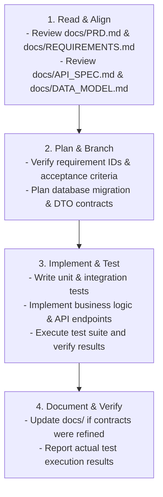

# Groom.ai — Agent Operating Instructions & Engineering Standards

**Target Audience:** Future AI coding assistants, autonomous engineering agents, and human contributors.  
**Scope:** Root-level guidelines governing all implementation, modification, testing, and documentation tasks across the Groom.ai repository.  
**Authority:** This file is the primary operational rulebook. When implementing features, agents **must** adhere strictly to the guidelines defined below.

---

## 1. Product Context & Architectural Baseline

- **Product Vision:** Groom.ai is an AI-powered personal grooming assistant helping users make confident, personalized grooming choices (hairstyles, beard styles, barber instructions, maintenance routines).
- **Architecture Baseline:**
  - **Backend:** Modular Monolith built with **Java 21 LTS** and **Spring Boot 3.x**, managed by **Maven**, backed by **PostgreSQL 16** with **Flyway** migrations.
  - **Mobile:** Cross-platform mobile app built with **React Native**, **Expo**, **Expo Router**, and **TypeScript** with strict type checking.
  - **Storage:** Private cloud object storage (S3-compatible) with pre-signed upload URLs and short-lived read access.
  - **AI Integration:** Hosted multimodal AI provider accessed via a clean backend abstraction layer with server-side JSON schema validation.
- **Architectural Guardrail:** Do **NOT** introduce Redis, Apache Kafka, RabbitMQ, Kubernetes, vector databases, microservices, or a separate Python microservice unless an explicit Architecture Decision Record (ADR) in `docs/DECISIONS.md` has been accepted and approved by the project lead.

---

## 2. Repository Directory Organization

```
GroomAI/
├── AGENTS.md                   # THIS FILE (Agent Operating Standards)
├── docs/                       # Project Specifications & Architecture Records
│   ├── PRD.md                  # Product Requirements Document
│   ├── ARCHITECTURE.md         # System Architecture & Component Design
│   ├── REQUIREMENTS.md         # Requirements & Traceability Matrix
│   ├── API_SPEC.md             # REST API Contract & Schema Specifications
│   ├── DATA_MODEL.md           # Relational Database Schema & ERD
│   ├── DECISIONS.md            # Architecture Decision Records (ADRs)
│   └── ROADMAP.md              # Milestone Plan & Implementation Phasing
├── backend/                    # Spring Boot Application (Maven)
│   ├── pom.xml
│   └── src/
│       ├── main/
│       │   ├── java/com/groomai/
│       │   │   ├── auth/           # Registration, login, password reset, JWT token handling
│       │   │   ├── user/           # Profiles and grooming preferences
│       │   │   ├── photo/          # Presigned URLs, upload verification, S3 adapter, outbox sweeper
│       │   │   ├── recommendation/ # AI orchestrator, prompts, schema validator, async jobs
│       │   │   ├── plan/           # Saved recommendations, active grooming plan
│       │   │   └── common/         # Global exceptions, error response, base DTOs
│       │   └── resources/
│       │       ├── application.yml
│       │       └── db/migration/   # V1__initial_schema.sql (Flyway migrations)
│       └── test/                   # JUnit 5, Mockito, Testcontainers tests
└── mobile/                     # React Native Expo Application
    ├── app/                    # Expo Router file-based navigation
    ├── src/
    │   ├── api/                # Centralized Axios/Fetch client & typed endpoints
    │   ├── components/         # Reusable design system UI components
    │   ├── features/           # Feature slices (auth, camera, recommendations, plan)
    │   ├── hooks/              # Custom React hooks
    │   ├── types/              # Strict TypeScript definitions & API models
    │   └── utils/              # Client-side validation, formatting, storage
    ├── package.json
    └── tsconfig.json           # Strict TypeScript configuration
```

---

## 3. Technology Stack & Language Conventions

### 3.1 Java & Spring Boot Standards
- **Java Version:** Java 21 LTS. Utilize modern Java idioms: `record` classes for immutable DTOs and API payloads, pattern matching, and text blocks for prompts.
- **Package Encapsulation:** Follow domain-based packaging (`com.groomai.<module>`). Do not make package-private classes public unnecessarily.
- **DTOs vs. Entities:** **Never** expose JPA entities directly in `@RestController` endpoints. Always map between persistence entities and immutable Java records/DTOs using dedicated mappers.
- **Bean Validation:** Enforce `@NotNull`, `@Size`, `@Email`, and custom validators on all incoming request DTOs.
- **Layered Architecture:** Follow the strict unidirectional flow:  
  `Controller -> Service Interface -> Service Implementation -> Repository`.  
  Cross-module dependencies must call Service interfaces, never directly access another module's repository.
- **Exception Handling:** Throw domain-specific runtime exceptions extending a base `GroomAiException`. Handle all exceptions in `com.groomai.common.GlobalExceptionHandler` (`@RestControllerAdvice`) returning standard error payloads matching `docs/API_SPEC.md`.

### 3.2 TypeScript & React Native Standards
- **Strict Type Checking:** `tsconfig.json` must enforce `"strict": true`, `"noImplicitAny": true`, `"strictNullChecks": true`, and `"noUnusedLocals": true`.
- **No `any` Types:** Use of `any` is strictly prohibited. If a type is unknown, use `unknown` and narrow it with type guards, or define explicit TypeScript interfaces matching `docs/API_SPEC.md`.
- **State Management:** Keep state close to the component. Use standard React hooks (`useState`, `useReducer`, `useContext`) or lightweight stores (e.g., Zustand) if cross-cutting state is required.
- **File & Folder Naming:**
  - Components: PascalCase (e.g., `BarberCard.tsx`).
  - Hooks: camelCase with `use` prefix (e.g., `useRecommendationJob.ts`).
  - Utils/Types: kebab-case or camelCase (e.g., `api-client.ts`, `recommendation.types.ts`).

---

## 4. Security, Privacy & Compliance Rules

1. **Zero Hardcoded Secrets:** Never hardcode API keys, passwords, database URLs, or JWT secrets in code or configuration files committed to git. All credentials must be read from environment variables or Spring `@Value` / `@ConfigurationProperties`.
2. **Server-Side Authorization & Tenancy Isolation:** Every database operation querying or mutating user data must enforce ownership against the authenticated user ID extracted from Spring Security's `Authentication` context (`userId == token.sub`). Prevent Insecure Direct Object References (IDOR).
3. **No Biometric Data in Logs:**
   - Raw image binary streams, presigned URLs, and base64 strings must **never** be logged.
   - User passwords and raw JWT tokens must be masked in log statements.
4. **Photo Privacy Consent Enforcement:** Upload-intent generation and recommendation processing must verify that the user has granted explicit photo consent (`photo_consent_granted == true`).
5. **Private Storage & Short-Lived Access:**
   - Uploads must target private storage buckets.
   - Presigned download URLs must have an expiration TTL of ≤ 15 minutes.
6. **Data Deletion Completeness & Cloud Outbox Sweeper:**
   - Account deletion (`DELETE /api/v1/users/account`) executes within a **single `@Transactional` database transaction**: cancel in-flight jobs; insert each photo storage key into `storage_deletion_outbox` (`status = 'PENDING'`, `attempts = 0`, `next_attempt_at = NOW()`); execute `DELETE FROM users WHERE id = :userId`, cascading across all 11 dependent tables. On commit, return HTTP `204 No Content` (provisional target: < 500ms until measured).
   - Cloud storage keys are enqueued into `storage_deletion_outbox` as part of that transaction. To minimize PII and decouple retries from user existence, `storage_deletion_outbox` has **no** `user_id` and **no** foreign keys.
   - Immediately after commit, a dispatcher attempts deletion. The outbox row is durable before dispatch, so the sweeper can recover if the callback or worker never runs. The dispatcher and sweeper must atomically claim work to avoid concurrent processing. Use a one-minute sweeper and retry delays measured from the preceding claimed attempt: 15 minutes, 1 hour, 6 hours, then 16 hours 45 minutes (24 hours total across four retries). After five failed attempts, transition to `FAILED` and emit `STORAGE_DELETION_DEAD_LETTER`.
   - **Deletion Reliability Rule:** Unverified deletion tasks are **NEVER automatically purged**. `FAILED` outbox rows persist until cloud deletion is positively confirmed by an operator. Operational log retention is separate from durable outbox task records. A successful provider response or verified object non-existence is required before removing a task.
7. **Foreign Key Decoupling for Photo Deletion:**
   - Foreign keys from `recommendation_jobs` and `recommendations` referencing `photo_assets` must use `ON DELETE SET NULL`. Deleting a photo purges the image binary while preserving historical recommendation text.
8. **Stateless JWT Invalidation Rules:**
   - Account deletion immediately invalidates access tokens because the user row no longer exists in `users`.
   - Password resets and security revokes update `users.tokens_invalid_before = NOW()`, causing the JWT filter to reject any access token whose `iat` precedes that timestamp.
9. **Image Normalization & Format Rejection:**
   - Mobile client must transcode iOS HEIC photos to JPEG using `expo-image-manipulator` before requesting an upload intent. Client-side JPEG normalization is the only supported format path for MVP.
   - The backend `POST /api/v1/photos/upload-intent` endpoint **rejects** `contentType: "image/heic"` with HTTP `400 Bad Request` (code `UNSUPPORTED_IMAGE_FORMAT`). Server-side HEIC transcoding via Java ImageIO / TwelveMonkeys is **not** available — TwelveMonkeys does not support the HEVC codec used by HEIC. A server-side HEIC decoding library must be evaluated and tested before any backend fallback is implemented or specified.
   - If server-side transcoding for any format is ever added, any temporary files created on disk must be unconditionally deleted in a `finally` block immediately after processing.
10. **Provisional Latency Target & Timeout Enforcement:**
   - The 15-second recommendation latency target is provisional and measured strictly on the backend from `recommendation_jobs.created_at` to `completed_at` (excluding mobile upload and render times).
   - Backend calls to external AI providers must enforce a strict 30-second read timeout, transitioning jobs exceeding timeout to `FAILED` with code `AI_INFERENCE_TIMEOUT` without deducting user quota.

---

## 5. Testing Expectations & Verification Rules

1. **Rule: No False Claims of Passing Tests:**
   > **CRITICAL:** Agents must NEVER claim tests ran or passed unless they actually executed the commands and verified exit code 0 and successful test counts. If an environment prevents test execution, state this explicitly.
2. **Backend Testing Standards:**
   - Unit tests: JUnit 5 and Mockito for domain services, validation logic, and AI prompt assembly.
   - Integration tests: `@SpringBootTest` with **Testcontainers** running a real PostgreSQL container. Test actual Flyway migrations, JPA queries, and transactional boundaries.
   - External service mocking: Use **WireMock** to simulate AI provider responses, timeouts, and HTTP 429 rate limit responses.
3. **Mobile Testing Standards:**
   - Unit tests using Jest for formatting utilities, validation functions, and API transformation logic.
   - Component rendering tests using React Native Testing Library.
4. **Coverage Target:** Aim for ≥ 80% line coverage across backend domain services and validators.

---

## 6. Database Migrations & API Contract Integrity

1. **Flyway Migration Rules:**
   - Schema changes must be written as sequential, immutable SQL migration scripts in `backend/src/main/resources/db/migration/` (e.g., `V1__initial_schema.sql`, `V2__add_index.sql`).
   - **Never modify or overwrite an existing migration file that has already been executed or committed.** Always add a new incremented migration file.
   - Hibernate's `ddl-auto` must be set to `validate` in all environments (never `create` or `update`).
2. **API Contract Adherence:**
   - All endpoint paths, HTTP verbs, request schemas, response codes, and error envelopes must strictly match `docs/API_SPEC.md`.
   - Asynchronous recommendation job creation must return **HTTP `202 Accepted`**.
   - If an endpoint change is necessary during implementation, update `docs/API_SPEC.md` first or simultaneously in the same task.

---

## 7. Prohibited Shortcuts & Anti-Patterns

- ❌ **Prohibited:** Silently swallowing exceptions in empty `catch` blocks.
- ❌ **Prohibited:** Creating mock/fake implementations in production code paths (e.g., hardcoded mock recommendation responses returned from production endpoints). Mocks belong exclusively in test directories.
- ❌ **Prohibited:** Storing binary files (images) in JVM heap memory or database tables as BLOBs/base64 strings.
- ❌ **Prohibited:** Committing `.env` files, credentials, or private keys.
- ❌ **Prohibited:** Disabling TypeScript strict mode or bypassing type checks using `@ts-ignore` without written justification and approval.
- ❌ **Prohibited:** Introducing microservices, Docker Compose sprawl, Redis, or Kafka before justification is approved via an ADR.

---

## 8. Required Feature Implementation Workflow

When assigned a feature or task, follow this exact four-stage workflow:



1. **Stage 1: Read & Align:** Read the relevant sections of `docs/PRD.md`, `docs/ARCHITECTURE.md`, `docs/REQUIREMENTS.md`, `docs/API_SPEC.md`, and `docs/DATA_MODEL.md`.
2. **Stage 2: Plan:** Verify requirement IDs and acceptance criteria. Check if database migrations, API changes, or security checks are required.
3. **Stage 3: Implement & Test:**
   - Implement clean code following language standards and module boundaries.
   - Write unit and integration tests covering positive paths, edge cases, and authorization failures.
   - Execute the test suite and verify output.
4. **Stage 4: Document & Verify:** If any architectural detail, schema property, or endpoint changed, update the corresponding markdown specification in `docs/`. Report exact test status honestly.
