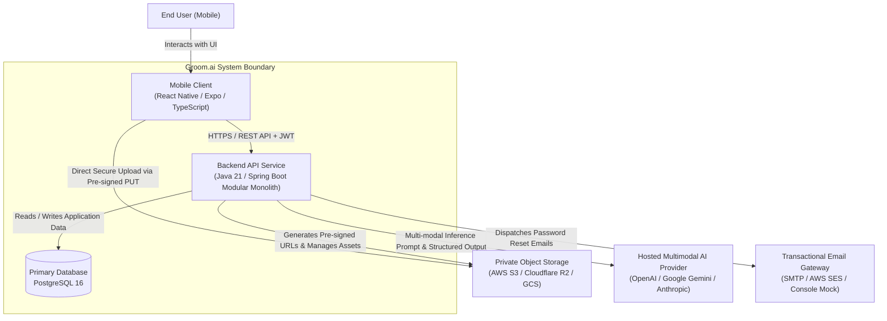
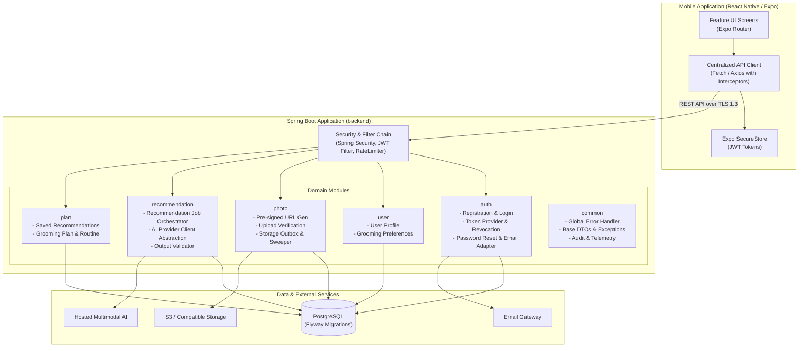
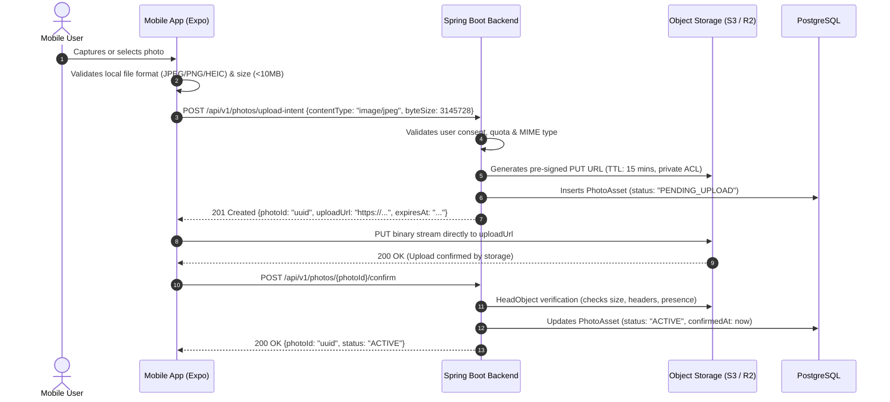
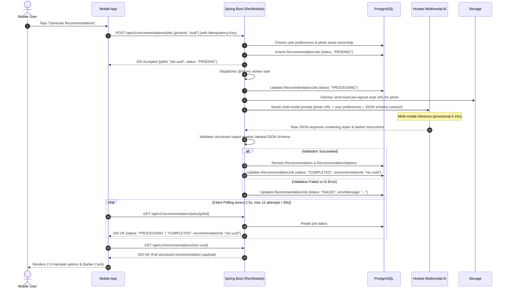
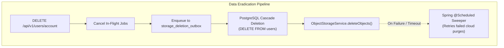
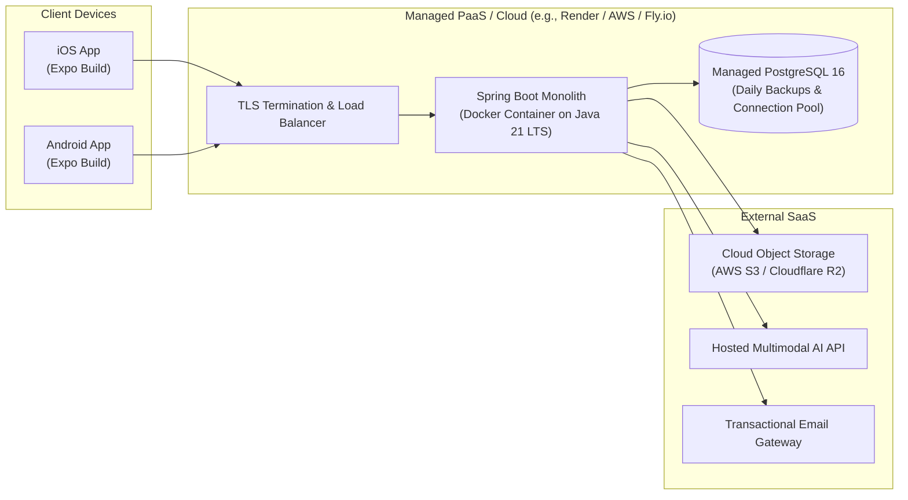

# Groom.ai — System Architecture & Technical Design

**Document Version:** 1.1.0  
**Status:** Draft — Proposed Architecture (Pending Stakeholder Approval)  
**Architecture Baseline:** Modular Spring Boot Monolith + React Native (Expo) Mobile Client  
**Last Updated:** October 2026  

---

## 1. Architecture Goals & Guiding Principles

### 1.1 Architecture Goals
1. **Developer Velocity & Simplicity:** Maximize time spent delivering validated user value rather than managing distributed infrastructure.
2. **Strict Privacy & Data Isolation:** Secure user portraits with private object storage, short-lived access credentials, durable deletion tracking, retries, and operator escalation for unresolved failures.
3. **Resilience to AI Latency & Failures:** Isolate the client experience from slow, variable, or failing hosted AI inference through asynchronous job orchestration and structured error handling.
4. **Actionable Implementation Guidance:** Provide clean, well-bounded modular abstractions in Spring Boot and React Native that coding agents and developers can execute without ambiguity.
5. **Pragmatic Early-Stage Evolution:** Avoid premature adoption of microservices, distributed message brokers (Kafka/RabbitMQ), caching tiers (Redis), or vector databases until measurable scale or latency bottlenecks demand them.

### 1.2 Core Architectural Principles
- **Modular Monolith First:** Group backend capabilities by logical domain modules inside a single deployable Spring Boot application. High cohesion within modules; low coupling across boundaries.
- **Stateless Application Tier with Hybrid Invalidation:** The backend server maintains zero in-memory user session state. Authentication is verified per-request via cryptographically signed JWT tokens, with user-existence and invalidation timestamp checks (`tokens_invalid_before`) reconciling immediate revocation for account deletion and password resets.
- **Client-Side Storage Directness with Backend Authorization:** Large binary assets (images) never stream through backend JVM memory. Mobile clients upload directly to private object storage using short-lived pre-signed URLs generated and authorized by the backend.
- **Defensive Server-Side Boundaries:** Never trust client-reported image formats, sizes, or user IDs. All authorization decisions use authenticated claims extracted directly from security contexts.
- **Decoupled Photo References:** Historical recommendation reports retain styling rationale and Barber Cards even if a user subsequently deletes their uploaded photo (`ON DELETE SET NULL`).
- **Durable Cloud Storage Deletion via Outbox:** Cloud storage deletion tasks are enqueued in PostgreSQL in the same transaction as relational deletion. Retries, durable task retention, and alerts support recovery from provider failures, but do not constitute an unconditional guarantee of successful eradication.
- **Idempotency & Cost Control:** AI inference calls are expensive and rate-limited. Protect recommendation endpoints with idempotency keys and per-user throttling to prevent duplicate executions.

---

## 2. System Context & Component Architecture

### 2.1 System Context (C4 Level 1)



### 2.2 Component Architecture (C4 Level 2: Backend Modular Monolith)

The Spring Boot backend is organized as a structured modular monolith. Package boundaries strictly enforce domain isolation:



---

## 3. Backend Module Boundaries & Responsibilities

| Module Package | Responsibility | Primary Entities | Outbound Dependencies |
| :--- | :--- | :--- | :--- |
| `com.groomai.auth` | User account creation, password hashing (Argon2id / BCrypt), JWT generation/validation, token refresh, token revocation, password reset workflows. | `User`, `RefreshToken`, `PasswordResetToken` | `com.groomai.common`, Email Gateway Adapter |
| `com.groomai.user` | User demographic profile and grooming preferences (hair type, beard pattern, styling effort). | `UserProfile`, `GroomingPreference` | `com.groomai.auth`, `com.groomai.common` |
| `com.groomai.photo` | Photo metadata tracking, pre-signed upload URL generation, validation of uploaded assets in object storage, photo deletion, storage deletion outbox sweeper. | `PhotoAsset`, `StorageDeletionOutbox` | `com.groomai.common`, Cloud Storage SDK Adapter |
| `com.groomai.recommendation` | Recommendation job lifecycle management, multi-modal prompt construction, AI provider invocation, JSON schema validation, persistence of style options. | `RecommendationJob`, `Recommendation`, `RecommendationOption` | `com.groomai.photo`, `com.groomai.user`, `com.groomai.common`, AI SDK Adapter |
| `com.groomai.plan` | Bookmarking recommendations into a user's active grooming plan, managing daily maintenance checklist items. | `SavedRecommendation`, `GroomingPlan`, `GroomingPlanItem` | `com.groomai.recommendation`, `com.groomai.common` |
| `com.groomai.common` | Shared exception hierarchy, global `@RestControllerAdvice`, API error response records, security context helpers, audit listeners. | None (shared cross-cutting utilities) | Standard Spring & Jakarta libraries |

*Rule:* Cross-module communication occurs via explicit service interfaces (e.g., `PhotoService`, `UserProfileService`) rather than direct repository access across domain boundaries.

---

## 4. Key End-to-End Workflows

### 4.1 Photo Ingestion Flow (Direct Pre-Signed Upload)
To avoid high memory overhead and bandwidth bottlenecks on the Spring Boot server, image binaries are uploaded directly from mobile to private object storage.



#### 4.1.1 Image Normalization & Format Strategy (HEIC Compatibility)
- **Client-Side Normalization — MVP Supported Path:** Mobile camera hardware (notably on iOS) frequently produces photos in Apple HEIC/HEIF format, and leading multimodal AI providers (e.g., GPT-4o, Claude 3.5 Sonnet) do not natively accept it. The React Native client uses `expo-image-manipulator` to transcode all photos to standard `image/jpeg` before requesting an upload intent (`POST /api/v1/photos/upload-intent`). This is the only format path that is tested and supported for MVP.
- **Server-Side HEIC Handling — Pending Implementation Choice:**

  > [!WARNING]
  > **Feasibility Not Verified:** Java ImageIO combined with the TwelveMonkeys ImageIO plugins library does **not** reliably decode HEIC/HEIF images. HEIC uses HEVC (H.265) video compression, which TwelveMonkeys does not include a codec for. A backend HEIC transcoding path **must not be claimed as available until a tested Java library or native tool (e.g., `libheif` via JNI, or a JVM wrapper) is evaluated and validated.** This is a pending implementation choice, not a resolved capability.

  For MVP, the backend handles an unexpected `image/heic` upload as follows:
  - The `POST /api/v1/photos/upload-intent` endpoint rejects `contentType: "image/heic"` with HTTP `400 Bad Request` and error code `UNSUPPORTED_IMAGE_FORMAT`, instructing the client to normalize to JPEG before retrying.
  - The `POST /api/v1/photos/{id}/confirm` endpoint verifies the uploaded object's content-type header; if the stored object is HEIC, confirmation is rejected with HTTP `400 Bad Request`.
  - A viable server-side HEIC decoding library must be evaluated, integrated, and tested before a backend fallback path is added to the specification.
- **Strict Ephemeral Cleanup (if server-side transcoding is ever added):** Any temporary files created on backend disk during transcoding must be unconditionally deleted in a `finally` block immediately after processing, ensuring zero residual biometric photos remain on backend disk.
- **Provider Compatibility Validation:** AI provider image format support must be validated as a Phase 3 task before production freeze.

### 4.2 AI Recommendation Processing Flow: Asynchronous Job Lifecycle



#### 4.2.1 Recommendation Latency Targets & Measurement Boundaries
- **Provisional Latency Target:** The target of returning recommendations within 15 seconds is strictly provisional and contingent upon upstream AI provider response times (typically 6–15 seconds for vision-capable foundation models).
- **Measurement Boundaries:** Recommendation latency is measured strictly on the backend as the elapsed duration between `recommendation_jobs.created_at` (job insertion timestamp) and `recommendation_jobs.completed_at` (successful persistence of structured recommendations). It explicitly excludes mobile client photo upload time, mobile network round-trips, and client-side UI rendering.
- **Timeout & Failure Handling:**
  - Upstream AI inference HTTP calls enforce a strict 30-second socket read timeout.
  - If the upstream AI provider exceeds 30 seconds or fails validation, the job transitions to `FAILED` with error code `AI_INFERENCE_TIMEOUT`, and the user's hourly quota is preserved (not deducted).
  - The mobile client polls every 2.5 seconds up to a maximum of 12 attempts (30 seconds total elapsed polling). If the job remains in `PROCESSING` status after 30 seconds, the mobile app terminates polling and displays a graceful timeout notification with a retry action.

---

## 5. Authentication & Authorization Model

### 5.1 Proposed Baseline: Self-Managed Spring Security JWT
- **Stateless Bearer JWT:** Mobile client transmits an `Authorization: Bearer <jwt_access_token>` header on all protected endpoints.
- **Token Lifecycles:**
  - **Access Token:** Short-lived (15 minutes). Contains claims: `sub` (User UUID), `email`, `role`, `iat`, `exp`. Signed with HMAC-SHA256 or RSA-256.
  - **Refresh Token:** Long-lived (30 days). Cryptographically secure random token stored as a salted SHA-256 hash in PostgreSQL `refresh_tokens` table.
- **Mobile Token Storage:** Tokens are securely persisted in `Expo SecureStore` (using iOS Keychain / Android KeyStore).

### 5.2 Reconciling Stateless JWT with Immediate Access Revocation
A pure stateless JWT remains cryptographically valid until its expiration time (`exp`). To satisfy immediate revocation requirements without querying the database on every micro-operation, Groom.ai uses a **hybrid verification strategy**:
1. **Account Deletion:** The user record in `users` is permanently deleted. The `JwtAuthenticationFilter` performs a lightweight user existence check (or cached lookup). If the user record no longer exists, the request is rejected immediately with `401 Unauthorized`.
2. **Password Reset & Security Revocation:** The `users` table includes a `tokens_invalid_before TIMESTAMPTZ NULL` column. When a password reset occurs or a user revokes all sessions, `tokens_invalid_before` is updated to `NOW()`. The JWT filter compares the token's `iat` (issued-at) timestamp against `tokens_invalid_before`; tokens issued prior to that timestamp are rejected immediately (`401 Unauthorized`).
3. **Single Device Logout:** The mobile client clears tokens from `Expo SecureStore`, and `POST /api/v1/auth/logout` marks the refresh token as revoked in `refresh_tokens`. The existing access token expires within at most 15 minutes.

### 5.3 Password Reset Architecture
- **Forgot Password (`POST /api/v1/auth/forgot-password`):** Rate-limited public endpoint. Generates a secure random token, stores its hash in `password_reset_tokens` (15-minute TTL), and triggers email dispatch via an `EmailSender` interface. Always returns HTTP 200 to prevent user enumeration.
- **Reset Password (`POST /api/v1/auth/reset-password`):** Validates the token hash, expiration, and unused status. Updates `users.password_hash`, marks the token as used, updates `tokens_invalid_before = NOW()`, and invalidates all existing refresh tokens.

### 5.4 Server-Side Authorization & Tenancy Isolation (IDOR Defense)
- Every database query accessing a user resource (`UserProfile`, `PhotoAsset`, `RecommendationJob`, `GroomingPlan`) **must** include the authenticated user ID extracted from Spring Security's `SecurityContext`:
  ```sql
  -- Example query ensuring tenancy isolation
  SELECT * FROM photo_assets WHERE id = :photoId AND user_id = :authenticatedUserId;
  ```
- If an entity exists but belongs to another user, the backend returns `404 Not Found` (preferred to prevent leaking existence of private IDs) or `403 Forbidden`.

---

## 6. Error Handling, Reliability & Rate Limiting

### 6.1 Standard Error Format
All API error responses adhere to a consistent JSON schema:
```json
{
  "timestamp": "2026-10-14T10:15:30.123Z",
  "status": 400,
  "error": "Bad Request",
  "code": "INVALID_IMAGE_DIMENSIONS",
  "message": "The uploaded photo must be at least 400x400 pixels in resolution.",
  "path": "/api/v1/photos/upload-intent",
  "details": [
    {
      "field": "byteSize",
      "issue": "Exceeds maximum allowable size of 10MB"
    }
  ]
}
```

### 6.2 Rate Limiting & Abuse Protection
- **Global / Unauthenticated Endpoints:** Rate-limited by client IP address (max 10 requests/minute on `POST /api/v1/auth/login`; max 5 requests/hour on `POST /api/v1/auth/forgot-password`).
- **Expensive AI Endpoints:** Rate-limited per authenticated User ID (maximum 5 recommendation generation jobs per user per hour).
- **Enforcement Mechanism:** Spring Web Filter utilizing an in-memory token bucket (Bucket4j) during MVP.

### 6.3 AI Provider Resiliency & Fault Handling
1. **Timeouts:** HTTP client connecting to AI provider configured with strict socket connect timeout (5s) and read timeout (30s).
2. **Bounded Retries:** If provider returns transient HTTP 503 or 429, retry at most 2 times with exponential backoff (initial delay 1s, backoff multiplier 2x, with jitter).
3. **Structured Fallback:** If the AI provider returns unparseable JSON or fails schema validation, the job status is marked `FAILED` with user-friendly error `AI_OUTPUT_UNAVAILABLE`, prompting the user to retry without deducting quota.

---

## 7. Security, Privacy & Deletion Architecture



### 7.1 Data Storage & Access Isolation
1. **Storage Isolation:** User photos are never stored in a public S3 bucket or served through open CDN links. Storage buckets enforce private access controls with all public read/write blocked at the cloud provider level.
2. **Ephemeral Access:** Viewing images in the mobile client requires the backend to issue a pre-signed GET URL with a strict maximum 15-minute time-to-live.
3. **Consent Audit Trail:** Prior to initiating photo analysis or generating upload intents, user consent is verified and recorded in `user_profiles.photo_consent_granted_at`.
4. **Sanitized Telemetry:** Loggers are configured with strict masking filters. Raw photo URLs, presigned URLs, binary payloads, base64 strings, and authorization tokens are prohibited from log outputs.

### 7.2 Photo Deletion vs. Recommendation History Retention
- When a user explicitly deletes a photo (`DELETE /api/v1/photos/{id}`), the storage key is enqueued with `next_attempt_at = NOW()` in `storage_deletion_outbox` in the same transaction that deletes the `photo_assets` row. The shared dispatcher/outbox lifecycle applies to individual-photo and account deletion.
- Because foreign keys on `recommendation_jobs.photo_asset_id` and `recommendations.photo_asset_id` specify `ON DELETE SET NULL`, the historical recommendation text, styling rationale, and Barber Cards are safely preserved with `photo_asset_id = NULL`.

### 7.3 Account Deletion & Cloud Storage Outbox Eradication Pipeline
To reconcile the HTTP `204 No Content` response, rapid API latency, and eventual cloud storage consistency without introducing external message brokers:

#### 7.3.1 Atomic Database Transaction
When a user requests account deletion via `DELETE /api/v1/users/account`, all of the following execute within a **single `@Transactional` database transaction**:
1. In-flight recommendation jobs for the user are aborted (`status = CANCELLED`).
2. All cloud storage object keys are extracted (`SELECT storage_key FROM photo_assets WHERE user_id = :userId`) and inserted into `storage_deletion_outbox` (`status = 'PENDING'`, `attempts = 0`, `next_attempt_at = NOW()`).
3. `DELETE FROM users WHERE id = :userId` is executed. Foreign key `ON DELETE CASCADE` constraints atomically remove all rows from all **11 dependent tables**:
   - **9 direct child tables:** `user_profiles`, `grooming_preferences`, `refresh_tokens`, `password_reset_tokens`, `photo_assets`, `recommendation_jobs`, `recommendations`, `saved_recommendations`, and `grooming_plans`.
   - **2 transitive child tables:** `recommendation_options` (cascading from `recommendations`) and `grooming_plan_items` (cascading from `grooming_plans`).
   - *(Note: `storage_deletion_outbox` has no user foreign key by design and is not deleted.)*
4. The transaction commits. The client receives **HTTP `204 No Content`** immediately upon commit. The `< 500ms` response target is **provisional until measured under production conditions**. All subsequent API requests with existing JWTs fail immediately (`401 Unauthorized`) because the user row no longer exists.

#### 7.3.2 Prompt Asynchronous Cloud Object Eradication & Outbox Lifecycle
Immediately after the transaction commits (via Spring `TransactionSynchronizationManager.registerSynchronization().afterCommit()`), cloud deletion is dispatched asynchronously. The `storage_deletion_outbox` is the durable source of pending work.

1. **Initial dispatch:** Immediately after commit, a worker attempts `ObjectStorageService.deleteObjects()`. The row was durably inserted before dispatch. A successful deletion response or verified object non-existence completes the task, after which the outbox row may be deleted. `attempts` counts claimed deletion attempts; `last_attempt_at` records the most recent claimed attempt.
2. **Outbox Privacy Minimization:** `storage_deletion_outbox` stores only `id`, `storage_key`, `attempts`, `status`, `last_attempt_at`, `next_attempt_at`, `lease_expires_at`, `error_message`, and `created_at`. It has **no** `user_id` column and **no** foreign keys. The `storage_key` is retained only to locate the object and must be treated as sensitive operational data; it must never be logged casually.
3. **Scheduled Sweeper, Atomic Claiming & Retry Schedule:** The sweeper runs every minute (`@Scheduled(cron = "0 * * * * *")`) and selects due `PENDING` rows where `next_attempt_at <= NOW()`. Each row is inserted with `next_attempt_at = NOW()`, so it remains eligible if the post-commit callback or immediate dispatch never runs. The post-commit dispatcher and sweeper use the same atomic claim operation: transition `PENDING` to `PROCESSING`, increment `attempts`, set `last_attempt_at = NOW()`, and set `lease_expires_at = NOW() + INTERVAL '2 minutes'`. Only the claimant may process the row. A worker crash is recovered when a `PROCESSING` lease expires. Configure the object-storage timeout below the two-minute lease. After a failed attempt, clear the lease and, while `attempts < 5`, return the row to `PENDING` and set `next_attempt_at = last_attempt_at + retry_delay` using these delays from the preceding claimed attempt:
   - **Attempt 2:** 15 minutes after Attempt 1
   - **Attempt 3:** 1 hour after Attempt 2
   - **Attempt 4:** 6 hours after Attempt 3
   - **Attempt 5:** 16 hours 45 minutes after Attempt 4
   The four retry delays total 24 hours; the one-minute sweeper may add up to approximately one minute of scheduling delay per due time.
4. **Dead-Letter Escalation & Deletion Task Preservation:** After five failed claimed attempts, set `status = 'FAILED'`, clear the lease, and emit `STORAGE_DELETION_DEAD_LETTER` (structured alert + Micrometer counter). Automated retries halt until operator intervention. An unverified task is **never automatically purged**. An operator may re-drive it by setting `status = 'PENDING'`, `attempts = 0`, `next_attempt_at = NOW()`, clearing `lease_expires_at`, and retaining the error history where practical; alternatively, the operator may remove the row only after verifying the cloud object is already absent.
5. **Access Restrictions:** Outbox records are accessible only to `StorageOutboxSweeper` and authorised database administrators. No mobile or public API exposes this table.

---

## 8. Deployment Architecture (Initial Baseline)



- **Runtime:** Single containerized Spring Boot instance running on managed PaaS (e.g., Render, Railway, AWS App Runner).
- **Database:** Managed PostgreSQL instance (e.g., Supabase, Neon, AWS RDS) with automated backups and connection pooling (HikariCP).
- **Environment Configuration:** Injected via secure environment variables in the hosting dashboard; zero credentials in git.

---

## 9. Logging, Monitoring & Observability

- **Structured Logging:** Logback configured with Logstash JSON encoder for production output. Each request assigned a unique `traceId` / correlation ID in MDC (Mapped Diagnostic Context) propagated through request headers.
- **Health Checks:**
  - `GET /actuator/health` exposes liveness and readiness states (database connection validation via Spring Boot Actuator).
  - Public unauthenticated ping at `GET /api/v1/health`.
- **Metrics:** Micrometer integration ready for Prometheus/CloudWatch metrics (JVM memory, HTTP request latencies, AI job durations).

---

## 10. Testing Strategy

```
        / \
       /   \     E2E User Flow Tests (Detox / Maestro - Post-MVP)
      / ----\
     /  API  \   Integration & Slice Tests (@SpringBootTest, Testcontainers, @WebMvcTest)
    / --------\
   /   Unit    \ Unit Tests (JUnit 5, Mockito, Jest for TypeScript)
  /-------------\
```

1. **Unit Testing:**
   - Backend: JUnit 5 and Mockito for domain services, validation logic, and AI prompt building.
   - Frontend: Jest and React Native Testing Library for pure UI components and utility functions.
2. **Integration Testing:**
   - Spring Boot integration tests utilize **Testcontainers** running a real PostgreSQL container to test Flyway migrations and Spring Data JPA repositories.
   - WireMock used to simulate hosted AI provider responses, timeouts, and rate limits.
3. **Continuous Integration (CI):**
   - GitHub Actions pipeline runs on every pull request:
     - Java: `mvn clean verify` (spotless formatting check, compiler warnings, unit & integration tests).
     - Mobile: `npm run lint`, `tsc --noEmit` (strict TypeScript), `npm test`.

---

## 11. Architectural Trade-offs & Alternatives

| Decision Area | Selected Approach | Alternatives Considered | Rationale & Trade-off |
| :--- | :--- | :--- | :--- |
| **Backend Architecture** | Modular Monolith | Microservices; Python FastAPI service | Monolith drastically simplifies deployment, transactional integrity, and debugging. A separate Python service for AI is unnecessary since hosted AI providers expose standard REST/JSON APIs easily called from Java. |
| **Recommendation Engine** | Async Job Polling in Monolith | Message Broker (Kafka/RabbitMQ) + Worker; Synchronous HTTP | Polling against database job records requires zero additional infrastructure (no Redis or Kafka cluster to maintain). Acceptable for MVP volume (< 50 concurrent jobs). |
| **Photo Uploads** | Direct Pre-signed Object Storage PUT | Multipart upload through Spring Boot server | Streaming multi-megabyte images through the JVM causes memory pressure, GC pauses, and server bandwidth costs. Pre-signed uploads offload all binary transport to cloud storage. |
| **Cloud Deletion Reliability** | PostgreSQL Outbox + Scheduled Sweeper | External Message Queue (SQS / RabbitMQ) | Durable deletion tasks, bounded retries, and alerts support recovery; unresolved tasks remain for operator remediation. |
| **JWT Revocation** | Hybrid User Check & Invalidation Timestamp | Full Stateful Session / Redis Token Blacklist | Balances stateless scalability for high-frequency reads with immediate revocation for account deletion and security resets. |
| **Database Migrations** | Flyway | Liquibase; Hibernate `ddl-auto` | Flyway uses plain, readable SQL files and is the industry standard for Spring Boot. `ddl-auto` is strictly prohibited in non-local environments to prevent accidental data loss. |

---

## 12. Scaling Considerations & Evolution Triggers

| Current Scale (0 – 10,000 MAU) | Growth Trigger | Future Architecture Evolution |
| :--- | :--- | :--- |
| Single Spring Boot container + DB polling | High concurrent recommendation jobs (> 100 concurrent) causing DB lock contention | Introduce Redis for distributed job queuing (Spring Data Redis / BullMQ) or Amazon SQS. |
| In-memory rate limiting (Bucket4j) | Multiple backend container instances behind load balancer | Migrate rate-limiting state to shared Redis key-value store. |
| Client HTTP polling every 2.5s | User experience friction from polling latency | Migrate job completion notifications to Server-Sent Events (SSE) or WebSockets. |
| Single primary PostgreSQL | Read load on profile/history exceeds primary DB capacity | Introduce PostgreSQL read replicas with Spring Data routing datasource. |
