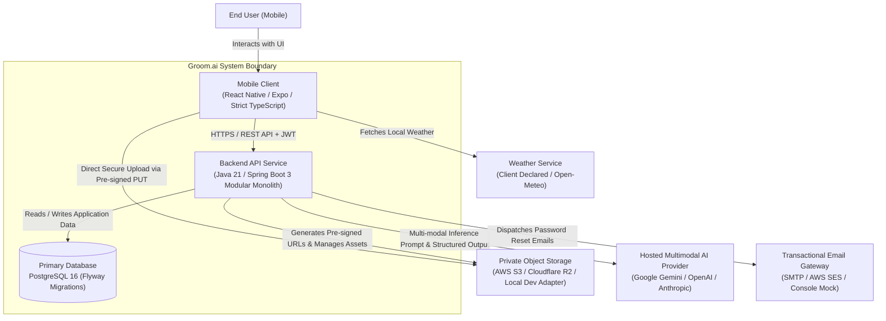
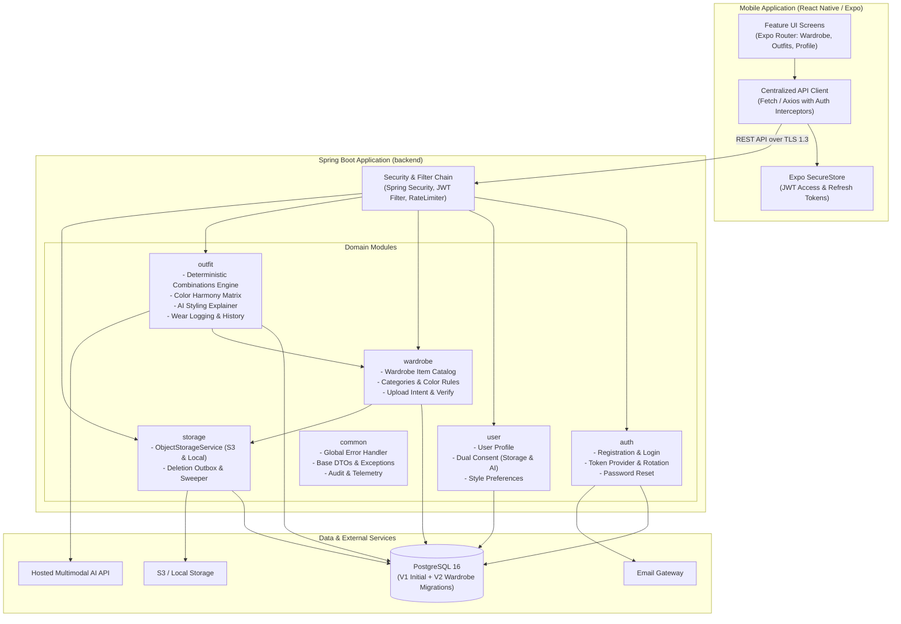
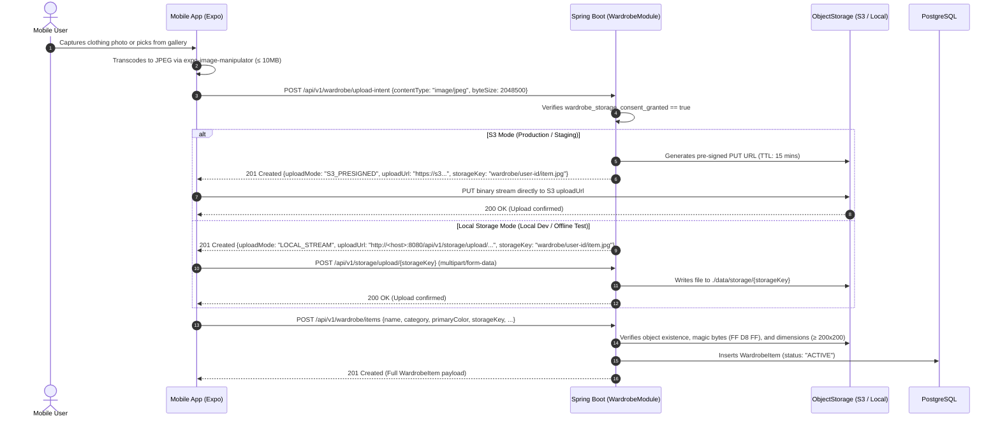
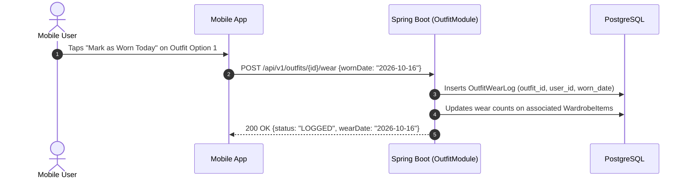
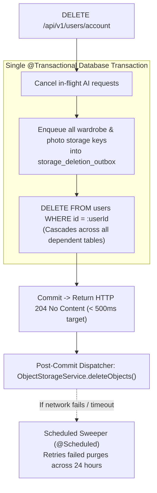
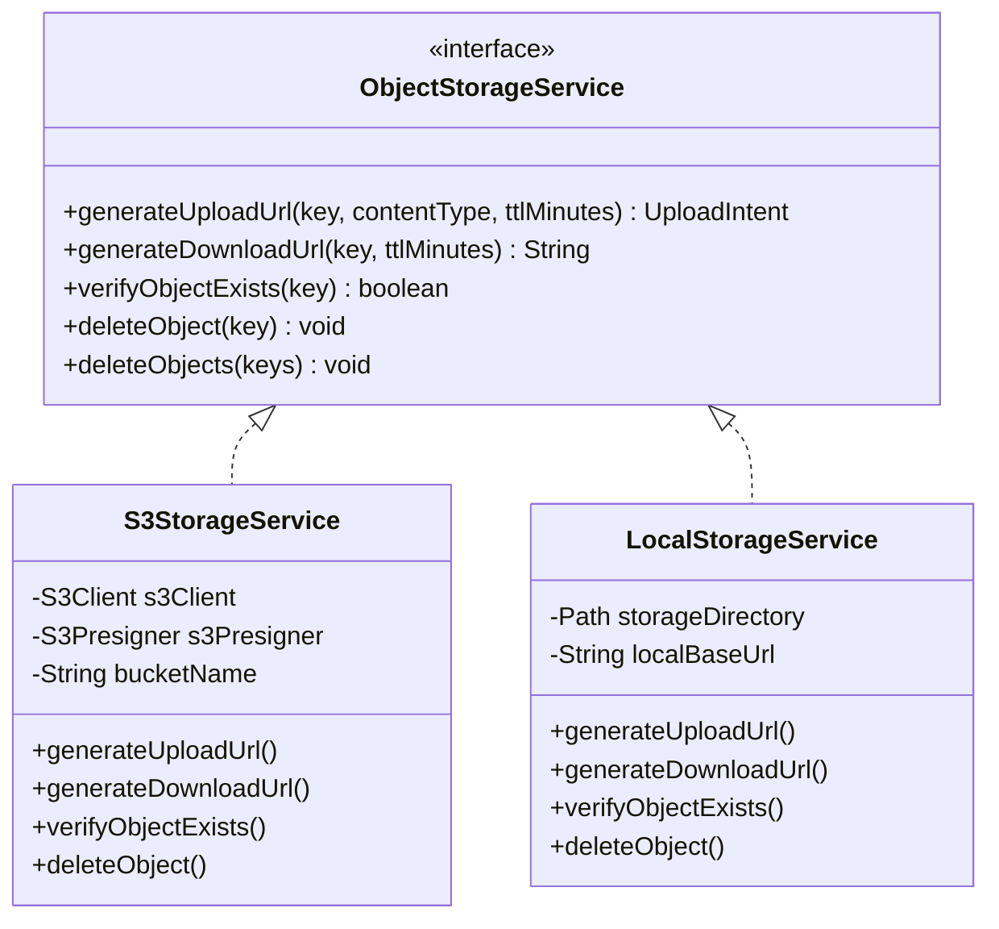
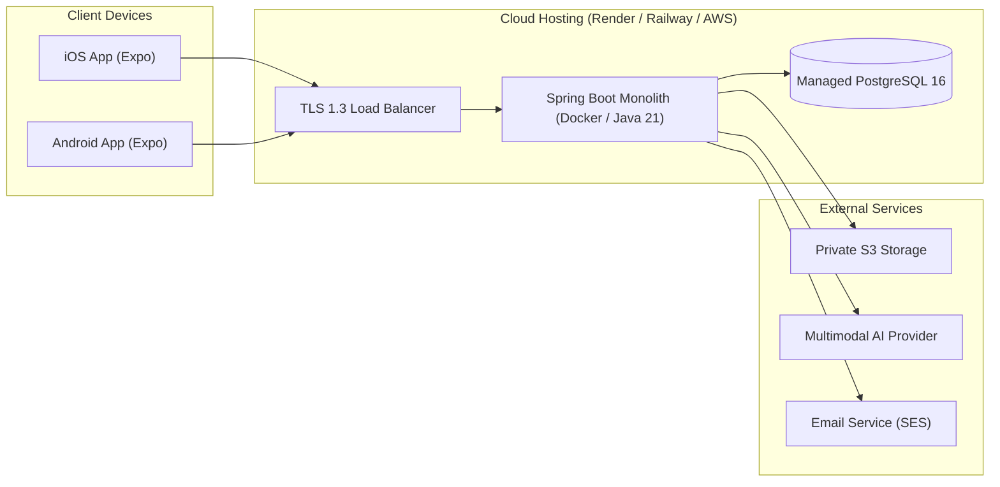

# Groom.ai — System Architecture & Technical Design

**Document Version:** 2.0.0  
**Status:** Approved Architecture Baseline (Pivot to Wardrobe-First AI Personal Stylist)  
**Architecture Baseline:** Modular Spring Boot Monolith + React Native (Expo) Mobile Client  
**Last Updated:** October 2026  

---

## 1. Architecture Goals & Guiding Principles

### 1.1 Architecture Goals
1. **Developer Velocity & Simplicity:** Maximize time delivering validated user value using a clean Modular Monolith in Spring Boot (Java 21) and React Native (Expo SDK, strict TypeScript).
2. **Zero Wardrobe Item Hallucination:** Ensure outfit recommendations consist exclusively of verified items present in the user's active wardrobe. Never allow an AI model to hallucinate or recommend unowned clothes.
3. **Strict Privacy & Dual Decoupled Consent:** Secure user wardrobe photos with private object storage, short-lived signed URLs, durable deletion tracking via transactional outbox, and strictly decoupled consent for storage vs. AI analysis.
4. **Resilience to AI Latency & Outages:** Isolate the core recommendation capability through a two-stage hybrid pipeline: deterministic rule-based candidate filtering runs in < 100ms on the JVM; external multimodal AI is invoked strictly for styling explanation with a 30s timeout.
5. **Seamless Offline / Local Development:** Provide a first-class local filesystem storage adapter (`LocalStorageService` at `./data/storage`) allowing developers to test image upload and viewing on physical devices and emulators without AWS credentials.
6. **Pragmatic Early-Stage Evolution:** Prohibit Redis, Kafka, RabbitMQ, vector databases, and microservices until concrete scale triggers demand them.

### 1.2 Core Architectural Principles
- **Modular Monolith First:** Group backend capabilities by domain modules (`auth`, `user`, `wardrobe`, `outfit`, `storage`, `common`). High cohesion within modules; low coupling across boundaries via service interfaces.
- **Stateless Application Tier with Hybrid Invalidation:** Zero in-memory session state. Authentication verified per-request via signed JWTs (15-min access), database-backed rotating refresh tokens (30-day), and immediate cutoff checks (`tokens_invalid_before`).
- **Client-Side Storage Directness with Backend Authorization:** Large binary images never stream through JVM heap memory. Mobile clients upload directly to private cloud storage (or local dev storage) via short-lived pre-signed URLs authorized by the backend.
- **Defensive Server-Side Boundaries:** Never trust client-reported image formats, sizes, or user IDs. All authorization enforces `userId == authenticatedUserId`.
- **Durable Cloud Storage Deletion via Outbox:** Storage keys are enqueued in `storage_deletion_outbox` within the same database transaction as relational entity deletion. Bounded retries and operator alerts prevent orphaned cloud files.

---

## 2. System Context & Component Architecture

### 2.1 System Context (C4 Level 1)



### 2.2 Component Architecture (C4 Level 2: Backend Modular Monolith)



---

## 3. Backend Module Boundaries & Responsibilities

| Module Package | Responsibility | Primary Entities | Outbound Dependencies |
| :--- | :--- | :--- | :--- |
| `com.groomai.auth` | User account registration, password hashing (Argon2id/BCrypt), JWT generation/validation, token refresh rotation, revocation, password reset workflows. | `User`, `RefreshToken`, `PasswordResetToken` | `com.groomai.common`, Email Gateway Adapter |
| `com.groomai.user` | User demographic profile, style preferences (primary style, fit, favorite/avoided colors, default formality), and dual decoupled consent management (`wardrobe_storage_consent_granted`, `ai_styling_consent_granted`). | `UserProfile`, `StylePreference` | `com.groomai.auth`, `com.groomai.common` |
| `com.groomai.wardrobe` | Digital wardrobe item cataloging, category validation (TOP, BOTTOM, FOOTWEAR, OUTERWEAR, ACCESSORY), color/pattern tagging, upload intent generation, item lifecycle. | `WardrobeItem` | `com.groomai.storage`, `com.groomai.common` |
| `com.groomai.outfit` | Two-stage hybrid styling pipeline: deterministic candidate generation & scoring (formality, weather, color harmony, wear history penalty) + multimodal AI styling rationale orchestration; wear logging. | `Outfit`, `OutfitItem`, `OutfitWearLog` | `com.groomai.wardrobe`, `com.groomai.user`, `com.groomai.common`, AI SDK Adapter |
| `com.groomai.storage` | Vendor-neutral `ObjectStorageService` abstraction (`S3StorageService` for cloud, `LocalStorageService` for dev), durable `StorageDeletionOutbox`, and scheduled sweeper worker. | `StorageDeletionOutbox` | `com.groomai.common`, Cloud Storage SDK Adapter |
| `com.groomai.common` | Shared exception hierarchy (`GroomAiException`), global `@RestControllerAdvice`, API error response records, security context helpers, audit listeners. | None (cross-cutting utilities) | Standard Spring & Jakarta libraries |

*Rule:* Cross-module communication occurs strictly via Service interfaces (e.g., `WardrobeItemService`, `StorageService`), never through direct repository queries across domain boundaries. Legacy grooming packages (`com.groomai.photo`, `com.groomai.recommendation`, `com.groomai.plan`) remain dormant in the codebase for future grooming expansion.

---

## 4. Key End-to-End Workflows

### 4.1 Wardrobe Item Ingestion Flow (Direct Pre-Signed Upload)

Image binaries are uploaded directly from mobile to storage, bypassing the Spring Boot JVM memory:



#### 4.1.1 Image Normalization & Storage Fallback Strategy
- **Client-Side JPEG Normalization:** Mobile client normalizes all images (converting iOS HEIC/HEIF to standard JPEG) via `expo-image-manipulator` before requesting an upload intent.
- **Backend Rejection:** Backend upload intent endpoints **reject** `image/heic` with HTTP `400 Bad Request` (`code: "UNSUPPORTED_IMAGE_FORMAT"`).
- **Dual-Tier Storage Abstraction:**
  - In production / staging (`S3_PRESIGNED`): `S3StorageService` generates pre-signed AWS S3 URLs. Direct upload from mobile to S3 keeps heavy binary streams off JVM heap memory.
  - In local development (`LOCAL_STREAM`): `LocalStorageService` persists files to `./data/storage` via `POST /api/v1/storage/upload/{storageKey}` and exposes authenticated streaming endpoints (`GET /api/v1/storage/files/{storageKey}`), allowing physical iPhones and emulators to test upload and display without AWS keys.

#### 4.1.2 Image Content Validation
During item catalog confirmation (`POST /api/v1/wardrobe/items`), the backend validates the staged object before persisting the record:
1. **Magic Bytes Verification:** Inspects the first 3 bytes of the binary to guarantee `0xFF, 0xD8, 0xFF` (JPEG SOI marker). Files failing magic-byte inspection are rejected with HTTP `400 Bad Request` (`INVALID_IMAGE_PAYLOAD`).
2. **File Size Enforcement:** Rejects binaries exceeding 10MB (`10,485,760` bytes).
3. **Dimension Bounds:** Inspects image header to guarantee minimum resolution of 200x200 pixels to ensure styling legibility.

#### 4.1.3 Interrupted-Upload Cleanup
To prevent storage bloat from aborted or interrupted uploads (where an intent is generated or binary uploaded, but the item is never confirmed):
1. **S3 Staging Lifecycle Policy:** In cloud production, the staging storage prefix (`wardrobe/staging/`) has an S3 Lifecycle rule configured to automatically expire and delete unconfirmed objects after 24 hours. When an item is confirmed, it is moved/tagged as active.
2. **Local Storage Sweeper:** In local development, a scheduled file sweeper scans `./data/storage` every 6 hours and purges unreferenced files older than 24 hours.

---

### 4.2 Hybrid Outfit Recommendation Pipeline: Two-Stage Architecture

Groom.ai employs a two-stage hybrid recommendation pipeline to guarantee zero item hallucination and high reliability:

```mermaid
sequenceDiagram
    autonumber
    actor User as Mobile User
    participant App as Mobile App
    participant Backend as Spring Boot (OutfitModule)
    participant DB as PostgreSQL
    participant AI as Hosted Multimodal AI

    User->>App: Selects Occasion ("Business Casual") & Weather ("Mild / Sunny")
    App->>Backend: POST /api/v1/outfits/generate {occasion: "BUSINESS_CASUAL", weather: {...}}
    Backend->>DB: Loads user's active WardrobeItems and recent OutfitWearLogs
    Backend->>Backend: Runs deterministic candidate generation regardless of AI consent
    alt AI styling consent granted
        Backend->>Backend: May invoke hosted AI for rationale only
    else AI styling consent absent
        Backend->>Backend: Skip hosted AI; omit AI rationale/tips
    end
    
    Note over Backend: Stage 1: Deterministic Engine (< 100ms)<br/>1. Enforce completeness (1 Top + 1 Bottom + 1 Footwear)<br/>2. Filter by occasion & weather suitability<br/>3. Score color harmony (monochrome / complementary / neutral)<br/>4. Apply wear history penalty (deduct score if worn in last 7 days)
    
    Backend->>Backend: Selects top 2–3 candidate outfit combinations
    
    Backend->>AI: Sends candidate combinations + styling prompt (timeout: 30s)
    Note over AI: Multimodal AI generates styling rationale<br/>("Why this works", tucking/layering tips)<br/>STRICT GUARDRAIL: Never invents unowned items
    AI-->>Backend: Structured JSON styling explanations
    
    Backend->>DB: Persists generated Outfit records
    Backend-->>App: 200 OK {outfits: [ ... ] with item details & AI rationale}
    App-->>User: Displays 2–3 complete outfits made of user's own clothes
```

#### 4.2.1 Stage 1: Deterministic Candidate Generation & Grammar Rules
1. **Category Completeness:** Every valid outfit candidate must contain at minimum:
   - Exactly 1 `TOP`
   - Exactly 1 `BOTTOM`
   - Exactly 1 `FOOTWEAR`
   - Optional `OUTERWEAR` (required or recommended if weather is `COLD` or `COOL`, or condition is `RAINY`)
   - Optional `ACCESSORY` (watch, belt, hat)
2. **Occasion & Formality Bounds:** Filters items whose `formalityLevel` is compatible with the requested occasion (`CASUAL`, `SMART_CASUAL`, `BUSINESS_CASUAL`, `CORPORATE_FORMAL`, `DATE_NIGHT`, `LOUNGEWEAR`, `ATHLETIC`).
3. **Weather Compatibility:** Evaluates seasonal tags (`SUMMER`, `WINTER`, `ALL_SEASON`) and weather flags against client-provided temperature bracket (`HOT`, `WARM`, `MILD`, `COOL`, `COLD`) and condition (`SUNNY`, `RAINY`, `WINDY`, `SNOWY`).
4. **Color Harmony Matrix:** Applies classic color theory (monochromatic, analogous, complementary, neutral anchors such as navy, white, black, grey, beige).
5. **Wear History Repetition Penalty:** Checks `outfit_wear_logs` within the past 3–7 days; items worn recently receive heavy scoring deductions to ensure variety.

#### 4.2.2 Stage 2: Multimodal AI Styling Rationale
- The candidate combinations produced by Stage 1 are passed to the hosted multimodal AI.
- The AI's role is strictly **explanatory and advisory**: it articulates why the combination looks good, offers proportion advice (e.g., untucked vs. French tuck), and explains why an alternative combination was ranked lower.
- **Strict Guardrail:** The AI is strictly constrained to the candidate item set; it is forbidden from proposing garments not owned by the user.

---

### 4.3 Wear Logging & Repetition Tracking Flow



---

## 5. Authentication & Authorization Model

### 5.1 Baseline: Self-Managed Spring Security JWT
- **Password Hashing:** Enforced via `new BCryptPasswordEncoder(12)` in `SecurityConfig.java`. Salt is generated per-user automatically.
- **Stateless Bearer JWT:** Client transmits `Authorization: Bearer <token>` on all protected endpoints.
- **Access Token:** Short-lived (15 minutes). Claims: `sub` (User UUID), `email`, `role`, `iat`, `exp`.
- **Refresh Token:** Long-lived (30 days). Cryptographically secure random token stored as salted SHA-256 hash in PostgreSQL `refresh_tokens`.
- **Mobile Storage:** Securely stored in `Expo SecureStore` (iOS Keychain / Android KeyStore).

### 5.2 Stateless JWT with Immediate Revocation
- **Account Deletion:** User row is permanently deleted. `JwtAuthenticationFilter` performs a user existence check, failing immediately (`401 Unauthorized`).
- **Password Reset & Revocation:** `users.tokens_invalid_before` records the cutoff timestamp. Any JWT whose `iat` precedes this cutoff is rejected (`401 Unauthorized`).
- **Logout:** `POST /api/v1/auth/logout` revokes the refresh token and clears SecureStore.

### 5.3 Tenancy Isolation & IDOR Defense
Every database operation querying or mutating user data must enforce ownership:
```sql
SELECT * FROM wardrobe_items WHERE id = :itemId AND user_id = :authenticatedUserId;
```

---

## 6. Privacy, Consent & Data Deletion Architecture

### 6.1 Dual Decoupled Consent Architecture
To protect user trust, Groom.ai decouples consent into two explicit, unbundled flags stored in `user_profiles`:
1. `wardrobe_storage_consent_granted` & `_at`: Authorizes storing clothing photos in private cloud storage. Required before creating upload intents (`POST /api/v1/wardrobe/upload-intent`).
2. `ai_styling_consent_granted` & `_at`: Authorizes passing wardrobe metadata and imagery to external AI models for AI-written styling rationale. It is required before any external AI call, not for deterministic outfit generation itself.
*(Note: The legacy `photo_consent_granted` column from V1 remains untouched for future portrait grooming analysis and is never repurposed).*

#### 6.1.1 Consent Revocation Semantics
Users can update their consent preferences at any time via `PUT /api/v1/profile/consents`:
- **Wardrobe Storage Revocation (`wardrobe_storage_consent_granted = false`):** Immediately blocks future upload intent creation (`POST /api/v1/wardrobe/upload-intent` fails with HTTP `403 Forbidden` / `CONSENT_REQUIRED`). Existing wardrobe items remain saved and accessible in the user's digital wardrobe catalog unless the user explicitly deletes them.
- **AI Styling Revocation (`ai_styling_consent_granted = false`):** Immediately blocks future outfit generation requests (`POST /api/v1/outfits/generate` fails with HTTP `403 Forbidden` / `CONSENT_REQUIRED`). Previously generated outfits, saved outfits, and wear history remain intact.

### 6.2 Data Deletion & Cloud Storage Outbox Pipeline



#### 6.2.1 Transactional Guarantee & Cascade Scope
- Account deletion executes within a **single `@Transactional` database transaction**.
- Enqueues all photo and wardrobe storage keys into `storage_deletion_outbox` (`status = 'PENDING'`, `attempts = 0`).
- Executes `DELETE FROM users WHERE id = :userId`, cascading across all dependent user tables (`user_profiles`, `wardrobe_items`, `style_preferences`, `outfits`, `outfit_items`, `outfit_wear_logs`, `photo_assets`, etc.).
- On commit, returns **HTTP `204 No Content`** immediately (< 500ms provisional target). All existing JWTs are invalidated immediately.
- **Implementation Status:** The `storage_deletion_outbox` relational table is **already applied in `V1__initial_schema.sql`**. The Spring Boot background worker (`StorageOutboxSweeper`), atomic claim query (`SELECT ... FOR UPDATE SKIP LOCKED`), and retry dispatcher (with delays of 15m, 1h, 6h, 16h45m across 24 hours) are **scheduled for implementation in Phase 5**. Tasks transition to `FAILED` with dead-letter alert on Attempt 5 and are never automatically purged until deletion is confirmed.

---

## 7. Storage Abstraction Architecture



- **Production / Staging:** `S3StorageService` targets AWS S3 with private ACLs, issuing pre-signed URLs (TTL ≤ 15 min).
- **Local Dev / Testing:** `LocalStorageService` writes files to `./data/storage` and exposes streaming endpoints, enabling offline mobile testing on physical devices or emulators.

---

## 8. Deployment Architecture (Baseline)



---

## 9. Testing Strategy

1. **Unit Testing:** JUnit 5 and Mockito for deterministic outfit rules, color harmony matrix, validation, and AI prompt building. Jest for mobile utilities.
2. **Integration Testing:** `@SpringBootTest` with **Testcontainers** running a real PostgreSQL container. Verifies Flyway migrations (V1 and V2) and JPA repositories. WireMock for external AI API calls.
3. **CI Pipeline:** GitHub Actions checks formatting, compiles with zero warnings, executes full test suite, runs strict TypeScript, and verifies Expo builds.

---

## 10. Architectural Trade-offs & Alternatives

| Decision Area | Selected Approach | Alternatives Considered | Rationale & Trade-off |
| :--- | :--- | :--- | :--- |
| **Styling Engine** | Two-Stage Hybrid (Deterministic Grammar + AI Rationale) | Single-Prompt Pure Generative LLM | Pure LLM hallucinates unowned clothes and suffers high latency (15–30s). The deterministic engine guarantees category completeness and color harmony in < 100ms; AI provides natural explanations. |
| **Storage Abstraction** | Dual-Tier (`S3StorageService` + `LocalStorageService`) | S3-Only | Allows development and automated tests on physical devices without AWS credentials or cloud costs. |
| **Privacy Consent** | Dual Decoupled Flags in `user_profiles` | Single Bundled Consent | Users can store clothes privately without granting permission for AI analysis until they choose to generate recommendations. |
| **Schema Evolution** | Immutable V1 + V2 Wardrobe Migrations | Modifying V1 Migration | Modifying applied migrations breaks Flyway checksums and existing databases. Dormant V1 tables remain intact for future grooming expansion. |
