# Groom.ai — Relational Data Model & Schema Specification

**Document Version:** 2.0.0  
**Status:** Approved Specification (Wardrobe-First Evolution)  
**Target Engine:** PostgreSQL 15+ / 16  
**Migration Tool:** Flyway (SQL migrations)  
**Last Updated:** October 2026  

---

## 1. Data Model Principles & Philosophy

1. **Strict Tenancy Isolation:** Every user-owned entity directly or transitively belongs to an authenticated `user_id`. Queries must filter by `user_id` to guarantee tenant isolation and prevent horizontal privilege escalation (IDOR).
2. **Metadata Only for Binary Assets:** Database records store metadata (storage keys, MIME types, dimensions, colors, categories) and never raw image binaries or base64 strings.
3. **Decoupled Item References (`ON DELETE SET NULL`):** Foreign keys referencing `wardrobe_items` from `outfit_items` are nullable and use `ON DELETE SET NULL`. If a user deletes an individual wardrobe item, historical outfit records and styling explanations remain intact with their item reference set to `null`.
4. **Referential Integrity & Cascading Account Purge:** Deleting an account executes a single root deletion on `users`, cascading cleanly (`ON DELETE CASCADE`) across all dependent user tables without restrictive foreign keys blocking deletion.
5. **Durable Cloud Asset Deletion via Outbox:** Cloud storage deletion tasks are recorded in `storage_deletion_outbox` in the same database transaction. A dispatcher and scheduled sweeper retry failures and alert operators; unresolved tasks remain durable until deletion is verified.
6. **Flyway Migration Immutability & Safety:**
   - Applied migration `V1__initial_schema.sql` is strictly immutable and remains untouched.
   - Wardrobe capabilities are added via `V2__wardrobe_schema.sql`.
   - Legacy V1 grooming tables (`grooming_preferences`, `recommendations`, `recommendation_jobs`, `photo_assets`, etc.) remain dormant in the database for future grooming expansion.
7. **Auditing & Timestamps:** All primary tables include `created_at` and `updated_at` timestamps using `TIMESTAMPTZ` (UTC).

---

## 2. Entity-Relationship Diagram (ERD)

```mermaid
erDiagram
    USERS ||--o| USER_PROFILES : "has"
    USERS ||--o| STYLE_PREFERENCES : "declares"
    USERS ||--o{ REFRESH_TOKENS : "holds"
    USERS ||--o{ PASSWORD_RESET_TOKENS : "requests"
    USERS ||--o{ WARDROBE_ITEMS : "owns"
    USERS ||--o{ OUTFITS : "receives"
    USERS ||--o{ OUTFIT_WEAR_LOGS : "logs"

    OUTFITS ||--|{ OUTFIT_ITEMS : "contains"
    WARDROBE_ITEMS |o--o{ OUTFIT_ITEMS : "referenced_in (nullable)"
    OUTFITS |o--o{ OUTFIT_WEAR_LOGS : "worn_in (nullable)"

    %% Dormant V1 Grooming Entities (Preserved for Future Expansion)
    USERS ||--o| GROOMING_PREFERENCES : "legacy_declares"
    USERS ||--o{ PHOTO_ASSETS : "legacy_uploads"
    USERS ||--o{ RECOMMENDATION_JOBS : "legacy_initiates"
    USERS ||--o{ RECOMMENDATIONS : "legacy_owns"
    USERS ||--o{ SAVED_RECOMMENDATIONS : "legacy_bookmarks"
    USERS ||--o| GROOMING_PLANS : "legacy_maintains"

    USERS {
        uuid id PK
        varchar email UK
        varchar password_hash
        varchar role
        timestamptz tokens_invalid_before
        timestamptz created_at
        timestamptz updated_at
    }

    USER_PROFILES {
        uuid id PK
        uuid user_id FK, UK
        varchar display_name
        varchar age_bracket
        boolean wardrobe_storage_consent_granted "V2"
        timestamptz wardrobe_storage_consent_granted_at "V2"
        boolean ai_styling_consent_granted "V2"
        timestamptz ai_styling_consent_granted_at "V2"
        boolean photo_consent_granted "V1 Dormant"
        timestamptz photo_consent_granted_at "V1 Dormant"
        timestamptz created_at
        timestamptz updated_at
    }

    STYLE_PREFERENCES {
        uuid id PK
        uuid user_id FK, UK
        varchar primary_style
        varchar preferred_fit
        jsonb color_preferences
        jsonb avoided_colors
        varchar default_formality
        timestamptz created_at
        timestamptz updated_at
    }

    WARDROBE_ITEMS {
        uuid id PK
        uuid user_id FK
        varchar name
        varchar category
        varchar subcategory
        varchar primary_color
        varchar secondary_color
        varchar pattern
        varchar formality_level
        varchar season
        varchar storage_key UK
        varchar status
        timestamptz created_at
        timestamptz updated_at
    }

    OUTFITS {
        uuid id PK
        uuid user_id FK
        varchar occasion
        varchar temperature_bracket
        varchar weather_condition
        text styling_rationale
        integer suitability_score
        timestamptz created_at
    }

    OUTFIT_ITEMS {
        uuid id PK
        uuid outfit_id FK
        uuid wardrobe_item_id FK "nullable, ON DELETE SET NULL"
        varchar item_role
    }

    OUTFIT_WEAR_LOGS {
        uuid id PK
        uuid user_id FK
        uuid outfit_id FK "nullable, ON DELETE SET NULL"
        date worn_date
        text notes
        timestamptz created_at
    }

    STORAGE_DELETION_OUTBOX {
        uuid id PK
        varchar storage_key
        integer attempts
        varchar status
        timestamptz last_attempt_at
        timestamptz next_attempt_at
        timestamptz lease_expires_at
        text error_message
        timestamptz created_at
    }
```



---

## 3. Relational Table Definitions

### 3.1 Table: `users` (V1 Baseline — Implemented)
Core identity table storing credentials and account status.

| Column | Type | Constraints | Description |
| :--- | :--- | :--- | :--- |
| `id` | `UUID` | `PRIMARY KEY DEFAULT gen_random_uuid()` | Unique user identifier. |
| `email` | `VARCHAR(255)` | `NOT NULL UNIQUE` | Normalized lowercase email address. |
| `password_hash` | `VARCHAR(255)` | `NOT NULL` | Cryptographic hash (implemented with `BCryptPasswordEncoder(12)` in Phase 1). |
| `role` | `VARCHAR(32)` | `NOT NULL DEFAULT 'ROLE_USER'` | User authorization role. |
| `tokens_invalid_before` | `TIMESTAMPTZ` | `NULL` | Invalidation cutoff timestamp; any access token issued prior to this is rejected immediately. |
| `created_at` | `TIMESTAMPTZ` | `NOT NULL DEFAULT NOW()` | Record creation timestamp. |
| `updated_at` | `TIMESTAMPTZ` | `NOT NULL DEFAULT NOW()` | Record last update timestamp. |

- **Indexes:**
  - `idx_users_email` ON `users (email)`

---

### 3.2 Table: `user_profiles` (V1 Baseline + V2 Consent Alteration)
Stores demographic profile and explicit, unbundled privacy consents.

| Column | Type | Constraints | Description |
| :--- | :--- | :--- | :--- |
| `id` | `UUID` | `PRIMARY KEY DEFAULT gen_random_uuid()` | Unique profile identifier. |
| `user_id` | `UUID` | `NOT NULL UNIQUE REFERENCES users(id) ON DELETE CASCADE` | Associated user identity. |
| `display_name` | `VARCHAR(100)` | `NOT NULL` | User's preferred display name. |
| `age_bracket` | `VARCHAR(32)` | `NULL` | Optional age range enum. |
| `wardrobe_storage_consent_granted` | `BOOLEAN` | `NOT NULL DEFAULT FALSE` | **(V2)** Explicit consent for storing clothing photos in private cloud storage. |
| `wardrobe_storage_consent_granted_at` | `TIMESTAMPTZ` | `NULL` | **(V2)** Timestamp when wardrobe storage consent was granted. |
| `ai_styling_consent_granted` | `BOOLEAN` | `NOT NULL DEFAULT FALSE` | **(V2)** Explicit consent for analyzing wardrobe imagery with external AI models. |
| `ai_styling_consent_granted_at` | `TIMESTAMPTZ` | `NULL` | **(V2)** Timestamp when AI styling consent was granted. |
| `photo_consent_granted` | `BOOLEAN` | `NOT NULL DEFAULT FALSE` | *(V1 Dormant)* Legacy portrait photo consent. |
| `photo_consent_granted_at` | `TIMESTAMPTZ` | `NULL` | *(V1 Dormant)* Legacy portrait photo consent timestamp. |
| `created_at` | `TIMESTAMPTZ` | `NOT NULL DEFAULT NOW()` | Record creation timestamp. |
| `updated_at` | `TIMESTAMPTZ` | `NOT NULL DEFAULT NOW()` | Record last update timestamp. |

- **Indexes:**
  - `idx_user_profiles_user_id` ON `user_profiles (user_id)`

---

### 3.3 Table: `style_preferences` (V2 Wardrobe Schema)
Stores user style preferences, preferred fits, and color affinities.

| Column | Type | Constraints | Description |
| :--- | :--- | :--- | :--- |
| `id` | `UUID` | `PRIMARY KEY DEFAULT gen_random_uuid()` | Unique preference identifier. |
| `user_id` | `UUID` | `NOT NULL UNIQUE REFERENCES users(id) ON DELETE CASCADE` | Associated user identity. |
| `primary_style` | `VARCHAR(50)` | `NOT NULL DEFAULT 'CASUAL'` | Primary style aesthetic (`CASUAL`, `SMART_CASUAL`, `MINIMALIST`, `CLASSIC`, `STREETWEAR`, `PREPPY`, `ATHLEISURE`). |
| `preferred_fit` | `VARCHAR(32)` | `NOT NULL DEFAULT 'REGULAR'` | Preferred fit (`SLIM`, `REGULAR`, `RELAXED`, `OVERSIZED`). |
| `color_preferences` | `JSONB` | `NOT NULL DEFAULT '[]'::jsonb` | JSON array of favorite color codes (e.g. `["NAVY", "WHITE", "OLIVE"]`). |
| `avoided_colors` | `JSONB` | `NOT NULL DEFAULT '[]'::jsonb` | JSON array of colors the user prefers not to wear. |
| `default_formality` | `VARCHAR(32)` | `NOT NULL DEFAULT 'CASUAL'` | Default formality level (`CASUAL`, `SMART_CASUAL`, `BUSINESS_CASUAL`, `FORMAL`). |
| `created_at` | `TIMESTAMPTZ` | `NOT NULL DEFAULT NOW()` | Record creation timestamp. |
| `updated_at` | `TIMESTAMPTZ` | `NOT NULL DEFAULT NOW()` | Record last update timestamp. |

- **Indexes:**
  - `idx_style_preferences_user_id` ON `style_preferences (user_id)`

---

### 3.4 Table: `wardrobe_items` (V2 Wardrobe Schema)
Catalog of clothing items, shoes, and accessories owned by the user.

| Column | Type | Constraints | Description |
| :--- | :--- | :--- | :--- |
| `id` | `UUID` | `PRIMARY KEY DEFAULT gen_random_uuid()` | Unique wardrobe item identifier. |
| `user_id` | `UUID` | `NOT NULL REFERENCES users(id) ON DELETE CASCADE` | Owning user ID (tenancy isolation). |
| `name` | `VARCHAR(100)` | `NOT NULL` | User-defined item label (e.g., "Navy Oxford Shirt"). |
| `category` | `VARCHAR(32)` | `NOT NULL` | Main category: `TOP`, `BOTTOM`, `FOOTWEAR`, `OUTERWEAR`, `ACCESSORY`. |
| `subcategory` | `VARCHAR(50)` | `NULL` | Specific garment subtype (e.g., `BUTTON_DOWN`, `CHINOS`, `SNEAKERS`, `BLAZER`). |
| `primary_color` | `VARCHAR(32)` | `NOT NULL` | Base color (`WHITE`, `BLACK`, `NAVY`, `GREY`, `BEIGE`, `BROWN`, `BLUE`, `GREEN`, `OLIVE`, `RED`, `BURGUNDY`, `YELLOW`, `MULTI`). |
| `secondary_color` | `VARCHAR(32)` | `NULL` | Optional secondary accent color. |
| `pattern` | `VARCHAR(32)` | `NOT NULL DEFAULT 'SOLID'` | Garment pattern (`SOLID`, `STRIPED`, `CHECKED`, `FLORAL`, `GRAPHIC`, `TEXTURED`). |
| `formality_level` | `VARCHAR(32)` | `NOT NULL DEFAULT 'CASUAL'` | Formality tier: `CASUAL`, `SMART_CASUAL`, `BUSINESS_CASUAL`, `FORMAL`. |
| `season` | `VARCHAR(32)` | `NOT NULL DEFAULT 'ALL_SEASON'` | Seasonality tag: `SPRING`, `SUMMER`, `FALL`, `WINTER`, `ALL_SEASON`. |
| `storage_key` | `VARCHAR(512)` | `NOT NULL UNIQUE` | Private storage path for image asset. |
| `status` | `VARCHAR(32)` | `NOT NULL DEFAULT 'ACTIVE'` | Item status: `ACTIVE`, `ARCHIVED`. |
| `created_at` | `TIMESTAMPTZ` | `NOT NULL DEFAULT NOW()` | Record creation timestamp. |
| `updated_at` | `TIMESTAMPTZ` | `NOT NULL DEFAULT NOW()` | Record last update timestamp. |

- **Indexes:**
  - `idx_wardrobe_items_user_category` ON `wardrobe_items (user_id, category)`
  - `idx_wardrobe_items_user_status` ON `wardrobe_items (user_id, status)`
  - `idx_wardrobe_items_storage_key` ON `wardrobe_items (storage_key)`

---

### 3.5 Table: `outfits` (Proposed — Phase 3 Specification)
Stores recommended and saved outfit combinations.

| Column | Type | Constraints | Description |
| :--- | :--- | :--- | :--- |
| `id` | `UUID` | `PRIMARY KEY DEFAULT gen_random_uuid()` | Unique outfit identifier. |
| `user_id` | `UUID` | `NOT NULL REFERENCES users(id) ON DELETE CASCADE` | Owning user ID. |
| `occasion` | `VARCHAR(50)` | `NOT NULL` | Target occasion (`CASUAL`, `SMART_CASUAL`, `BUSINESS_CASUAL`, `CORPORATE_FORMAL`, `DATE_NIGHT`, `LOUNGEWEAR`, `ATHLETIC`). |
| `temperature_bracket` | `VARCHAR(32)` | `NULL` | Weather temperature bracket (`HOT`, `WARM`, `MILD`, `COOL`, `COLD`). |
| `weather_condition` | `VARCHAR(32)` | `NULL` | Condition tag (`SUNNY`, `RAINY`, `WINDY`, `SNOWY`, `CLOUDY`). |
| `styling_rationale` | `TEXT` | `NOT NULL` | AI-generated explanation of why the outfit works and styling tips. |
| `suitability_score` | `INTEGER` | `NOT NULL` | Deterministic engine suitability score (1–100). |
| `created_at` | `TIMESTAMPTZ` | `NOT NULL DEFAULT NOW()` | Recommendation timestamp. |

- **Indexes:**
  - `idx_outfits_user_created` ON `outfits (user_id, created_at DESC)`

---

### 3.6 Table: `outfit_items` (Proposed — Phase 3 Specification)
Links wardrobe items into an outfit.

| Column | Type | Constraints | Description |
| :--- | :--- | :--- | :--- |
| `id` | `UUID` | `PRIMARY KEY DEFAULT gen_random_uuid()` | Unique entry identifier. |
| `outfit_id` | `UUID` | `NOT NULL REFERENCES outfits(id) ON DELETE CASCADE` | Parent outfit reference. |
| `wardrobe_item_id` | `UUID` | `NULL REFERENCES wardrobe_items(id) ON DELETE SET NULL` | Wardrobe item (decoupled: item deletion preserves outfit text). |
| `item_role` | `VARCHAR(32)` | `NOT NULL` | Role in outfit (`TOP`, `BOTTOM`, `FOOTWEAR`, `OUTERWEAR`, `ACCESSORY`). |

- **Indexes:**
  - `idx_outfit_items_outfit_id` ON `outfit_items (outfit_id)`
  - `idx_outfit_items_wardrobe_item_id` ON `outfit_items (wardrobe_item_id)`

---

### 3.7 Table: `outfit_wear_logs` (Proposed — Phase 4 Specification)
Tracks historical wear dates for outfits to prevent repetitive recommendations.

| Column | Type | Constraints | Description |
| :--- | :--- | :--- | :--- |
| `id` | `UUID` | `PRIMARY KEY DEFAULT gen_random_uuid()` | Unique wear log identifier. |
| `user_id` | `UUID` | `NOT NULL REFERENCES users(id) ON DELETE CASCADE` | Owning user ID. |
| `outfit_id` | `UUID` | `NULL REFERENCES outfits(id) ON DELETE SET NULL` | Associated outfit reference. |
| `worn_date` | `DATE` | `NOT NULL DEFAULT CURRENT_DATE` | Date when the outfit was worn. |
| `notes` | `TEXT` | `NULL` | Optional personal user wear notes. |
| `created_at` | `TIMESTAMPTZ` | `NOT NULL DEFAULT NOW()` | Log entry creation timestamp. |

- **Indexes:**
  - `idx_outfit_wear_logs_user_date` ON `outfit_wear_logs (user_id, worn_date DESC)`

---

### 3.8 Table: `storage_deletion_outbox` (Applied in V1 Schema; Worker Scheduled for Phase 5)
Durable task table recording storage keys scheduled for cloud eradication. The table schema was created in `V1__initial_schema.sql` (lines 116–126). The Spring Boot background sweeper worker, atomic claims, and retry dispatcher are scheduled for implementation in Phase 5.

| Column | Type | Constraints | Description |
| :--- | :--- | :--- | :--- |
| `id` | `UUID` | `PRIMARY KEY DEFAULT gen_random_uuid()` | Unique task identifier. |
| `storage_key` | `VARCHAR(512)` | `NOT NULL` | Path to object in storage (treated as sensitive operational data). |
| `attempts` | `INTEGER` | `NOT NULL DEFAULT 0` | Count of claimed deletion attempts. |
| `status` | `VARCHAR(32)` | `NOT NULL DEFAULT 'PENDING'` | Task lifecycle: `PENDING`, `PROCESSING`, `FAILED`. |
| `last_attempt_at` | `TIMESTAMPTZ` | `NULL` | Timestamp of most recent attempt. |
| `next_attempt_at` | `TIMESTAMPTZ` | `NOT NULL DEFAULT NOW()` | Scheduled time for next attempt. |
| `lease_expires_at` | `TIMESTAMPTZ` | `NULL` | Lease expiration for crash recovery (2-minute window). |
| `error_message` | `TEXT` | `NULL` | Failure diagnostic details. |
| `created_at` | `TIMESTAMPTZ` | `NOT NULL DEFAULT NOW()` | Enqueue timestamp. |

- **Indexes:**
  - `idx_storage_outbox_due` ON `storage_deletion_outbox (status, next_attempt_at)`

---

## 4. Proposed `V2__wardrobe_schema.sql` Migration Script

```sql
-- =============================================================================
-- Groom.ai: Migration V2__wardrobe_schema.sql
-- Digital Wardrobe Catalog & Style Preferences
-- =============================================================================

-- 1. Alter user_profiles to add unbundled wardrobe & AI styling consents
ALTER TABLE user_profiles
    ADD COLUMN wardrobe_storage_consent_granted BOOLEAN NOT NULL DEFAULT FALSE,
    ADD COLUMN wardrobe_storage_consent_granted_at TIMESTAMPTZ NULL,
    ADD COLUMN ai_styling_consent_granted BOOLEAN NOT NULL DEFAULT FALSE,
    ADD COLUMN ai_styling_consent_granted_at TIMESTAMPTZ NULL;

-- 2. Style Preferences Table
CREATE TABLE style_preferences (
    id UUID PRIMARY KEY DEFAULT gen_random_uuid(),
    user_id UUID NOT NULL UNIQUE REFERENCES users(id) ON DELETE CASCADE,
    primary_style VARCHAR(50) NOT NULL DEFAULT 'CASUAL',
    preferred_fit VARCHAR(32) NOT NULL DEFAULT 'REGULAR',
    color_preferences JSONB NOT NULL DEFAULT '[]'::jsonb,
    avoided_colors JSONB NOT NULL DEFAULT '[]'::jsonb,
    default_formality VARCHAR(32) NOT NULL DEFAULT 'CASUAL',
    created_at TIMESTAMPTZ NOT NULL DEFAULT NOW(),
    updated_at TIMESTAMPTZ NOT NULL DEFAULT NOW()
);

CREATE INDEX idx_style_preferences_user_id ON style_preferences (user_id);

-- 3. Wardrobe Items Catalog Table
CREATE TABLE wardrobe_items (
    id UUID PRIMARY KEY DEFAULT gen_random_uuid(),
    user_id UUID NOT NULL REFERENCES users(id) ON DELETE CASCADE,
    name VARCHAR(100) NOT NULL,
    category VARCHAR(32) NOT NULL,
    subcategory VARCHAR(50) NULL,
    primary_color VARCHAR(32) NOT NULL,
    secondary_color VARCHAR(32) NULL,
    pattern VARCHAR(32) NOT NULL DEFAULT 'SOLID',
    formality_level VARCHAR(32) NOT NULL DEFAULT 'CASUAL',
    season VARCHAR(32) NOT NULL DEFAULT 'ALL_SEASON',
    storage_key VARCHAR(512) NOT NULL UNIQUE,
    status VARCHAR(32) NOT NULL DEFAULT 'ACTIVE',
    created_at TIMESTAMPTZ NOT NULL DEFAULT NOW(),
    updated_at TIMESTAMPTZ NOT NULL DEFAULT NOW()
);

CREATE INDEX idx_wardrobe_items_user_category ON wardrobe_items (user_id, category);
CREATE INDEX idx_wardrobe_items_user_status ON wardrobe_items (user_id, status);
CREATE INDEX idx_wardrobe_items_storage_key ON wardrobe_items (storage_key);

-- 4. Outfits Table (Phase 3 Foundation)
CREATE TABLE outfits (
    id UUID PRIMARY KEY DEFAULT gen_random_uuid(),
    user_id UUID NOT NULL REFERENCES users(id) ON DELETE CASCADE,
    occasion VARCHAR(50) NOT NULL,
    temperature_bracket VARCHAR(32) NULL,
    weather_condition VARCHAR(32) NULL,
    styling_rationale TEXT NOT NULL,
    suitability_score INTEGER NOT NULL,
    created_at TIMESTAMPTZ NOT NULL DEFAULT NOW()
);

CREATE INDEX idx_outfits_user_created ON outfits (user_id, created_at DESC);

-- 5. Outfit Items Junction Table
CREATE TABLE outfit_items (
    id UUID PRIMARY KEY DEFAULT gen_random_uuid(),
    outfit_id UUID NOT NULL REFERENCES outfits(id) ON DELETE CASCADE,
    wardrobe_item_id UUID NULL REFERENCES wardrobe_items(id) ON DELETE SET NULL,
    item_role VARCHAR(32) NOT NULL
);

CREATE INDEX idx_outfit_items_outfit_id ON outfit_items (outfit_id);
CREATE INDEX idx_outfit_items_wardrobe_item_id ON outfit_items (wardrobe_item_id);

-- 6. Outfit Wear Logs Table (Phase 4 Foundation)
CREATE TABLE outfit_wear_logs (
    id UUID PRIMARY KEY DEFAULT gen_random_uuid(),
    user_id UUID NOT NULL REFERENCES users(id) ON DELETE CASCADE,
    outfit_id UUID NULL REFERENCES outfits(id) ON DELETE SET NULL,
    worn_date DATE NOT NULL DEFAULT CURRENT_DATE,
    notes TEXT NULL,
    created_at TIMESTAMPTZ NOT NULL DEFAULT NOW()
);

CREATE INDEX idx_outfit_wear_logs_user_date ON outfit_wear_logs (user_id, worn_date DESC);
```

---

## 5. Account Deletion Cascade & Outbox Extraction Query

When an account is deleted, the following atomic transaction executes:

```sql
BEGIN;

-- 1. Extract all wardrobe image storage keys and portrait storage keys into outbox
INSERT INTO storage_deletion_outbox (storage_key, status, attempts, next_attempt_at)
SELECT storage_key, 'PENDING', 0, NOW()
FROM wardrobe_items
WHERE user_id = :userId
UNION ALL
SELECT storage_key, 'PENDING', 0, NOW()
FROM photo_assets
WHERE user_id = :userId;

-- 2. Execute root deletion; cascades across all dependent tables
DELETE FROM users WHERE id = :userId;

COMMIT;
```
