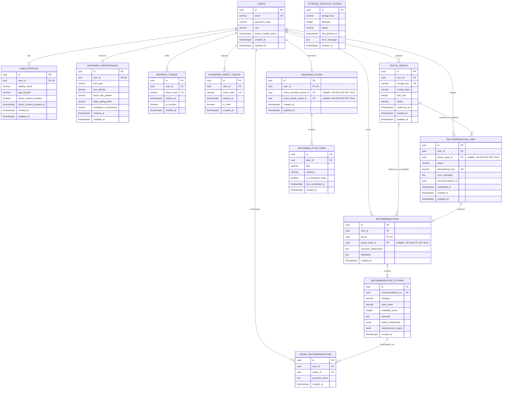
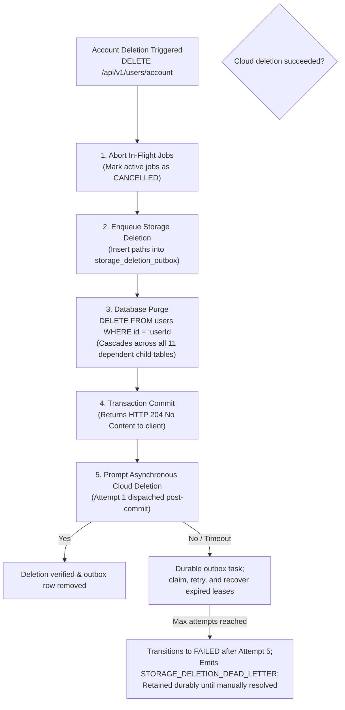

# Groom.ai — Relational Data Model & Schema Specification

**Document Version:** 1.1.0  
**Status:** Draft — Proposed Specification (Pending Stakeholder Approval)  
**Target Engine:** PostgreSQL 15+ / 16  
**Migration Tool:** Flyway (SQL migrations)  
**Last Updated:** October 2026  

---

## 1. Data Model Principles & Philosophy

1. **Strict Tenancy Isolation:** Every user-owned entity directly or transitively belongs to an authenticated `user_id`. Queries must filter by `user_id` to guarantee tenant isolation and prevent horizontal privilege escalation (Insecure Direct Object Reference / IDOR).
2. **Metadata Only for Binary Assets:** Database records store metadata (storage keys, MIME types, file sizes, processing states) and never raw image binaries or base64 strings.
3. **Decoupled Photo References (`ON DELETE SET NULL`):** Foreign keys referencing `photo_assets` from `recommendations` and `recommendation_jobs` are nullable and use `ON DELETE SET NULL`. If a user deletes an individual photo, the image binary is eradicated while preserving historical text analysis, style advice, and Barber Cards in their grooming history.
4. **Referential Integrity & Cascading Account Purge:** Deleting an account executes a single root deletion on `users`, cascading cleanly (`ON DELETE CASCADE`) across all dependent tables without restrictive foreign keys blocking deletion.
5. **Durable Cloud Asset Deletion via Outbox:** Cloud storage deletion tasks are recorded in `storage_deletion_outbox` in the same database transaction. A dispatcher and scheduled sweeper retry failures and alert operators; unresolved tasks remain durable until deletion is verified.
6. **Auditing & Timestamps:** All primary tables include `created_at` and `updated_at` timestamps using `TIMESTAMPTZ` (UTC).

---

## 2. Entity-Relationship Diagram (ERD)



---

## 3. Relational Table Definitions

### 3.1 Table: `users`
Core identity table storing credentials and account status.

| Column | Type | Constraints | Description |
| :--- | :--- | :--- | :--- |
| `id` | `UUID` | `PRIMARY KEY DEFAULT gen_random_uuid()` | Unique user identifier. |
| `email` | `VARCHAR(255)` | `NOT NULL UNIQUE` | Normalized lowercase email address. |
| `password_hash` | `VARCHAR(255)` | `NOT NULL` | Cryptographic hash (Argon2id or BCrypt). |
| `role` | `VARCHAR(32)` | `NOT NULL DEFAULT 'ROLE_USER'` | User authorization role. |
| `tokens_invalid_before` | `TIMESTAMPTZ` | `NULL` | Invalidation cutoff timestamp; any access token issued prior to this is rejected immediately. |
| `created_at` | `TIMESTAMPTZ` | `NOT NULL DEFAULT NOW()` | Record creation timestamp. |
| `updated_at` | `TIMESTAMPTZ` | `NOT NULL DEFAULT NOW()` | Record last update timestamp. |

- **Indexes:**
  - `idx_users_email` ON `users (email)`

---

### 3.2 Table: `user_profiles`
User profile and biometric privacy consent metadata.

| Column | Type | Constraints | Description |
| :--- | :--- | :--- | :--- |
| `id` | `UUID` | `PRIMARY KEY DEFAULT gen_random_uuid()` | Unique profile identifier. |
| `user_id` | `UUID` | `NOT NULL UNIQUE REFERENCES users(id) ON DELETE CASCADE` | 1:1 foreign key to `users`. |
| `display_name` | `VARCHAR(64)` | `NULL` | Preferred display name. |
| `age_bracket` | `VARCHAR(32)` | `NULL` | Enum: `TEENS`, `TWENTIES`, `THIRTIES`, `FORTIES`, `FIFTY_PLUS`. |
| `photo_consent_granted` | `BOOLEAN` | `NOT NULL DEFAULT FALSE` | Flag indicating explicit privacy consent. |
| `photo_consent_granted_at` | `TIMESTAMPTZ`| `NULL` | Timestamp when consent was recorded. |
| `created_at` | `TIMESTAMPTZ` | `NOT NULL DEFAULT NOW()` | Creation timestamp. |
| `updated_at` | `TIMESTAMPTZ` | `NOT NULL DEFAULT NOW()` | Last modification timestamp. |

---

### 3.3 Table: `grooming_preferences`
Declared styling habits and physical hair characteristics.

| Column | Type | Constraints | Description |
| :--- | :--- | :--- | :--- |
| `id` | `UUID` | `PRIMARY KEY DEFAULT gen_random_uuid()` | Unique preferences identifier. |
| `user_id` | `UUID` | `NOT NULL UNIQUE REFERENCES users(id) ON DELETE CASCADE` | 1:1 foreign key to `users`. |
| `hair_type` | `VARCHAR(32)` | `NOT NULL` | Enum: `STRAIGHT`, `WAVY`, `CURLY`, `COILY`. |
| `hair_density` | `VARCHAR(32)` | `NOT NULL` | Enum: `THIN`, `MEDIUM`, `THICK`. |
| `facial_hair_pattern` | `VARCHAR(32)` | `NOT NULL` | Enum: `CLEAN_SHAVEN`, `STUBBLE`, `FULL_BEARD`, `PATCHY`, `GOATEE`. |
| `daily_styling_effort`| `VARCHAR(32)` | `NOT NULL` | Enum: `MINIMAL_UNDER_5_MIN`, `MODERATE_5_TO_15_MIN`, `EXTENSIVE_OVER_15_MIN`. |
| `workplace_environment`| `VARCHAR(32)`| `NOT NULL` | Enum: `CORPORATE_FORMAL`, `BUSINESS_CASUAL`, `CREATIVE_CASUAL`. |
| `created_at` | `TIMESTAMPTZ` | `NOT NULL DEFAULT NOW()` | Creation timestamp. |
| `updated_at` | `TIMESTAMPTZ` | `NOT NULL DEFAULT NOW()` | Last update timestamp. |

---

### 3.4 Table: `refresh_tokens`
Cryptographic refresh tokens for rotating session management.

| Column | Type | Constraints | Description |
| :--- | :--- | :--- | :--- |
| `id` | `UUID` | `PRIMARY KEY DEFAULT gen_random_uuid()` | Unique record identifier. |
| `user_id` | `UUID` | `NOT NULL REFERENCES users(id) ON DELETE CASCADE` | Owner user reference. |
| `token_hash` | `VARCHAR(255)`| `NOT NULL UNIQUE` | SHA-256 hash of the issued refresh token. |
| `expires_at` | `TIMESTAMPTZ` | `NOT NULL` | Token expiration cutoff (30 days). |
| `is_revoked` | `BOOLEAN` | `NOT NULL DEFAULT FALSE` | Flag for revoked/logged-out tokens. |
| `created_at` | `TIMESTAMPTZ` | `NOT NULL DEFAULT NOW()` | Issuance timestamp. |

- **Indexes:**
  - `idx_refresh_tokens_hash` ON `refresh_tokens (token_hash)`
  - `idx_refresh_tokens_user` ON `refresh_tokens (user_id)`

---

### 3.5 Table: `password_reset_tokens`
Cryptographic single-use tokens for email-based password recovery.

| Column | Type | Constraints | Description |
| :--- | :--- | :--- | :--- |
| `id` | `UUID` | `PRIMARY KEY DEFAULT gen_random_uuid()` | Unique record identifier. |
| `user_id` | `UUID` | `NOT NULL REFERENCES users(id) ON DELETE CASCADE` | Target user reference. |
| `token_hash` | `VARCHAR(255)`| `NOT NULL UNIQUE` | SHA-256 hash of the one-time reset token. |
| `expires_at` | `TIMESTAMPTZ` | `NOT NULL` | Token expiration cutoff (15 minutes). |
| `is_used` | `BOOLEAN` | `NOT NULL DEFAULT FALSE` | Flag indicating if token was already redeemed. |
| `created_at` | `TIMESTAMPTZ` | `NOT NULL DEFAULT NOW()` | Issuance timestamp. |

- **Indexes:**
  - `idx_pwd_reset_tokens_hash` ON `password_reset_tokens (token_hash)`
  - `idx_pwd_reset_tokens_user` ON `password_reset_tokens (user_id)`

---

### 3.6 Table: `photo_assets`
Metadata tracking uploaded portrait photos stored in private cloud object storage.

| Column | Type | Constraints | Description |
| :--- | :--- | :--- | :--- |
| `id` | `UUID` | `PRIMARY KEY DEFAULT gen_random_uuid()` | Photo asset identifier. |
| `user_id` | `UUID` | `NOT NULL REFERENCES users(id) ON DELETE CASCADE` | Asset owner. |
| `storage_key` | `VARCHAR(512)`| `NOT NULL UNIQUE` | Relative path key in private bucket. |
| `content_type` | `VARCHAR(64)` | `NOT NULL` | Validated MIME type (`image/jpeg`, `image/png`, `image/heic`). |
| `byte_size` | `INTEGER` | `NOT NULL CHECK (byte_size > 0 AND byte_size <= 10485760)` | File size in bytes (max 10MB). |
| `status` | `VARCHAR(32)` | `NOT NULL DEFAULT 'PENDING_UPLOAD'` | Enum: `PENDING_UPLOAD`, `ACTIVE`, `DELETED`. |
| `confirmed_at` | `TIMESTAMPTZ` | `NULL` | Timestamp when client confirmed S3 upload. |
| `created_at` | `TIMESTAMPTZ` | `NOT NULL DEFAULT NOW()` | Record creation timestamp. |
| `updated_at` | `TIMESTAMPTZ` | `NOT NULL DEFAULT NOW()` | Status update timestamp. |

- **Indexes:**
  - `idx_photo_assets_user_status` ON `photo_assets (user_id, status)`

---

### 3.7 Table: `storage_deletion_outbox`
Transactional queue for durable object-storage deletion work, retry scheduling, and operator remediation without an external message broker.

| Column | Type | Constraints | Description |
| :--- | :--- | :--- | :--- |
| `id` | `UUID` | `PRIMARY KEY DEFAULT gen_random_uuid()` | Queue record identifier. |
| `storage_key` | `VARCHAR(512)`| `NOT NULL` | Target object path in cloud storage (sole parameter required by cloud SDK). |
| `attempts` | `INTEGER` | `NOT NULL DEFAULT 0` | Deletion retry count. |
| `status` | `VARCHAR(32)` | `NOT NULL DEFAULT 'PENDING'` | Allowed values: `PENDING`, `PROCESSING`, `FAILED`. Successful tasks are removed after verified completion. |
| `last_attempt_at` | `TIMESTAMPTZ` | `NULL` | Timestamp when the most recent attempt was claimed. |
| `next_attempt_at` | `TIMESTAMPTZ` | `NOT NULL DEFAULT NOW()` | Earliest time the pending task may be claimed; initial value makes unattempted rows immediately eligible. |
| `lease_expires_at` | `TIMESTAMPTZ` | `NULL` | Expiry for a `PROCESSING` claim; expired leases are recoverable after worker failure. |
| `error_message` | `TEXT` | `NULL` | Sanitized exception summary if deletion failed; do not store credentials or signed URLs. |
| `created_at` | `TIMESTAMPTZ` | `NOT NULL DEFAULT NOW()` | Enqueue timestamp. |

- **Privacy & Foreign Key Isolation:** This table deliberately contains **no `user_id` column and no foreign keys** so user deletion cannot cascade away pending deletion tasks. The `storage_key` is retained solely to locate the object and may be sensitive or indirectly user-linked; restrict access and do not expose it through public APIs or routine logs.
- **Indexes:**
  - `idx_storage_outbox_status_due` ON `storage_deletion_outbox (status, next_attempt_at)`
  - `idx_storage_outbox_lease` ON `storage_deletion_outbox (status, lease_expires_at)`

---

### 3.8 Table: `recommendation_jobs`
Lifecycle tracker for asynchronous AI inference workflows.

| Column | Type | Constraints | Description |
| :--- | :--- | :--- | :--- |
| `id` | `UUID` | `PRIMARY KEY DEFAULT gen_random_uuid()` | Job tracking UUID. |
| `user_id` | `UUID` | `NOT NULL REFERENCES users(id) ON DELETE CASCADE` | Owner user. |
| `photo_asset_id` | `UUID` | `NULL REFERENCES photo_assets(id) ON DELETE SET NULL` | Portrait analyzed in this run (nullable so photo can be purged independently). |
| `status` | `VARCHAR(32)` | `NOT NULL DEFAULT 'PENDING'` | Enum: `PENDING`, `PROCESSING`, `COMPLETED`, `FAILED`. |
| `idempotency_key` | `VARCHAR(128)`| `NULL UNIQUE` | Client-provided deduplication key. |
| `error_message` | `TEXT` | `NULL` | User-facing failure explanation if failed. |
| `recommendation_id` | `UUID` | `NULL` | ID of produced recommendation upon completion. |
| `completed_at` | `TIMESTAMPTZ` | `NULL` | Completion or failure timestamp. |
| `created_at` | `TIMESTAMPTZ` | `NOT NULL DEFAULT NOW()` | Job creation timestamp. |
| `updated_at` | `TIMESTAMPTZ` | `NOT NULL DEFAULT NOW()` | Last status update. |

- **Indexes:**
  - `idx_rec_jobs_user_status` ON `recommendation_jobs (user_id, status)`

---

### 3.9 Table: `recommendations`
Immutable report summary header generated from a successful job.

| Column | Type | Constraints | Description |
| :--- | :--- | :--- | :--- |
| `id` | `UUID` | `PRIMARY KEY DEFAULT gen_random_uuid()` | Recommendation report identifier. |
| `user_id` | `UUID` | `NOT NULL REFERENCES users(id) ON DELETE CASCADE` | Owner user. |
| `job_id` | `UUID` | `NOT NULL UNIQUE REFERENCES recommendation_jobs(id) ON DELETE CASCADE` | Originating job. |
| `photo_asset_id` | `UUID` | `NULL REFERENCES photo_assets(id) ON DELETE SET NULL` | Associated photo asset (nullable so photo can be purged independently). |
| `summary_observation` | `TEXT` | `NOT NULL` | High-level observation of facial symmetry & hair features. |
| `disclaimer` | `TEXT` | `NOT NULL` | Advisory legal and non-medical disclaimer. |
| `created_at` | `TIMESTAMPTZ` | `NOT NULL DEFAULT NOW()` | Report generation timestamp. |

- **Indexes:**
  - `idx_recommendations_user_created` ON `recommendations (user_id, created_at DESC)`

---

### 3.10 Table: `recommendation_options`
Individual hairstyle or beard style option cards belonging to a recommendation report.

| Column | Type | Constraints | Description |
| :--- | :--- | :--- | :--- |
| `id` | `UUID` | `PRIMARY KEY DEFAULT gen_random_uuid()` | Option identifier. |
| `recommendation_id` | `UUID` | `NOT NULL REFERENCES recommendations(id) ON DELETE CASCADE` | Parent recommendation report. |
| `category` | `VARCHAR(32)` | `NOT NULL` | Enum: `HAIRSTYLE`, `BEARD`. |
| `style_name` | `VARCHAR(128)`| `NOT NULL` | Descriptive title (e.g., "Textured Crop with Low Taper"). |
| `suitability_score`| `INTEGER` | `NOT NULL CHECK (suitability_score BETWEEN 1 AND 100)` | Confidence/suitability rating (1–100). |
| `rationale` | `TEXT` | `NOT NULL` | Reasoning matching user features to this style. |
| `barber_instructions` | `JSONB` | `NOT NULL` | Structured object: top length, sides technique, neckline, texturing. |
| `maintenance_routine` | `JSONB` | `NOT NULL` | Structured object: daily time, products array, technique, trim cadence. |
| `created_at` | `TIMESTAMPTZ` | `NOT NULL DEFAULT NOW()` | Creation timestamp. |

- **Indexes:**
  - `idx_rec_options_parent` ON `recommendation_options (recommendation_id)`

---

### 3.11 Table: `saved_recommendations`
User bookmarks for style options they want to save or reference later.

| Column | Type | Constraints | Description |
| :--- | :--- | :--- | :--- |
| `id` | `UUID` | `PRIMARY KEY DEFAULT gen_random_uuid()` | Saved record identifier. |
| `user_id` | `UUID` | `NOT NULL REFERENCES users(id) ON DELETE CASCADE` | Owner user. |
| `option_id` | `UUID` | `NOT NULL REFERENCES recommendation_options(id) ON DELETE CASCADE` | Target style option. |
| `personal_notes` | `TEXT` | `NULL` | Optional user notes (e.g., "Ask for this next Friday"). |
| `created_at` | `TIMESTAMPTZ` | `NOT NULL DEFAULT NOW()` | Bookmark timestamp. |

- **Constraints & Indexes:**
  - `uq_saved_user_option` UNIQUE (`user_id`, `option_id`)
  - `idx_saved_rec_user` ON `saved_recommendations (user_id)`

---

### 3.12 Table: `grooming_plans`
Active grooming dashboard state for the user.

| Column | Type | Constraints | Description |
| :--- | :--- | :--- | :--- |
| `id` | `UUID` | `PRIMARY KEY DEFAULT gen_random_uuid()` | Plan identifier. |
| `user_id` | `UUID` | `NOT NULL UNIQUE REFERENCES users(id) ON DELETE CASCADE` | 1:1 foreign key to `users`. |
| `active_hairstyle_saved_id` | `UUID` | `NULL REFERENCES saved_recommendations(id) ON DELETE SET NULL` | Currently active haircut target. |
| `active_beard_saved_id` | `UUID` | `NULL REFERENCES saved_recommendations(id) ON DELETE SET NULL` | Currently active beard target. |
| `created_at` | `TIMESTAMPTZ` | `NOT NULL DEFAULT NOW()` | Creation timestamp. |
| `updated_at` | `TIMESTAMPTZ` | `NOT NULL DEFAULT NOW()` | Last update timestamp. |

---

### 3.13 Table: `grooming_plan_items`
Checklist maintenance items associated with the user's active grooming plan.

| Column | Type | Constraints | Description |
| :--- | :--- | :--- | :--- |
| `id` | `UUID` | `PRIMARY KEY DEFAULT gen_random_uuid()` | Item identifier. |
| `plan_id` | `UUID` | `NOT NULL REFERENCES grooming_plans(id) ON DELETE CASCADE` | Parent plan. |
| `title` | `VARCHAR(255)`| `NOT NULL` | Maintenance task description. |
| `cadence` | `VARCHAR(32)` | `NOT NULL` | Enum: `DAILY`, `WEEKLY`, `BIWEEKLY`, `MONTHLY`. |
| `is_completed_today` | `BOOLEAN` | `NOT NULL DEFAULT FALSE` | Daily completion toggle. |
| `last_completed_at` | `TIMESTAMPTZ` | `NULL` | Timestamp of last recorded completion. |
| `created_at` | `TIMESTAMPTZ` | `NOT NULL DEFAULT NOW()` | Creation timestamp. |

- **Indexes:**
  - `idx_plan_items_plan` ON `grooming_plan_items (plan_id)`

---

## 4. Retention & Deletion Policies



1. **User Account Purge (Atomic Transaction & Synchronous Response):**
   - **Atomic Database Transaction (`@Transactional`):**
     When a user requests account deletion (`DELETE /api/v1/users/account`), the backend executes the following within a single atomic database transaction:
     1. Aborts and marks as `CANCELLED` any active or in-flight recommendation jobs for the user.
     2. Extracts all photo `storage_key` paths belonging to the user (`SELECT storage_key FROM photo_assets WHERE user_id = :userId`) and enqueues them into `storage_deletion_outbox` with `status = 'PENDING'` and `attempts = 0`.
     3. Executes `DELETE FROM users WHERE id = :userId`. PostgreSQL `ON DELETE CASCADE` triggers atomically remove all database rows across all **11 dependent child tables**:
        - **9 Direct Child Tables:** `user_profiles`, `grooming_preferences`, `refresh_tokens`, `password_reset_tokens`, `photo_assets`, `recommendation_jobs`, `recommendations`, `saved_recommendations`, and `grooming_plans`.
        - **2 Transitive Child Tables:** `recommendation_options` (cascading from `recommendations`) and `grooming_plan_items` (cascading from `grooming_plans`).
        - *(Note: `storage_deletion_outbox` intentionally has no user foreign key and is not deleted).*
     4. The transaction successfully commits.
   - **Synchronous Response:**
     Immediately upon transaction commit, the backend returns **HTTP `204 No Content`** to the client. This satisfies the **provisional performance target of < 500ms** (until verified under production benchmarks). Existing JWT access tokens are immediately invalidated (`401 Unauthorized`) because the user row no longer exists in `users`.
   - **Prompt Asynchronous Cloud Deletion:**
     Immediately following transaction commit (via Spring transaction synchronization `afterCommit`), the backend promptly dispatches **Attempt 1** to cloud object storage (`ObjectStorageService.deleteObjects()`). The `storage_deletion_outbox` serves as the durable source of pending work.

2. **Storage Deletion Outbox Lifecycle, Privacy & Retry Semantics:**
   - **Minimizing Retained Information:** The outbox stores only `id`, `storage_key`, `attempts`, `status`, `last_attempt_at`, `error_message`, and `created_at`. It contains **no foreign key to `users` or `photo_assets`** and holds no user-linked PII, preserving the ability to purge files from cloud storage after the user row has been completely eradicated.
   - **Initial Dispatch, Atomic Claiming, and Crash Recovery:** Each outbox row is inserted as `PENDING`, `attempts = 0`, and `next_attempt_at = NOW()`. The post-commit dispatcher and the one-minute sweeper use the same atomic claim operation, transitioning a due `PENDING` row to `PROCESSING`, incrementing `attempts`, setting `last_attempt_at = NOW()`, and setting `lease_expires_at = NOW() + INTERVAL '2 minutes'`. Only the claimant may call the storage provider. If the callback or worker never runs, the row remains eligible for the sweeper. If a worker crashes after claiming, the row becomes recoverable when `status = 'PROCESSING' AND lease_expires_at <= NOW()`. Configure the provider timeout below the two-minute lease.
   - **Retry Schedule:** After a failed attempt, clear `lease_expires_at`. If `attempts < 5`, return the row to `PENDING` and set `next_attempt_at = last_attempt_at + retry_delay`, where the delay depends on the attempt that just failed:
     - After Attempt 1: 15 minutes (Attempt 2).
     - After Attempt 2: 1 hour (Attempt 3).
     - After Attempt 3: 6 hours (Attempt 4).
     - After Attempt 4: 16 hours 45 minutes (Attempt 5).
     The four retry delays total 24 hours. The sweeper runs every minute via `@Scheduled(cron = "0 * * * * *")`; scheduling may add up to approximately one minute of delay per due time. Eligibility is `status = 'PENDING' AND next_attempt_at <= NOW()`, or an expired `PROCESSING` lease for crash recovery.
   - **Dead-Letter Escalation & Deletion Task Preservation:** If Attempt 5 fails, the task transitions to `status = 'FAILED'` and its lease is cleared. Emit `STORAGE_DELETION_DEAD_LETTER` and increment an alert metric. Do not log raw storage keys; include the outbox ID, attempt count, and sanitized error summary. Automated retries halt until operator intervention. Unverified deletion tasks are **never** automatically deleted or purged based on age or retry threshold; retain the row indefinitely until cloud deletion is verified. Operational telemetry retention is separate from the durable task record.
   - **Operator Remediation:** Administrators investigate the root cause. Once resolved, re-drive by setting `status = 'PENDING'`, `attempts = 0`, `next_attempt_at = NOW()`, and `lease_expires_at = NULL`, retaining error history where practical; alternatively, delete the row only after verifying the cloud object is absent.
   - **Access Restrictions:** Restricted strictly to internal backend service components (`StorageOutboxSweeper`) and database administrators. No public or mobile API endpoint exposes this table.

3. **Individual Photo Deletion Policy:**
   - When a user deletes a specific photo (`DELETE /api/v1/photos/{id}`):
     - In an atomic transaction, the storage key is inserted into `storage_deletion_outbox` (`status = 'PENDING'`, `attempts = 0`) and the `photo_assets` row is deleted.
     - Prompt asynchronous cloud deletion is dispatched post-commit.
     - Thanks to `ON DELETE SET NULL`, any existing historical records in `recommendations` and `recommendation_jobs` remain intact with `photo_asset_id = NULL`.
     - The user's historical recommendations continue to show their styling rationale, score, and Barber Card text, while the photo binary is scheduled for permanent cloud eradication.

4. **Orphaned Upload Cleanup:**
   - Any `photo_assets` records remaining in `PENDING_UPLOAD` status for more than 24 hours are enqueued to `storage_deletion_outbox` and purged by a daily maintenance sweep.

---

## 5. Synthetic Example Data

```sql
-- 1. Synthetic User
INSERT INTO users (id, email, password_hash, role, tokens_invalid_before, created_at, updated_at)
VALUES (
    'd290f1ee-6c54-4b01-90e6-d701748f0851',
    'alex.sharma@example.com',
    '$2a$12$e8YxGz4m6V8q9Z4K9mP8re7q1u.Zz6vF9.Q3RzK4LpNmOq1s2t3u',
    'ROLE_USER',
    NULL,
    '2026-10-14 10:00:00+00',
    '2026-10-14 10:00:00+00'
);

-- 2. Synthetic User Profile
INSERT INTO user_profiles (id, user_id, display_name, age_bracket, photo_consent_granted, photo_consent_granted_at, created_at, updated_at)
VALUES (
    'b101c202-3d03-4e04-5f05-6a06b707c808',
    'd290f1ee-6c54-4b01-90e6-d701748f0851',
    'Alex Sharma',
    'TWENTIES',
    TRUE,
    '2026-10-14 10:02:00+00',
    '2026-10-14 10:00:00+00',
    '2026-10-14 10:02:00+00'
);

-- 3. Synthetic Grooming Preferences
INSERT INTO grooming_preferences (id, user_id, hair_type, hair_density, facial_hair_pattern, daily_styling_effort, workplace_environment, created_at, updated_at)
VALUES (
    'c202d303-4e04-5f05-6a06-7b07c808d909',
    'd290f1ee-6c54-4b01-90e6-d701748f0851',
    'WAVY',
    'MEDIUM',
    'STUBBLE',
    'MODERATE_5_TO_15_MIN',
    'BUSINESS_CASUAL',
    '2026-10-14 10:03:00+00',
    '2026-10-14 10:03:00+00'
);

-- 4. Synthetic Refresh Token
INSERT INTO refresh_tokens (id, user_id, token_hash, expires_at, is_revoked, created_at)
VALUES (
    'e505f606-7a07-8b08-9c09-0d0e1f2a3b4c',
    'd290f1ee-6c54-4b01-90e6-d701748f0851',
    'a591a6d40bf420404a011733cfb7b190d62c65bf0bcda32b57b277d9ad9f146e',
    '2026-11-14 10:00:00+00',
    FALSE,
    '2026-10-14 10:00:00+00'
);

-- 5. Synthetic Password Reset Token
INSERT INTO password_reset_tokens (id, user_id, token_hash, expires_at, is_used, created_at)
VALUES (
    '77889900-aabb-ccdd-eeff-112233445566',
    'd290f1ee-6c54-4b01-90e6-d701748f0851',
    '2c26b46b68ffc68ff99b453c1d30413413422d706483bfa0f98a5e886266e7ae',
    '2026-10-14 10:15:00+00',
    FALSE,
    '2026-10-14 10:00:00+00'
);

-- 6. Synthetic Photo Asset
INSERT INTO photo_assets (id, user_id, storage_key, content_type, byte_size, status, confirmed_at, created_at, updated_at)
VALUES (
    'a1b2c3d4-e5f6-7890-abcd-ef1234567890',
    'd290f1ee-6c54-4b01-90e6-d701748f0851',
    'uploads/d290f1ee-6c54-4b01-90e6-d701748f0851/a1b2c3d4-e5f6.jpg',
    'image/jpeg',
    2840120,
    'ACTIVE',
    '2026-10-14 10:05:00+00',
    '2026-10-14 10:04:00+00',
    '2026-10-14 10:05:00+00'
);

-- 7. Synthetic Storage Deletion Outbox Entry (No user_id stored)
INSERT INTO storage_deletion_outbox (id, storage_key, attempts, status, last_attempt_at, next_attempt_at, lease_expires_at, error_message, created_at)
VALUES (
    'ff00ee11-2233-4455-6677-8899aabbccdd',
    'uploads/d290f1ee-6c54-4b01-90e6-d701748f0851/old-avatar.jpg',
    0,
    'PENDING',
    NULL,
    '2026-10-14 10:05:00+00',
    NULL,
    NULL,
    '2026-10-14 10:05:00+00'
);

-- 8. Synthetic Recommendation Job
INSERT INTO recommendation_jobs (id, user_id, photo_asset_id, status, idempotency_key, error_message, recommendation_id, completed_at, created_at, updated_at)
VALUES (
    'f7a6b5c4-d3e2-1098-7654-3210fedcba98',
    'd290f1ee-6c54-4b01-90e6-d701748f0851',
    'a1b2c3d4-e5f6-7890-abcd-ef1234567890',
    'COMPLETED',
    'idem-key-9988-7766',
    NULL,
    '99887766-5544-3322-1100-aabbccddeeff',
    '2026-10-14 10:06:12+00',
    '2026-10-14 10:06:00+00',
    '2026-10-14 10:06:12+00'
);

-- 9. Synthetic Recommendation Report
INSERT INTO recommendations (id, user_id, job_id, photo_asset_id, summary_observation, disclaimer, created_at)
VALUES (
    '99887766-5544-3322-1100-aabbccddeeff',
    'd290f1ee-6c54-4b01-90e6-d701748f0851',
    'f7a6b5c4-d3e2-1098-7654-3210fedcba98',
    'a1b2c3d4-e5f6-7890-abcd-ef1234567890',
    'Balanced oval facial geometry with thick wavy hair and medium stubble coverage.',
    'Groom.ai styling recommendations are suggestions based on AI visual analysis and user preferences.',
    '2026-10-14 10:06:12+00'
);

-- 10. Synthetic Recommendation Option
INSERT INTO recommendation_options (id, recommendation_id, category, style_name, suitability_score, rationale, barber_instructions, maintenance_routine, created_at)
VALUES (
    'opt-1111-2222-3333-4444',
    '99887766-5544-3322-1100-aabbccddeeff',
    'HAIRSTYLE',
    'Textured Modern Crop with Low Taper',
    94,
    'Enhances natural waves on top while keeping the perimeter crisp and office-appropriate.',
    '{"topLengthDescription": "2.5 inches with point cut texture", "sidesAndBackTechnique": "Low taper fade starting at guard #1", "necklineFinish": "Natural tapered finish", "texturizingAdvice": "Scissor texturing throughout crown"}'::jsonb,
    '{"dailyStylingTimeMinutes": 5, "productCategories": ["Matte Styling Clay"], "applicationTechnique": "Rub pea-sized clay in palms and distribute through dry hair", "trimCadenceWeeks": 3}'::jsonb,
    '2026-10-14 10:06:12+00'
);

-- 11. Synthetic Saved Recommendation
INSERT INTO saved_recommendations (id, user_id, option_id, personal_notes, created_at)
VALUES (
    'sav-9988-7766-5544',
    'd290f1ee-6c54-4b01-90e6-d701748f0851',
    'opt-1111-2222-3333-4444',
    'Show to barber next week',
    '2026-10-14 10:10:00+00'
);

-- 12. Synthetic Grooming Plan & Plan Items
INSERT INTO grooming_plans (id, user_id, active_hairstyle_saved_id, active_beard_saved_id, created_at, updated_at)
VALUES (
    'plan-1234-5678-90ab',
    'd290f1ee-6c54-4b01-90e6-d701748f0851',
    'sav-9988-7766-5544',
    NULL,
    '2026-10-14 10:10:00+00',
    '2026-10-14 10:10:00+00'
);

INSERT INTO grooming_plan_items (id, plan_id, title, cadence, is_completed_today, last_completed_at, created_at)
VALUES (
    'item-001',
    'plan-1234-5678-90ab',
    'Apply matte clay before leaving home',
    'DAILY',
    TRUE,
    '2026-10-14 08:30:00+00',
    '2026-10-14 10:10:00+00'
);
```
