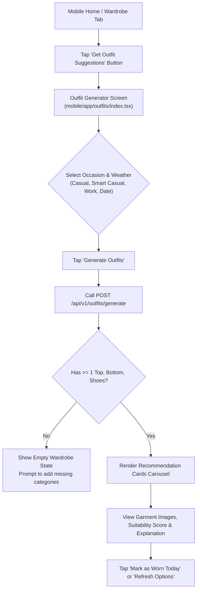

# Groom.ai — Stage 4A: Deterministic Outfit Generation Engine & Technical Design

**Status:** Technical Design Specification (Stage 4A Approved Baseline)  
**Target Version:** Groom.ai Phase 3 / Stage 4B Implementation  
**Module:** `backend/src/main/java/com/groomai/outfit/` & `mobile/src/features/outfits/`  
**Primary Authors:** Senior Software Architect & Recommendation Systems Engineering  

---

## 1. Executive Summary & Core Philosophy

Groom.ai is a **wardrobe-first personal styling application** built on the core promise:
> *"Help users decide what to wear using clothes they already own, explain why an outfit works, and help them make confident wardrobe decisions."*

To deliver on this promise reliably, the Stage 4 recommendation engine is **strictly deterministic, explainable, and testable**. It evaluates candidate combinations using established principles of menswear and styling—color harmony, formality consistency, seasonal suitability, pattern restraint, and repetition prevention—without delegating combinatorial logic to an opaque language model.

### 1.1 Architectural Guiding Principles
1. **Zero Wardrobe Item Hallucination:** Recommendations are constructed exclusively from active garments present in the user's catalog (`wardrobe_items` where `user_id == :currentUserId` and `status == 'ACTIVE'`). The engine never invents, assumes, or suggests unowned items.
2. **Deterministic-First Architecture (Two-Stage Hybrid Engine):**
   - **Stage 1 (Deterministic Backend Engine):** Generates, validates, scores, and ranks candidate outfits from user-owned items in $< 100\text{ ms}$. This engine is completely self-contained and operates entirely offline without external network dependencies.
   - **Stage 2 (Optional Hosted Multimodal AI):** Generates natural-language styling rationale and tucking/layering tips. Crucially, **AI consent is decoupled**: deterministic outfit generation functions fully without AI styling consent; when consent is omitted or revoked, the engine returns deterministic candidates accompanied by structured, rule-based explanations.
3. **Transparent & Inspectable Scoring:** The suitability score ($0\text{--}100$) is computed from distinct, modular sub-scores. Users and engineers can inspect exactly why an outfit scored high or low.
4. **Tenant Isolation & Privacy:** Every database lookup enforces strict user ownership (`user_id == token.sub`). No wardrobe metadata or images are ever transmitted to third-party services during Stage 1 candidate generation.
5. **Architectural Guardrails (ADR-0003 & ADR-0008):** Implemented cleanly within the existing Spring Boot modular monolith (`com.groomai.outfit`) and React Native Expo mobile client. No Redis, Kafka, microservices, or separate Python services.

---

## 2. Existing Codebase Inspection & Verified Metadata Baseline

A thorough inspection of the repository confirms the existing schema and entities:

### 2.1 Verified `WardrobeItem` Entity & Enum Metadata (`V2__wardrobe_schema.sql`)
| Field | Type | Constraints / Defaults | Implementation Verification |
| :--- | :--- | :--- | :--- |
| `id` | `UUID` | Primary Key, `gen_random_uuid()` | Verified in [`WardrobeItem.java`](file:///Users/shailesh/Desktop/Projects/GroomAI/backend/src/main/java/com/groomai/wardrobe/entity/WardrobeItem.java) |
| `user` | `User` | Foreign Key `users(id) ON DELETE CASCADE` | Verified; enforced in queries via `user.id` |
| `name` | `String` | Length $\le 100$, `@NotBlank` | Verified |
| `category` | `Category` | Enum: `TOP`, `BOTTOM`, `FOOTWEAR`, `OUTERWEAR`, `ACCESSORY` | Verified in [`Category.java`](file:///Users/shailesh/Desktop/Projects/GroomAI/backend/src/main/java/com/groomai/wardrobe/enums/Category.java) |
| `subcategory` | `String` | Length $\le 50$, Nullable | Freeform string (e.g. "BUTTON_DOWN", "CHINOS", "BOOTS") |
| `primaryColor` | `Color` | Enum: `WHITE`, `BLACK`, `NAVY`, `GREY`, `BEIGE`, `BROWN`, `BLUE`, `GREEN`, `OLIVE`, `RED`, `BURGUNDY`, `YELLOW`, `MULTI` | Verified in [`Color.java`](file:///Users/shailesh/Desktop/Projects/GroomAI/backend/src/main/java/com/groomai/wardrobe/enums/Color.java) |
| `secondaryColor` | `Color` | Enum, Nullable | Verified |
| `pattern` | `Pattern` | Enum: `SOLID`, `STRIPED`, `CHECKED`, `FLORAL`, `GRAPHIC`, `TEXTURED` (Default: `SOLID`) | Verified in [`Pattern.java`](file:///Users/shailesh/Desktop/Projects/GroomAI/backend/src/main/java/com/groomai/wardrobe/enums/Pattern.java) |
| `formalityLevel` | `FormalityLevel` | Enum: `CASUAL`, `SMART_CASUAL`, `BUSINESS_CASUAL`, `FORMAL` (Default: `CASUAL`) | Verified in [`FormalityLevel.java`](file:///Users/shailesh/Desktop/Projects/GroomAI/backend/src/main/java/com/groomai/wardrobe/enums/FormalityLevel.java) |
| `season` | `Season` | Enum: `SPRING`, `SUMMER`, `FALL`, `WINTER`, `ALL_SEASON` (Default: `ALL_SEASON`) | Verified in [`Season.java`](file:///Users/shailesh/Desktop/Projects/GroomAI/backend/src/main/java/com/groomai/wardrobe/enums/Season.java) |
| `storageKey` | `String` | Length $\le 512$, Unique, Not Null | Verified |
| `status` | `ItemStatus` | Enum: `ACTIVE`, `ARCHIVED` (Default: `ACTIVE`) | Verified in [`ItemStatus.java`](file:///Users/shailesh/Desktop/Projects/GroomAI/backend/src/main/java/com/groomai/wardrobe/enums/ItemStatus.java) |

### 2.2 Verified `StylePreferences` Entity (`V2__wardrobe_schema.sql`)
- `primaryStyle`: `String` (e.g. `CASUAL`, `CLASSIC`, `MINIMALIST`, `STREETWEAR`, default `CASUAL`).
- `preferredFit`: `String` (e.g. `SLIM`, `REGULAR`, `RELAXED`, `OVERSIZED`, default `REGULAR`).
- `colorPreferences`: `List<String>` stored as JSONB array of strings (e.g. `["NAVY", "WHITE", "OLIVE"]`).
- `avoidedColors`: `List<String>` stored as JSONB array of strings (e.g. `["YELLOW", "RED"]`).
- `defaultFormality`: `String` (default `CASUAL`).

### 2.3 Verified Pre-Existing Outfit Schema (`V2__wardrobe_schema.sql`)
The migration script already provisioned three relational tables for outfit storage and wear tracking:
1. `outfits`: `id`, `user_id`, `occasion`, `temperature_bracket`, `weather_condition`, `styling_rationale`, `suitability_score`, `created_at`.
2. `outfit_items`: `id`, `outfit_id`, `wardrobe_item_id` (`ON DELETE SET NULL`), `item_role`.
3. `outfit_wear_logs`: `id`, `user_id`, `outfit_id` (`ON DELETE SET NULL`), `worn_date`, `notes`, `created_at`.

### 2.4 Data Gaps & Architectural Handling
1. **Subcategory is Uncontrolled String:** `subcategory` is an open string rather than a rigid enum. The deterministic engine will **not** depend on `subcategory` for core compatibility; it relies on strongly typed enums (`category`, `formalityLevel`, `pattern`, `season`, `primaryColor`).
2. **No Fabric Weight or Breathability Index:** Seasonality is modeled using the `Season` enum (`SPRING`, `SUMMER`, `FALL`, `WINTER`, `ALL_SEASON`). Contextual weather filtering correlates directly with `Season` and temperature brackets.
3. **No Footwear Sub-classification (e.g. athletic sneaker vs oxford shoe):** Footwear appropriateness is captured reliably through the `formalityLevel` enum (`CASUAL`, `SMART_CASUAL`, `BUSINESS_CASUAL`, `FORMAL`).

---

## 3. MVP Outfit Grammar & Slot Model

### 3.1 Slot Definitions
An MVP outfit is composed of **slots**, each mapped to a top-level `Category`:

| Slot | Category | Required? | Quantity | Description |
| :--- | :--- | :---: | :---: | :--- |
| **Top** | `Category.TOP` | **Yes** | Exactly 1 | Shirts, T-shirts, polos, sweaters, henleys |
| **Bottom** | `Category.BOTTOM` | **Yes** | Exactly 1 | Trousers, chinos, jeans, shorts |
| **Footwear** | `Category.FOOTWEAR`| **Yes** | Exactly 1 | Sneakers, loafers, boots, dress shoes |
| **Outerwear**| `Category.OUTERWEAR`| Optional | 0 or 1 | Jackets, blazers, overcoats, cardigans (context-driven only) |
| **Accessory**| `Category.ACCESSORY`| Optional | 0 or 1 | Watches, belts, hats, scarves (deferred in candidate search for MVP) |

### 3.2 Eligibility & Inclusion Rules
- **Status Filter:** Only garments with `status == ItemStatus.ACTIVE` are eligible. Archived items are strictly excluded.
- **Tenancy Boundary:** Only items belonging to the authenticated user (`user.id == currentUserId`) are queried.
- **Single Slot Assignment:** Each garment occupies exactly one slot corresponding to its `category`.
- **Outerwear Anti-Duplication Rule (Approved Decision #1):**
  - Outerwear is evaluated and attached as a layer **only** when weather context (`COOL`, `COLD`, `RAINY`, `SNOWY`) or occasion formality (e.g. blazer for `BUSINESS_CASUAL` or `FORMAL`) calls for it.
  - Trivial layered and unlayered variants of the same core outfit (e.g., returning "T-shirt + Jeans + Sneakers" AND "T-shirt + Jeans + Sneakers + Denim Jacket") merely to inflate recommendation counts are **strictly prohibited**.
  - When an outerwear piece harmonizes with a core combination and raises or maintains the outfit's suitability, the 4-piece combination **replaces** the 3-piece combination. It is never emitted as an artificial duplicate recommendation.

### 3.3 Handling Missing Categories & Small Wardrobes
- **Precondition Check:** The user's active wardrobe must contain at least **1 Top, 1 Bottom, and 1 Footwear**.
- **Under-Threshold Response:** If an active wardrobe has fewer than 1 item in any required slot:
  - The endpoint rejects the request with **HTTP `422 Unprocessable Entity`**.
  - Returns a structured error payload:
    ```json
    {
      "code": "INSUFFICIENT_WARDROBE_ITEMS",
      "message": "A minimum of one active Top, Bottom, and Footwear is required to generate outfits.",
      "missingCategories": ["BOTTOM", "FOOTWEAR"]
    }
    ```
- **Empty Valid Combinations Response:** If the user has sufficient items ($\ge 1$ Top, Bottom, Footwear) but no candidate meets occasion or constraint filters:
  - The endpoint returns **HTTP `200 OK`** with `"outfits": []` and a helpful warning message (e.g., `"No compatible outfit combinations found matching occasion FORMAL with current wardrobe items."`).
- **Outerwear and Accessories:** Always optional. The absence of outerwear or accessories never prevents outfit generation. Outerwear is evaluated and attached as a layer only when weather or formality demands it.

---

## 4. Deterministic Compatibility Scoring Engine

The engine computes a composite **Suitability Score ($0\text{--}100$)** based on 5 modular positive sub-scores and 1 repetition deduction:

$$\text{Base Score} = S_{\text{color}} (0\text{--}30) + S_{\text{formality}} (0\text{--}25) + S_{\text{season\_weather}} (0\text{--}20) + S_{\text{pattern}} (0\text{--}15) + S_{\text{preference}} (0\text{--}10)$$
$$\text{Deductions} = P_{\text{wear}} (0\text{--}20)$$
$$\text{Suitability Score} = \text{clamp}\Big(0, 100, \; \text{Base Score} - P_{\text{wear}}\Big)$$

> [!IMPORTANT]
> **Arithmetic Breakdown Guarantee:** The maximum positive base score is $30 + 25 + 20 + 15 + 10 = 100$. The suitability score is guaranteed to equal the sum of positive sub-scores minus $P_{\text{wear}}$ (clamped to $[0, 100]$) with zero unexplained offsets or phantom penalties.

```mermaid
flowchart LR
    subgraph Inputs["1. Candidate Outfit Garments & Context"]
        T["Top"]
        B["Bottom"]
        F["Footwear"]
        O["Outerwear (Optional)"]
        Ctx["Occasion & Weather (Optional)"]
        Pref["Style Preferences"]
        Logs["Wear History (Optional)"]
    end

    subgraph HardFilters["2. Hard Rejection Gates"]
        G1["Category Completeness"]
        G2["Formality Delta <= 2"]
        G3["Zero Direct Seasonal Clash"]
        G4["Weather Temperature Viability"]
    end

    subgraph ScoringEngine["3. Modular Scoring Components (0-100 Base)"]
        SC["Color Harmony (0-30)"]
        SF["Formality Alignment (0-25)"]
        SS["Season & Weather Compatibility (0-20)"]
        SP["Pattern Restraint (0-15)"]
        SU["User Preferences (0-10)"]
    end

    subgraph Deductions["4. Penalty Deductions"]
        PW["Wear History Repetition (-20 to 0)"]
    end

    subgraph Output["5. Ranked Recommendations"]
        Score["Normalized Score (0-100)"]
        Expl["Structured Explanation"]
    end

    Inputs --> HardFilters
    HardFilters -- Pass --> ScoringEngine
    HardFilters -- Fail --> Discard["Discard Combination"]
    Inputs --> Deductions
    ScoringEngine --> Score
    Deductions --> Score
    Score --> Expl --> Output
```



---

### Component A: Color Harmony ($S_{\text{color}} \in [0, 30]$)

The color compatibility model is based on timeless menswear color theory and neutral grounding principles.

#### 1. Color Classification
- **Neutral Anchors:** `WHITE`, `BLACK`, `NAVY`, `GREY`, `BEIGE`, `BROWN`, `OLIVE`.  
  *Characteristics:* Neutrals harmonize universally with each other and serve as grounding anchors for all accent colors.
- **Accent Colors:** `BLUE`, `GREEN`, `RED`, `BURGUNDY`, `YELLOW`.  
  *Characteristics:* Vibrant or saturated tones that add personality but risk visual chaos if uncoordinated.
- **Special Complex:** `MULTI`.  
  *Characteristics:* Multi-colored garment; requires purely neutral companion pieces.

#### 2. Color Compatibility Matrix & Scoring Rules
- **Rule A1 — Neutral Anchor Baseline ($28\text{--}30\text{ pts}$):**  
  All pieces in the outfit have neutral primary colors (e.g., White Top + Navy Bottom + Brown Shoes, or Grey Top + Black Bottom + White Shoes).
  - Classic high-contrast pairings (Navy + Beige, White + Navy, Black + Grey): **$30\text{ pts}$**.
  - All other neutral combinations: **$28\text{ pts}$**.
- **Rule A2 — The "Rule of One Accent" ($26\text{--}30\text{ pts}$):**  
  Exactly one accent piece paired with neutral grounding garments (e.g., Burgundy Top + Beige Chinos + Brown Loafers, or Olive Top + Navy Jeans + White Sneakers).
  - Proven classic pairings:
    - `BURGUNDY` + `GREY` or `NAVY`: **$30\text{ pts}$**.
    - `OLIVE` / `GREEN` + `BEIGE` / `BROWN` / `WHITE`: **$29\text{ pts}$**.
    - `BLUE` + `BROWN` / `BEIGE`: **$28\text{ pts}$**.
  - Other single-accent + neutral pairings: **$26\text{ pts}$**.
- **Rule A3 — Tonal / Monochromatic Harmony ($24\text{--}26\text{ pts}$):**  
  Items share the same color family but differ in shade (e.g., Light Blue Top + Navy Bottom, or Grey Top + Charcoal Bottom): **$25\text{ pts}$**.
- **Rule A4 — Soft Color Penalties:**  
  - *Black & Brown Clash:* Pairing `BLACK` trousers with `BROWN` footwear without a bridging color: **$-6\text{ pts}$**.
  - *Two Non-Coordinated Accents:* Two non-neutral accent colors present in the outfit (e.g., Green Top + Yellow Bottom, or Red Top + Blue Bottom): **$-10\text{ pts}$**.
  - *Direct Saturated Clash:* High-contrast non-neutral clashes (e.g. `RED` + `GREEN` [holiday clash], `RED` + `YELLOW` [fast-food clash]): **$-15\text{ pts}$**.
  - *Multiple `MULTI` Items:* More than one garment with `MULTI` primary color: **$-15\text{ pts}$**.

---

### Component B: Formality Alignment ($S_{\text{formality}} \in [0, 25]$)

Formality levels are mapped to numeric ordinals:
$$\text{CASUAL} = 1, \quad \text{SMART\_CASUAL} = 2, \quad \text{BUSINESS\_CASUAL} = 3, \quad \text{FORMAL} = 4$$

#### 1. Internal Formality Delta ($\Delta_F$)
Let $\Delta_F = \max(F_{\text{items}}) - \min(F_{\text{items}})$ across all items in the candidate combination:
- **$\Delta_F = 0$ (Uniform Formality):** Every garment belongs to the exact same formality level: **$25\text{ pts}$**.
- **$\Delta_F = 1$ (Intentional Hi-Lo Styling):** Adjacent formality levels (e.g. Smart Casual button-down with Casual dark jeans, or Casual T-shirt under a Smart Casual blazer): **$20\text{ pts}$**.
- **$\Delta_F = 2$ (Noticeable Friction):** Gap of two tiers (e.g. Casual graphic tee with Business Casual pleated wool trousers): **$8\text{ pts}$**.
- **$\Delta_F \ge 3$ (Severe Mismatch):** Gap of three tiers (e.g. Casual gym shorts with Formal oxford dress shoes, or Formal tuxedo jacket with Casual sweatpants): **HARD REJECTION ($\text{Score} = 0$, candidate discarded immediately)**.

#### 2. Occasion Compatibility Bounds
When an `occasion` context is requested, garments are evaluated against acceptable formality ranges:

| Requested Occasion | Target Formality Level | Permitted Range ($\pm 1$) | Hard Rejection Threshold |
| :--- | :---: | :---: | :--- |
| `CASUAL` | 1 | 1 to 2 | Items with Formality $\ge 3$ (`BUSINESS_CASUAL`, `FORMAL`) |
| `SMART_CASUAL` | 2 | 1 to 3 | Items with Formality 4 (`FORMAL`) |
| `BUSINESS_CASUAL`| 3 | 2 to 3 | Items with Formality 1 (`CASUAL`) or 4 (`FORMAL`) |
| `FORMAL` / `CORPORATE` | 4 | 3 to 4 | Items with Formality $\le 2$ (`CASUAL`, `SMART_CASUAL`) |
| `LOUNGEWEAR` | 1 | 1 | Items with Formality $\ge 2$ |
| `ATHLETIC` | 1 | 1 | Items with Formality $\ge 2$ |

- If all items match the target formality of the occasion: full score (**$25\text{ pts}$**).
- If items deviate by 1 from occasion target: **$18\text{ pts}$**.
- If an item falls outside permitted range: **Hard Rejection**.

---

### Component C: Season & Weather Compatibility ($S_{\text{season\_weather}} \in [0, 20]$)

The season and weather model provides a single, unified score from $0$ to $20$ to prevent double-counting seasonal tags against temperature adjustments.

#### 1. Weather Context Availability Policy (Approved Decision #4 & #5)
- **Zero External Weather Provider Integration:** The MVP does **not** integrate external weather APIs. Weather context is strictly optional and user-supplied via `temperatureBracket` (`HOT`, `WARM`, `MILD`, `COOL`, `COLD`) and `weatherCondition` (`SUNNY`, `RAINY`, `WINDY`, `SNOWY`).
- **Honest Explanations Rule:**
  - If weather context is **omitted**: The system must **never** claim an outfit is "weather-appropriate" or infer external temperatures. It evaluates compatibility strictly on garment seasonal tags and explicitly states:  
    *"Weather context was not supplied; evaluated based on garment seasonality only."*
  - If weather context is **user-supplied**: The system states:  
    *"Based on user-supplied weather: {temperatureBracket} / {weatherCondition}."*

#### 2. Evaluation Rules & Scoring
- **When Weather Context is OMITTED:**
  - **All-Season Harmony:** All garments are `ALL_SEASON` (e.g., twill chinos, cotton Oxford, leather sneakers): **$20\text{ pts}$**.
  - **Adjacent Season Harmony:** Items combine `ALL_SEASON` with adjacent seasons (`SPRING` with `SUMMER` or `FALL`; `FALL` with `WINTER` or `SPRING`): **$18\text{ pts}$**.
  - **Direct Seasonal Collision:** Combining a `WINTER` garment (heavy shearling coat, flannel trousers) with a `SUMMER` garment (linen shorts, canvas espadrilles): **HARD REJECTION ($\text{Score} = 0$, discarded)**.
- **When Weather Context is USER-SUPPLIED:**
  - `HOT`:
    - Garments must be `SUMMER` or `ALL_SEASON`: **$20\text{ pts}$**.
    - If non-lightweight outerwear is attached: **$-6\text{ pts}$** deduction within component (score = $14$).
    - Any `WINTER` garment: **Hard Rejection**.
  - `COLD`:
    - Garments must be `WINTER`, `FALL`, or heavy `ALL_SEASON`: **$20\text{ pts}$** with outerwear.
    - If outerwear is omitted in cold weather: **$-6\text{ pts}$** deduction within component (score = $14$; explanation notes that an outer layer is recommended).
    - Any `SUMMER` garment (e.g. linen shorts): **Hard Rejection**.
  - `COOL`:
    - Garments adapt well to layering. Outerwear layer awarded **$20\text{ pts}$**; unlayered lightweight core: **$16\text{ pts}$**.
  - `WARM` / `MILD`:
    - Standard all-season and transitional balance: **$18\text{--}20\text{ pts}$**.
  - `RAINY` / `SNOWY` condition:
    - Footwear with weather resilience (boots, leather) prioritized over canvas/suede (+2 pts within component cap).

---

### Component D: Pattern Restraint ($S_{\text{pattern}} \in [0, 15]$)

Patterns: `SOLID`, `TEXTURED`, `STRIPED`, `CHECKED`, `FLORAL`, `GRAPHIC`.

- **Rule D1 — Solid Dominance ($15\text{ pts}$):**  
  All pieces are `SOLID` or a mix of `SOLID` and `TEXTURED`. Creates clean, sophisticated visual balance.
- **Rule D2 — The "Rule of One Pattern" ($14\text{ pts}$):**  
  Exactly one focal patterned item (`STRIPED`, `CHECKED`, `FLORAL`, or `GRAPHIC`) anchored entirely by `SOLID` or `TEXTURED` companions.
- **Rule D3 — Subtle Pattern Layering ($10\text{ pts}$):**  
  One `STRIPED` item paired with one `TEXTURED` piece.
- **Rule D4 — Pattern Clash Penalty:**  
  Two or more distinct loud patterns (e.g. `FLORAL` Top + `CHECKED` Bottom, or `GRAPHIC` Top + `STRIPED` Bottom): **$-12\text{ pt deduction}$**.

---

### Component E: User Style Preferences ($S_{\text{preference}} \in [0, 10]$)

When a `StylePreferences` record exists for the authenticated user:
- **Color Affiliation:** Outfit contains at least one of the user's `colorPreferences`: **$+5\text{ pts}$**.
- **Color Avoidance:** Outfit contains an item with a color listed in `avoidedColors`: **$-6\text{ pt deduction}$** (soft penalty, acknowledging wardrobe limitations).
- **Default Formality Alignment:** Outfit matches user's preferred `defaultFormality`: **$+3\text{ pts}$**.
- **Missing Preferences Fallback:** If the user has not completed style preferences, assign a neutral score of **$7\text{ pts}$** with zero penalties.

---

### Component F: Context & Repetition Penalty ($P_{\text{wear}} \in [0, 20]$)

#### 1. Missing Wear History Policy (Approved Decision #3)
- When wear history is unavailable or unpopulated (such as for new users, empty `outfit_wear_logs`, or prior to Phase 4 wear logging implementation):
  - **$P_{\text{wear}} = 0$**.
  - **Never infer or invent wear dates.**
  - The engine functions completely and seamlessly with zero deduction.

#### 2. Repetition Decay Schedule (When Logs Exist)
When `outfit_wear_logs` contains historical wear entries for items in the combination:
- **Worn Today ($0\text{ days ago}$):** **$-20\text{ pts}$** deduction per item.
- **Worn Recently ($1\text{--}3\text{ days ago}$):** **$-12\text{ pts}$** deduction per item.
- **Worn Within the Week ($4\text{--}7\text{ days ago}$):** **$-5\text{ pts}$** deduction per item.
- **Worn $> 7\text{ days ago}$ or Never Worn:** **$0\text{ pts}$** deduction (fresh rotation).
- **Cap:** The maximum total wear deduction across all items in a single outfit candidate is capped at **$-20\text{ pts}$**.

---

## 5. Hard Rejection Gates & Deterministic Tie-Breaking

### 5.1 Hard Rejection Gates (Pre-Scoring Filters)
Combinations that violate any of these gates receive a suitability score of $0$ and are discarded **before** candidate ranking:
1. **Category Incompleteness:** Missing a `TOP`, `BOTTOM`, or `FOOTWEAR`.
2. **Formality Incompatibility:** Maximum internal formality delta $\Delta_F \ge 3$ (e.g. Formal + Casual).
3. **Occasion Out-of-Bounds:** Any garment violates the acceptable formality range for the requested occasion.
4. **Direct Seasonal Collision:** Combining a `WINTER` item with a `SUMMER` item.
5. **Temperature Infeasibility:** Winter items in `HOT` weather or summer shorts in `COLD` weather.
6. **Inactive Status:** Any item with `status != ACTIVE`.
7. **Foreign Key Mismatch:** Any item not owned by the authenticated user.

### 5.2 Deterministic Tie-Breaking Hierarchy
When two candidate combinations have the identical total suitability score, ties are broken deterministically using this exact priority cascade:
1. **Least Recently Worn:** The outfit whose items have the largest sum of days since last worn.
2. **Higher Color Harmony Sub-Score:** Prefer the combination with higher $S_{\text{color}}$.
3. **Lower Formality Delta:** Prefer the combination with lower internal $\Delta_F$.
4. **Lexicographical Garment ID:** Stable fallback comparing item UUIDs (`top.id.compareTo(other.top.id)`, then `bottom.id`, then `footwear.id`).

> [!IMPORTANT]
> The lexicographical UUID fallback ensures that two requests with identical wardrobe state and identical parameters produce the **exact same ranking and output every single time**.

---

## 6. Generation Algorithm & Complexity Analysis

### 6.1 Generation Algorithm Pseudocode

```text
FUNCTION generateOutfits(userId, occasion, temperatureBracket, weatherCondition, limit = 3):
    // Step 1: Pre-condition checks & data fetch
    wardrobe = wardrobeItemRepository.findByUserIdAndStatus(userId, ACTIVE)
    tops = filter(wardrobe, category == TOP)
    bottoms = filter(wardrobe, category == BOTTOM)
    shoes = filter(wardrobe, category == FOOTWEAR)
    outerwear = filter(wardrobe, category == OUTERWEAR)

    IF tops.isEmpty() OR bottoms.isEmpty() OR shoes.isEmpty():
        THROW InsufficientWardrobeItemsException(missingCategories)

    // Step 2: Contextual Pre-Filtering (Prune pools before Cartesian product)
    IF occasion IS NOT NULL:
        tops = filterByOccasionBounds(tops, occasion)
        bottoms = filterByOccasionBounds(bottoms, occasion)
        shoes = filterByOccasionBounds(shoes, occasion)

    IF temperatureBracket IS NOT NULL:
        tops = filterByTemperature(tops, temperatureBracket)
        bottoms = filterByTemperature(bottoms, temperatureBracket)
        shoes = filterByTemperature(shoes, temperatureBracket)

    // Step 3: Candidate Tuple Evaluation with Bounded Min-Heap Priority Queue
    // In Java: PriorityQueue<CandidateOutfit> ordered by ascending score.
    // The head is the MINIMUM element. When size > limit, polling removes the lowest score,
    // retaining the top K highest-scoring candidates in O(K) space.
    boundedQueue = new MinHeapPriorityQueue(
        capacity = limit,
        comparator = Comparator.comparingInt(CandidateOutfit::getSuitabilityScore)
                               .thenComparing(CandidateOutfit::getTieBreakerOrder) // Lowest score at head
    )
    preferences = stylePreferencesRepository.findByUserId(userId)
    recentWearMap = (wearHistoryAvailable) ? fetchRecentWearDays(userId, pastDays = 7) : EMPTY_MAP

    FOR top IN tops:
        FOR bottom IN bottoms:
            // Early exit on Top-Bottom hard clash
            IF hasFormalityClash(top, bottom) OR hasSeasonClash(top, bottom):
                CONTINUE

            FOR shoe IN shoes:
                // Check 3-way hard constraints
                IF hasFormalityClash(top, bottom, shoe) OR hasSeasonClash(top, bottom, shoe):
                    CONTINUE

                // Step 3a: Outerwear Anti-Duplication Rule (Approved Decision #1)
                // Evaluate outerwear ONLY when occasion or cold/cool/rainy weather calls for it
                bestOuter = selectBestOuterwear(outerwear, top, bottom, shoe, temperatureBracket, occasion)
                
                IF bestOuter IS NOT NULL:
                    layered = createCandidate(top, bottom, shoe, bestOuter)
                    unlayered = createCandidate(top, bottom, shoe, NULL)
                    scoreLayered = computeSuitabilityScore(layered, occasion, temperatureBracket, preferences, recentWearMap)
                    scoreUnlayered = computeSuitabilityScore(unlayered, occasion, temperatureBracket, preferences, recentWearMap)
                    
                    // Replace unlayered candidate with layered candidate if it scores higher or equal.
                    // Anti-duplication: NEVER add both layered and unlayered variants to boundedQueue.
                    candidate = (scoreLayered.total >= scoreUnlayered.total) ? layered : unlayered
                    chosenScore = (scoreLayered.total >= scoreUnlayered.total) ? scoreLayered : scoreUnlayered
                ELSE:
                    candidate = createCandidate(top, bottom, shoe, NULL)
                    chosenScore = computeSuitabilityScore(candidate, occasion, temperatureBracket, preferences, recentWearMap)

                candidate.setScore(chosenScore.total)
                candidate.setBreakdown(chosenScore.breakdown)
                candidate.setExplanation(chosenScore.explanation)

                boundedQueue.offer(candidate)
                IF boundedQueue.size() > limit:
                    boundedQueue.poll() // Discard lowest score at head of min-heap

    // Step 4: Extract and sort descending (highest score first)
    rankedOutfits = boundedQueue.toListSortedDescending()
    RETURN rankedOutfits
```

### 6.2 Complexity & Performance Budget
- **Combinatorial Space:** For a typical active wardrobe ($N_T = 25$ tops, $N_B = 12$ bottoms, $N_F = 8$ shoes):
  $$\text{Total Combinations} = 25 \times 12 \times 8 = 2,400\text{ tuples}$$
- **Execution Time:** Evaluating 2,400 simple integer/enum comparisons in Java 21 takes **$< 4\text{ ms}$** on standard server hardware.
- **Large Wardrobe Ceiling ($N = 500$ items):** With $100$ tops, $50$ bottoms, and $30$ shoes ($150,000$ combinations), contextual pre-filtering prunes the pool by $\approx 60\%$, reducing tuples to $< 25,000$, executing in **$< 40\text{ ms}$**, comfortably under the **$100\text{ ms}$ performance budget (NFR-002)**.
- **Space Complexity:** $O(K)$ where $K = \text{limit}$ (typically 3–5) using a bounded priority queue, maintaining a negligible heap footprint.

---

## 7. Structured Explanation Model

To deliver explainability without AI dependencies, the engine generates structured, component-level explanation objects:

```json
{
  "suitabilityScore": 92,
  "breakdown": {
    "colorHarmony": 28,
    "formalityAlignment": 25,
    "seasonWeatherCompatibility": 20,
    "patternRestraint": 14,
    "preferenceMatch": 5,
    "wearPenalty": 0
  },
  "rationale": {
    "headline": "Classic High-Contrast Smart Casual",
    "colorExplanation": "Navy and Beige create a timeless, versatile contrast anchored by rich Brown footwear.",
    "formalityExplanation": "All garments align uniformly at the Smart Casual tier, ideal for your requested occasion.",
    "seasonWeatherExplanation": "All-season cotton Oxford and twill chinos provide optimal breathability. Weather context was not supplied; evaluated based on garment seasonality only.",
    "patternExplanation": "Solid items ensure clean, distraction-free visual balance."
  },
  "warnings": []
}
```

> [!NOTE]
> **Honest Explanations in Action (Approved Decision #5):** Notice that `seasonWeatherExplanation` openly discloses when weather context was omitted, rather than making unverified claims about outdoor temperature appropriateness. If user-supplied weather were present (e.g. `MILD`), the field would state: *"Based on user-supplied weather: MILD / SUNNY. All-season garments provide comfortable breathability."*

---

## 8. Benchmark Evaluation Dataset & Test Scenarios

The following representative scenarios will form the Stage 4B unit and integration test suite:

| Scenario ID | Test Case Description | Expected Result | Target Score |
| :--- | :--- | :--- | :---: |
| **TEST-01** | Classic Smart Casual: Navy Oxford Top + Beige Chino Bottom + Brown Loafers. Occasion: `SMART_CASUAL`. No weather supplied. | **Top Rank, Valid** | $92\text{--}96$ |
| **TEST-02** | Formality Mismatch: Casual graphic T-shirt + Formal Black Oxford dress shoes + Chinos. | **Hard Rejection or Heavy Deduction** | $< 40$ or Rejected |
| **TEST-03** | Severe Formality Clash: Gym athletic shorts (`CASUAL`) + Formal tuxedo jacket (`FORMAL`). | **Hard Rejection** | Discarded ($0$) |
| **TEST-04** | Direct Seasonal Clash: Heavy Winter wool overcoat + Summer linen shorts. | **Hard Rejection** | Discarded ($0$) |
| **TEST-05** | Pattern Clash: Bold Floral Top + Checked Trousers. | **Pattern Penalty Applied** | $\le 65$ |
| **TEST-06** | Neutral Monochromatic: Grey Wool Crewneck + Charcoal Trousers + White Minimalist Sneakers. | **High Compatibility** | $86\text{--}90$ |
| **TEST-07** | Recently Worn Item: High-scoring outfit containing a shirt worn yesterday ($1\text{ day ago}$). | **Deprioritized below fresh alternatives** | Penalty $-12$ |
| **TEST-08** | Small Wardrobe (1 Top, 1 Bottom, 1 Footwear). | **Returns single valid outfit** | Valid ($> 75$) |
| **TEST-09** | Incomplete Wardrobe (0 Footwear). | **Rejection with HTTP 422** | Error code `INSUFFICIENT_WARDROBE_ITEMS` |
| **TEST-10** | Deterministic Tie-Break: Two outfits with identical score $88$. | **Exact same outfit returned as #1 across 1,000 iterations** | Deterministic UUID tie-breaker |
| **TEST-11** | Missing Wear History: Empty wear history database table. | **Returns valid outfits with $P_{\text{wear}} = 0$** | No repetition deduction ($0$) |
| **TEST-12** | Outerwear Layering: Cold weather request with matching blazer vs unlayered core. | **Returns layered outfit; replaces unlayered duplicate** | Single 4-piece outfit returned |

---

## 9. Proposed API Contract (`POST /api/v1/outfits/generate`)

### 9.1 Request Contract
- **Method & Path:** `POST /api/v1/outfits/generate`
- **Headers:** `Authorization: Bearer <jwt_access_token>`, `Content-Type: application/json`
- **Request Payload:**
  ```json
  {
    "occasion": "SMART_CASUAL",
    "temperatureBracket": "MILD",
    "weatherCondition": "SUNNY",
    "limit": 3
  }
  ```
  - `occasion` (Optional): String matching occasion enum (`CASUAL`, `SMART_CASUAL`, `BUSINESS_CASUAL`, `FORMAL`, `DATE_NIGHT`, `LOUNGEWEAR`, `ATHLETIC`).
  - `temperatureBracket` (Optional): `HOT`, `WARM`, `MILD`, `COOL`, `COLD` (User-supplied; no external API integration).
  - `weatherCondition` (Optional): `SUNNY`, `RAINY`, `WINDY`, `SNOWY` (User-supplied).
  - `limit` (Optional, default 3, min 1, max 10): Number of top combinations to return. Enforced with `@Min(1) @Max(10)`.

### 9.2 Success Response (`200 OK`)
```json
{
  "outfits": [
    {
      "id": "e64c4328-0620-405b-97a9-22e84c77cb69",
      "occasion": "SMART_CASUAL",
      "suitabilityScore": 92,
      "aiStylingAvailable": false,
      "stylingRationale": "Navy and Beige create a timeless, versatile contrast anchored by rich Brown footwear. All garments align uniformly at the Smart Casual tier. Weather context was not supplied; evaluated based on garment seasonality only.",
      "scoreBreakdown": {
        "colorHarmony": 28,
        "formalityAlignment": 25,
        "seasonWeatherCompatibility": 20,
        "patternRestraint": 14,
        "preferenceMatch": 5,
        "wearPenalty": 0
      },
      "items": [
        {
          "role": "TOP",
          "id": "11111111-1111-1111-1111-111111111111",
          "name": "Navy Oxford Button-Down",
          "category": "TOP",
          "primaryColor": "NAVY",
          "secondaryColor": null,
          "pattern": "SOLID",
          "formalityLevel": "SMART_CASUAL",
          "season": "ALL_SEASON",
          "downloadUrl": "https://storage.groomai.com/wardrobe/user-1/navy_oxford.jpg?X-Amz-Expires=900..."
        },
        {
          "role": "BOTTOM",
          "id": "22222222-2222-2222-2222-222222222222",
          "name": "Slim Beige Chinos",
          "category": "BOTTOM",
          "primaryColor": "BEIGE",
          "secondaryColor": null,
          "pattern": "SOLID",
          "formalityLevel": "SMART_CASUAL",
          "season": "ALL_SEASON",
          "downloadUrl": "https://storage.groomai.com/wardrobe/user-1/chinos.jpg?X-Amz-Expires=900..."
        },
        {
          "role": "FOOTWEAR",
          "id": "33333333-3333-3333-3333-333333333333",
          "name": "Brown Leather Penny Loafers",
          "category": "FOOTWEAR",
          "primaryColor": "BROWN",
          "secondaryColor": null,
          "pattern": "SOLID",
          "formalityLevel": "SMART_CASUAL",
          "season": "ALL_SEASON",
          "downloadUrl": "https://storage.groomai.com/wardrobe/user-1/loafers.jpg?X-Amz-Expires=900..."
        }
      ]
    }
  ],
  "warnings": []
}
```

> [!NOTE]
> In local development mode (`storage.mode: local`), `downloadUrl` targets `http://localhost:8080/api/v1/storage/files/wardrobe/...` with authentication token support. In cloud staging/production (`storage.mode: s3`), `downloadUrl` returns private AWS S3 pre-signed URLs with a 15-minute expiration TTL.

### 9.3 Alternate & Error Responses
- **Empty Combinations (`200 OK`):** If the wardrobe has $\ge 1$ Top, Bottom, and Footwear, but zero combinations meet the specified occasion or weather constraints:
  ```json
  {
    "outfits": [],
    "warnings": [
      "No compatible outfit combinations found matching occasion FORMAL with current wardrobe items."
    ]
  }
  ```
- **`422 Unprocessable Entity` (`code: INSUFFICIENT_WARDROBE_ITEMS`):** Active wardrobe lacks at least 1 Top, 1 Bottom, or 1 Footwear.
- **`400 Bad Request` (`code: VALIDATION_FAILED`):** Invalid occasion enum, limit $< 1$, or limit $> 10$.
- **`401 Unauthorized`:** Missing or expired JWT access token.

---

## 10. Mobile User Experience Flow



1. **Entry Point:** A prominent floating or tab action: **"Generate Today's Outfit"**.
2. **Context Selection Sheet:** Lightweight horizontal chips:
   - Occasions: `Casual`, `Smart Casual`, `Work / Business`, `Date Night`, `Athletic`.
   - Weather (optional): `Warm / Sunny`, `Mild`, `Cool / Rainy`, `Cold`.
3. **Outfit Result Cards:**
   - Visual outfit collage rendering verified garment images.
   - Suitability Score badge (e.g., `94% Match` with green indicator).
   - "Why this works" explanation accordion.
   - Action: "Mark as Worn Today" (prepares for Phase 4 wear logging).

---

## 11. Stage 4B Implementation Plan & Acceptance Criteria Matrix

### 11.1 Stage 4B Acceptance Criteria Matrix

| Criterion ID | Requirement / Rule | Verification Method | Pass Target |
| :--- | :--- | :--- | :--- |
| **AC-4B-01** | Zero Unowned Item Hallucination | Unit & Integration Test | Every recommended item ID belongs to authenticated user's active wardrobe (`wardrobe_items.status == 'ACTIVE'`). Zero synthesized IDs. |
| **AC-4B-02** | Core Category Completeness | Unit Test | All outfits contain exactly 1 Top, 1 Bottom, and 1 Footwear. |
| **AC-4B-03** | Missing Categories Handling | API Integration Test | If user has $< 1$ Top, Bottom, or Footwear, returns HTTP `422 Unprocessable Entity` with `INSUFFICIENT_WARDROBE_ITEMS` and `missingCategories`. |
| **AC-4B-04** | Empty Combination Handling | API Integration Test | If user has sufficient items but 0 combinations pass filters, returns HTTP `200 OK` with `"outfits": []` and `"warnings"`. |
| **AC-4B-05** | Outerwear Anti-Duplication | Unit Test | Outerwear attached only when weather or occasion calls for it. Trivial layered/unlayered duplicates of the same core outfit are never emitted. Layered replaces unlayered if score is $\ge$. |
| **AC-4B-06** | Result Limit Flexibility | Unit & API Test | Supports `limit` parameter from $1$ to $10$ (default $3$). Values $< 1$ or $> 10$ rejected with HTTP `400 Bad Request`. |
| **AC-4B-07** | Missing Wear History Graceful Fallback | Unit Test | If `outfit_wear_logs` is empty or wear tracking is unpopulated, $P_{\text{wear}} = 0$. Never invent wear dates. |
| **AC-4B-08** | Honest Explanations | Unit Test | When weather context is omitted, rationale states weather context was not supplied. Distinguishes known facts vs heuristic rules. |
| **AC-4B-09** | Exact Score Breakdown Sum | Unit Test | `suitabilityScore` strictly equals sum of positive sub-scores minus $P_{\text{wear}}$ (clamped to $[0, 100]$). No phantom offsets. |
| **AC-4B-10** | Execution Latency Budget | Performance Test | Complete candidate generation executes in $< 10\text{ ms}$ for standard wardrobes ($50$ items) and $< 100\text{ ms}$ for $500$ items (NFR-002). |
| **AC-4B-11** | Tenancy Isolation & Security | Integration Test | User A cannot receive or reference items owned by User B. |
| **AC-4B-12** | Deterministic Reproducibility | Unit Test | 1,000 runs on identical wardrobe and parameters yield identical outfit ranking and item order via tie-breaking cascade. |

### 11.2 Modular Deliverables

1. **Task 4B.1 — Core Outfit Domain Models (`com.groomai.outfit`):**
   - Create package `com.groomai.outfit`.
   - Implement `Occasion` and `WeatherCondition` enums.
   - Implement DTOs: `OutfitRecommendationRequestDto`, `OutfitRecommendationResponseDto`, `OutfitItemResponseDto`, `ScoreBreakdownDto`.
2. **Task 4B.2 — Deterministic Compatibility Scorers:**
   - `ColorCompatibilityScorer`: Neutral anchors, complementary pairings, clash deductions.
   - `FormalityCompatibilityScorer`: Internal delta check ($\Delta_F$), occasion bounds check.
   - `SeasonWeatherCompatibilityScorer`: Unified season harmony and user-supplied weather modulation.
   - `PatternCompatibilityScorer`: Solid anchor rules, pattern clash deductions.
   - `WearHistoryPenaltyScorer`: Decay penalty querying `outfit_wear_logs` with zero penalty fallback.
3. **Task 4B.3 — Combinatorial Generator Service:**
   - Implement `OutfitGeneratorService` & `OutfitGeneratorServiceImpl`.
   - Pre-filtering and tuple generation algorithm with bounded min-heap priority queue ($O(K)$ space).
   - Context-driven outerwear evaluation with anti-duplication logic.
   - Deterministic tie-breaking cascade.
4. **Task 4B.4 — Controller & Contract Integration:**
   - Implement `OutfitController` with `POST /api/v1/outfits/generate`.
   - Bean validation (`@Min(1) @Max(10)`).
   - Global exception handling for `InsufficientWardrobeItemsException` returning HTTP 422.
5. **Task 4B.5 — Comprehensive Test Suite:**
   - Unit tests covering all 12 benchmark test scenarios.
   - Performance benchmark verifying $< 100\text{ ms}$ execution for 500-item wardrobes.
   - Tenancy isolation and IDOR integration tests.
6. **Task 4B.6 — Mobile Outfit Recommendation Screen:**
   - Implement `mobile/app/outfits/index.tsx` with occasion selector, swipeable outfit cards, and score breakdowns.
