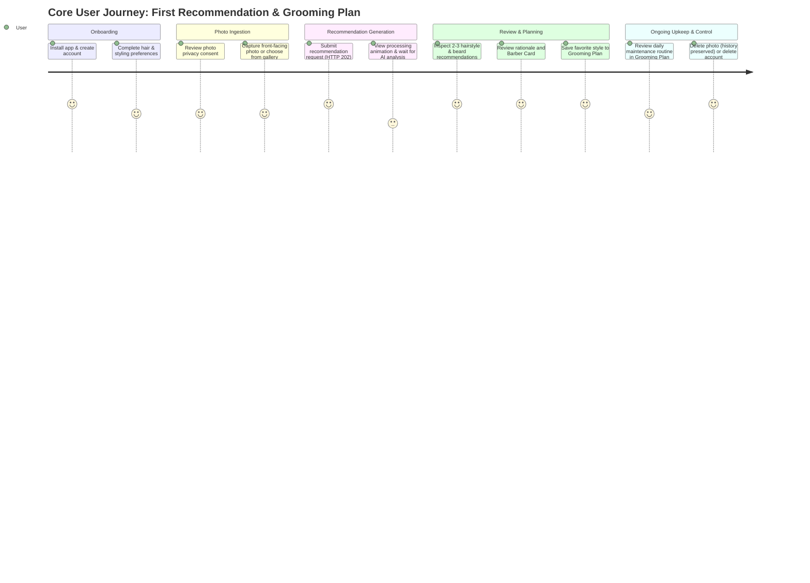
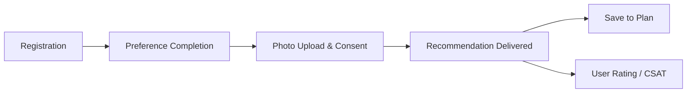

# Groom.ai — Product Requirements Document (PRD)

**Document Version:** 1.1.0  
**Status:** Draft — Proposed Baseline (Pending Stakeholder Approval)  
**Author:** Product & Architecture Working Group  
**Last Updated:** October 2026  

---

## 1. Executive Summary & Product Vision

### 1.1 Executive Summary
**Groom.ai** is an AI-powered personal grooming assistant delivered as a cross-platform mobile application (iOS and Android). The product helps individuals make confident, personalized grooming decisions by analyzing facial characteristics and user-declared lifestyle preferences to provide practical hairstyle and beard recommendations, accompanied by clear rationale and actionable maintenance routines.

### 1.2 Product Vision
Personal grooming directly influences self-confidence and professional presence, yet most individuals navigate grooming choices through guesswork, generic internet searches, or inconsistent advice from barbers. Groom.ai aims to democratize personalized grooming consultation, transforming a high-friction, uncertain task into an accessible, structured, and private digital experience.

---

## 2. Problem Statement & Target Audience

### 2.1 Problem Statement
1. **Uncertainty in Selection:** Most individuals do not know which hairstyles or beard shapes complement their facial structure, hair texture, density, or professional lifestyle.
2. **Communication Gap with Barbers:** Users struggle to describe desired cuts to barbers or stylists, often leaving salons dissatisfied.
3. **Lack of Ongoing Maintenance Guidance:** Choosing a style is only the first step; users rarely receive practical, daily routines for styling products, trim cadences, and upkeep tools tailored to their specific hair and beard types.
4. **Privacy Hesitancy:** Users are sensitive about sharing facial imagery with digital platforms, requiring explicit transparency regarding how photos are processed, stored, and deleted.

### 2.2 Target Audience (Provisional Hypothesis)
- **Primary Segment Hypothesis:** Men aged 18–35, initially focused on urban Indian users.
  - *Status:* **Hypothesis to Validate** (not an established market fact).
  - *Context:* High mobile penetration, rapid adoption of digital personal care services, and diverse variations in hair texture, facial hair growth patterns, and styling habits.
  - *Validation Metric:* Sign-up completion rate and recommendation completion among target cohort during initial beta testing.
- **Secondary / Future Segments:** Broad global demographics and women's styling consultations (deferred to post-MVP).

---

## 3. User Needs & Jobs to Be Done (JTBD)

### 3.1 Jobs to Be Done Framework
- **Core Functional Job:**  
  *When* I want to refresh my haircut or trim my beard,  
  *I want to* receive personalized style recommendations with concrete barber instructions and maintenance steps based on my face and preferences,  
  *So that* I look well-groomed without wasting time or risking a bad haircut.
- **Emotional Job:**  
  *I want to feel* confident and assured in my appearance without feeling judged or self-conscious about my features.
- **Privacy Job:**  
  *I want to know* that my facial photos are strictly used for grooming analysis, stored privately, and can be permanently deleted whenever I choose.

### 3.2 Target User Personas (Illustrative Archetypes)

#### Persona A: "The Style Explorer" (e.g., College Student / Early Professional, Age 22)
- **Profile:** Wants a modern, stylish look for interviews and social life; open to experimentation.
- **Pain Point:** Has had inconsistent haircuts; doesn't know how to specify fades, lengths, or beard lines.
- **Goal:** Get 2–3 modern recommendations that suit his face shape, with reference details he can show his barber.

#### Persona B: "The Low-Maintenance Professional" (e.g., Software Engineer, Age 29)
- **Profile:** Values efficiency; spends minimal time styling hair in the morning.
- **Pain Point:** Frustrated by high-maintenance haircuts that look messy without extensive blow-drying or pomade.
- **Goal:** Needs practical, low-effort cuts and a simple beard trim schedule that looks clean with 5 minutes of daily effort.

---

## 4. Value Proposition & Differentiation Hypotheses

### 4.1 Value Proposition
Groom.ai provides an objective, private, and contextual grooming advisor in your pocket. Unlike static style galleries, Groom.ai matches recommendations to user-declared constraints (styling effort, workplace environment, hair texture) combined with computer-assisted visual assessment.

### 4.2 Differentiation Hypotheses
| Area | Traditional Alternatives | Groom.ai Hypothesis | Validation Approach |
| :--- | :--- | :--- | :--- |
| **Consultation** | Generic Google/Pinterest image search; variable barber advice | Structured, explainable AI recommendation based on photo + personal preferences | Track user rating on recommendation suitability (CSAT) |
| **Barber Handoff** | Showing random celebrity photos that don't match hair type | Providing structured "Barber Notes" (clipper guard numbers, taper style, scissor work) | Measure percentage of users who save or share the barber card |
| **Maintenance** | Uninformed trial-and-error with commercial hair products | Personalized daily/weekly grooming checklist with tool and product categories | Measure 7-day retention on Grooming Plan views |
| **Data Privacy** | Opaque data collection by social filters | Ephemeral or user-controlled storage with one-click data purge and outbox retry | Monitor privacy consent opt-in rates and deletion requests |

---

## 5. Scope Definition: MVP vs. Post-MVP

To guarantee rapid validation, technical excellence, and reliable execution, the MVP scope is strictly bounded.

### 5.1 MVP Scope (Included)
1. **User Onboarding & Profile:**
   - Account registration, authenticated sessions with rotating refresh tokens, and logout.
   - User profile setup: age bracket, hair type (straight, wavy, curly, coily), hair density/thickness, facial hair pattern (full, patchy, stubble, clean-shaven preference).
   - Practical preferences: daily styling time commitment, workplace dress code/formality.
2. **Camera & Gallery Photo Ingestion:**
   - On-device camera capture with framing guide (front-facing, well-lit).
   - Gallery selection fallback.
   - Explicit consent modal explaining data handling prior to photo upload.
3. **AI-Assisted Style Recommendations:**
   - Multi-modal recommendation engine evaluating the photo alongside declared preferences.
   - 2 to 3 curated hairstyle options and 1 to 2 beard style options per analysis.
   - Explicit rationale (why this style suits the user's features and hair texture).
   - Confidence caveat: acknowledges AI advisory nature; avoids pseudoscientific certainty.
4. **Actionable Maintenance & Barber Guidance:**
   - Structured styling instructions for the user (recommended daily products, blow-drying/brushing advice).
   - Practical "Barber Card" (key terminology, guard lengths, taper instructions).
5. **Saved Recommendations & Personalized Grooming Plan:**
   - Ability to bookmark preferred styles.
   - Simple personalized Grooming Plan containing saved styles, daily maintenance checklist, and trim reminder schedule.
6. **User Profile Management & Complete Data Deletion:**
   - View/update profile attributes and preferences.
   - One-click account and data deletion (purging database profile, photo records, and private object storage assets via transactional outbox).

### 5.2 Explicitly Excluded Features (Post-MVP Roadmap)
The following capabilities are out of scope for the initial MVP:
- **Virtual Hairstyle Try-On / Generative Face Warping:** Generative diffusion models for synthetic hair rendering introduce high latency, heavy compute cost, and uncanny-valley distortion.
- **Skincare Diagnostics / Acne Detection:** Groom.ai is strictly a grooming styling tool, not a medical or dermatological diagnostic application.
- **Outfit / Fashion Recommendations:** Avoid premature scope creep beyond hair and beard grooming.
- **Product Marketplace / Direct E-Commerce / Affiliate Links:** Monetization and e-commerce integrations will be evaluated only after core recommendation utility is validated.
- **Push Notifications & Automated Background Reminders:** Complex background task scheduling on mobile is deferred to post-MVP.
- **Paid Subscriptions / Paywalls:** MVP will be free to invited beta cohorts to measure engagement and quality without paywall friction.

---

## 6. Core User Journeys



---

## 7. Functional Requirements (FR)

| Requirement ID | Module | Title | Description | Priority |
| :--- | :--- | :--- | :--- | :--- |
| **FR-001** | Auth | User Registration | System shall allow new users to register via email and secure password. | P0 |
| **FR-002** | Auth | User Login & Session | System shall authenticate users and issue secure short-lived tokens with refresh support. | P0 |
| **FR-003** | Auth | User Logout & Token Revocation | System shall allow authenticated users to terminate their session, revoking the active refresh token. | P0 |
| **FR-004** | Auth | Password Reset Workflow | System shall allow users to request a password reset link sent to their registered email address. | P1 |
| **FR-005** | Profile | Profile Management | System shall store and retrieve user profile attributes (display name, age group). | P0 |
| **FR-006** | Preferences | Grooming Preferences Questionnaire | System shall record hair type, hair density, beard growth pattern, daily styling commitment, and workplace setting. | P0 |
| **FR-007** | Photo | Explicit Photo Privacy Consent | System shall present a mandatory consent disclosure before first photo capture/upload, recording consent timestamp. | P0 |
| **FR-008** | Photo | In-App Camera Capture | Mobile client shall enable in-app photo capture using device camera with an alignment overlay. | P0 |
| **FR-009** | Photo | Photo Gallery Selection | Mobile client shall allow selecting an existing portrait from device photo gallery. | P0 |
| **FR-010** | Photo | Client-Side Pre-validation & Normalization | Mobile client shall validate image file size (max 10MB) and format. HEIC images must be transcoded to JPEG on-device before upload. Backend rejects `image/heic` with `UNSUPPORTED_IMAGE_FORMAT` (server-side HEIC transcoding is a pending implementation choice, not available for MVP). | P0 |
| **FR-011** | Photo | Pre-Signed Upload URL Generation | Backend shall generate short-lived, pre-signed upload URLs for private object storage, verifying asset ownership upon upload confirmation. | P0 |
| **FR-012** | Photo | Upload Confirmation & Activation | Backend shall verify uploaded image MIME type, magic bytes, dimensions, and size before activating photo asset. | P0 |
| **FR-013** | Photo | Photo Asset Deletion | Users shall be able to delete any uploaded photo; backend purges storage asset while historical recommendation text is preserved with photo reference set to null. | P0 |
| **FR-014** | AI Analysis | Asynchronous Recommendation Job Creation | Backend shall accept recommendation job requests (HTTP 202 Accepted) combining user photo and profile preferences into a structured JSON schema. | P0 |
| **FR-015** | AI Analysis | Job Status & Polling Retrieval | System shall allow mobile client to poll status of active jobs until completed or failed. | P0 |
| **FR-016** | AI Analysis | Multimodal Prompt Orchestration & AI Invocation | Backend shall orchestrate multi-modal AI prompt evaluation combining user photo and profile preferences. | P0 |
| **FR-017** | AI Analysis | Server-Side AI Output Validation | Backend shall strictly validate AI provider JSON response against schema; retry or gracefully fail on malformed outputs. | P0 |
| **FR-018** | AI Analysis | Structured Hairstyle & Beard Recommendations | System shall return 2–3 distinct hairstyle recommendations and 1–2 beard recommendations per analysis job. | P0 |
| **FR-019** | AI Analysis | Barber Instructions Card | Each recommendation must provide structured barber instructions (clipper lengths, taper types, scissor instructions). | P0 |
| **FR-020** | AI Analysis | Maintenance & Product Advice | Each recommendation must provide daily styling instructions, recommended generic product categories, and trim interval. | P0 |
| **FR-021** | History | Recommendation History Listing | Users shall be able to view their previous recommendation jobs and generated reports. | P0 |
| **FR-022** | Plan | Bookmark / Save Recommendation Option | Users shall be able to save/bookmark any generated recommendation option. | P0 |
| **FR-023** | Plan | Active Grooming Plan View | System shall display an active Grooming Plan featuring saved styles and maintenance checklist. | P0 |
| **FR-024** | Plan | Interactive Maintenance Checklist | Users shall be able to check off or toggle routine maintenance items in their active plan. | P1 |
| **FR-025** | Privacy | Complete Account Deletion | Users shall be able to trigger permanent account deletion: synchronous database cascade (HTTP 204) with asynchronous verified cloud object eradication via outbox retry. | P0 |
| **FR-026** | Privacy | User Data Export | Users shall be able to download/view a structured JSON archive of their profile and recommendations. | P1 |
| **FR-027** | System | Health & Diagnostic Ping | Backend shall expose a public health check endpoint reflecting service and database health. | P0 |

---

## 8. User Stories & Acceptance Criteria

### US-001: User Registration and Onboarding
- **As a** new user,  
- **I want to** create an account and specify my hair texture, beard growth, and styling preferences,  
- **So that** Groom.ai can tailor recommendations to my personal grooming reality.
- **Acceptance Criteria (Gherkin):**
  ```gherkin
  Scenario: Successful onboarding flow
    Given I am an unauthenticated user on the mobile app
    When I submit a valid email, strong password, and display name
    Then my account is created and an authenticated session is established
    And I am directed to the Grooming Preferences questionnaire
    When I select hair type "wavy", hair density "medium", beard pattern "stubble", and styling effort "5-10 mins"
    Then my preferences are persisted in my profile
    And I navigate to the home dashboard ready for photo analysis
  ```

### US-002: Photo Upload with Explicit Consent
- **As a** privacy-conscious user,  
- **I want to** understand how my photo will be used and choose whether to take a new photo or select from my gallery,  
- **So that** I feel safe and remain in control of my personal biometric data.
- **Acceptance Criteria (Gherkin):**
  ```gherkin
  Scenario: First-time photo consent prompt
    Given I have not previously granted photo processing consent
    When I tap "Analyze My Face"
    Then a modal appears detailing private storage, AI analysis purpose, and deletion rights
    When I decline consent
    Then photo capture does not launch and I return to dashboard
    When I accept consent
    Then my consent timestamp is recorded on the backend
    And I am offered choices: "Take Photo" or "Choose from Gallery"
  ```

### US-003: AI Recommendation Job Execution & Retrieval
- **As a** user who uploaded a photo,  
- **I want to** receive structured hairstyle and beard recommendations with clear rationale,  
- **So that** I know exactly what styles suit my face and why.
- **Acceptance Criteria (Gherkin):**
  ```gherkin
  Scenario: Asynchronous recommendation generation
    Given I have confirmed an uploaded portrait photo
    When I initiate a recommendation job
    Then a job record with status "PENDING" is created and HTTP 202 Accepted is returned
    And the mobile app displays an engaging progress indicator
    When the backend finishes AI processing within the provisional 15-second target window
    Then the job status transitions to "COMPLETED"
    And the app displays 2-3 hairstyle recommendations and 1-2 beard recommendations
    And each recommendation displays: style name, rationale, barber card, and maintenance routine
    When upstream AI processing exceeds 30 seconds
    Then the backend transitions the job to "FAILED" with error code AI_INFERENCE_TIMEOUT
    And the user is prompted to retry without quota deduction
  ```

### US-004: Barber Card & Maintenance Routine
- **As a** user at the barbershop,  
- **I want to** display a concise "Barber Card" with exact technical cut instructions,  
- **So that** the barber executes the cut accurately without miscommunication.
- **Acceptance Criteria (Gherkin):**
  ```gherkin
  Scenario: Viewing and referencing the Barber Card
    Given I am viewing an accepted recommendation
    When I tap "Barber Instructions"
    Then I see a high-contrast card showing clipper guard numbers, scissor texturing notes, and neckline style
    And I can bookmark this recommendation to my Grooming Plan
  ```

### US-005: Account & Data Deletion
- **As a** user who wishes to leave the service,  
- **I want to** permanently delete my account and all associated photos,  
- **So that** no residual personal information remains on Groom.ai servers.
- **Acceptance Criteria (Gherkin):**
  ```gherkin
  Scenario: Complete account deletion
    Given I am an authenticated user with uploaded photos and past recommendations
    When I navigate to Profile Settings and confirm "Delete Account and All Data"
    Then within a single atomic database transaction:
      the backend cancels any in-flight recommendation jobs
      and enqueues cloud storage keys into storage_deletion_outbox without retaining user PII
      and deletes the users row cascading across all 11 dependent tables
    And on transaction commit returns HTTP 204 No Content (provisional target: < 500ms until measured)
    And invalidates my active access tokens immediately (HTTP 401 on subsequent requests)
    And dispatches cloud storage deletion asynchronously after commit (Attempt 1)
    And if an attempt fails, the durable outbox retries up to four additional times on a schedule whose delays total 24 hours, with operator alerting after five failed attempts
    And unverified deletion tasks remain in the outbox until confirmed — they are never purged automatically
    And I am redirected to the login screen
  ```

---

## 9. Non-Functional Requirements (NFR)

| ID | Category | Requirement | Validation Method / Provisional Target |
| :--- | :--- | :--- | :--- |
| **NFR-001** | Performance | **API Latency:** Non-AI standard REST endpoints must respond within 300ms at the 95th percentile under normal load. | *Provisional Target:* Validate via automated integration benchmarks. |
| **NFR-002** | Performance | **AI Recommendation Latency (Provisional):** Async recommendation jobs target completion within **≤ 15 seconds** at the 90th percentile under normal provider conditions. **Measurement Boundary:** Measured strictly from backend job record insertion (`created_at`) to completion persistence (`completed_at`). Dominant factor is upstream provider latency. Handled with explicit 30s backend socket read timeout (marks job `FAILED` with `AI_INFERENCE_TIMEOUT`, no quota deduction) and 30s mobile client polling timeout with retry prompt. | *Provisional Target:* Monitored via backend job metrics; client timeout at 30s. |
| **NFR-003** | Security | **Transport Security:** All communication between mobile and backend, and backend and AI/Storage, must use TLS 1.3 (or 1.2+ minimum). | Automated SSL/TLS configuration checks. |
| **NFR-004** | Security | **Authorization Enforcement:** Server-side authorization must enforce strict object ownership checks on every user asset, photo, and job ID. | Insecure Direct Object Reference (IDOR) integration tests. |
| **NFR-005** | Security | **Secret Management:** Zero hardcoded API keys or credentials in client bundles or git repositories. Backend keys injected via environment configuration. | Pre-commit git secret scanners and CI linting. |
| **NFR-006** | Privacy | **Object Storage Privacy:** User photos stored in non-public object storage buckets. Accessible only via ephemeral pre-signed URLs (max 15-minute validity). | Bucket permission automated audit. |
| **NFR-007** | Privacy | **No PII in Logs:** Logs must never record raw user facial photos, presigned tokens, passwords, or PII. | Structured JSON logger sanitization rules. |
| **NFR-008** | Reliability | **Graceful Degradation:** If upstream AI provider encounters rate limits or downtime, system returns explicit retryable error messages without crashing. | Chaos / mock fault injection unit tests. |
| **NFR-009** | Reliability | **Database Consistency:** Database schema governed exclusively by versioned Flyway migrations; zero untracked DDL scripts. | Automated CI migration validation against fresh database container. |
| **NFR-010** | Mobile UX | **Offline / Network Resilience:** Mobile client displays clean offline banners and retry buttons on network dropouts. | Network cutoff manual & automated UI testing. |
| **NFR-011** | Mobile UX | **Accessibility:** Core UI elements must adhere to WCAG 2.1 AA contrast ratios and support screen readers (TalkBack / VoiceOver). | Expo accessibility audits. |
| **NFR-012** | Scalability | **Stateless Backend:** Spring Boot backend must remain stateless; session state maintained via signed JWT tokens with hybrid invalidation checks. | Multi-instance deployment sanity test. |

---

## 10. Product Success Metrics



1. **Activation Rate:**  
   - *Definition:* Percentage of newly registered users who complete preferences and submit their first photo.  
   - *Target Benchmark:* > 60% completion during initial beta.
2. **Recommendation Completion Rate:**  
   - *Definition:* Percentage of initiated recommendation jobs that successfully produce structured outputs without timeout or error.  
   - *Target Benchmark:* > 95% technical completion rate.
3. **Recommendation Utility (CSAT / Actionability):**  
   - *Definition:* In-app 1-to-5 star rating and quick feedback ("Did this style help you?") displayed after viewing recommendations.  
   - *Target Benchmark:* Average rating ≥ 4.0 / 5.0.
4. **Plan Engagement:**  
   - *Definition:* Percentage of users who save at least 1 recommended style to their Grooming Plan.  
   - *Target Benchmark:* > 40% of users who receive a recommendation.
5. **Data Deletion Reliability:**  
   - *Definition:* Account deletion commits relational erasure atomically and returns HTTP 204; cloud-object deletion is tracked by a durable outbox until success is verified or an operator resolves an alerted failure. The system measures the percentage of deletion tasks with verified outcomes and the age/count of unresolved tasks; it does not assume every cloud deletion succeeds automatically.

---

## 11. Assumptions, Risks & Mitigations

| Category | Description | Impact | Proposed Mitigation |
| :--- | :--- | :--- | :--- |
| **Risk** | Upstream AI Provider Latency / Outages | High | Asynchronous job model with client polling; clear loading states; bounded retries with exponential backoff. |
| **Risk** | AI Hallucination / Unrealistic Advice | Medium | Strict JSON schema enforcement via backend validation; prompt engineering discouraging unfeasible hairstyles for detected hair types. |
| **Risk** | Photo Privacy Sensitivity | High | Explicit consent screen before capture; private storage; short-lived pre-signed URLs; one-click account deletion with a durable outbox, retries, and operator alerting for unresolved storage deletion. |
| **Assumption** | Mobile camera capture provides adequate lighting and resolution for AI feature analysis. | Medium | Provide on-screen camera guide (oval face guide, lighting advice) to encourage clear front-facing portraits. |
| **Assumption** | Users will find text + diagrammatic barber instructions valuable even without generative image try-on. | High | Test via MVP feedback: measure if users actually show the "Barber Card" to stylists. |

---

## 12. Proposed Post-MVP Roadmap (Future Evolution)

- **Phase 2 (Post-MVP):**
  - Push notification reminders for scheduled haircut and beard maintenance intervals.
  - Skincare basic routine advisor (cleanser, moisturizer, SPF based on skin type questionnaire).
  - Social sharing card ("My Grooming Blueprint") with privacy-safe redactions.
- **Phase 3:**
  - Virtual 2D/3D Hairstyle Try-On evaluation (once generative models reach acceptable cost, latency, and photo-realistic quality).
  - Curated product discovery and partner affiliate links for recommended styling clays, pomades, and trimmers.
  - Barber discovery directory and direct appointment booking integrations.

---

## 13. Status Matrix: Facts, Hypotheses & Open Decisions

| Topic | Category | Current Status | Notes |
| :--- | :--- | :--- | :--- |
| **Target Audience** | Hypothesis | Provisional: Men (18-35), India-first | Requires validation during first beta cohort. |
| **Tech Stack (Mobile & Backend)** | Approved Fact | Accepted Baseline | React Native (Expo) + Spring Boot (Java 21) + PostgreSQL. |
| **Recommendation Flow** | Architectural Decision | Accepted Baseline | Asynchronous job creation (HTTP 202) + polling (prevents mobile HTTP timeout). |
| **AI Provider Selection** | Open Decision | Proposed — Pending Founder Evaluation | Evaluating OpenAI GPT-4o vs Google Gemini 1.5 Pro/Flash vs Anthropic Claude 3.5 Sonnet on cost, latency, privacy policies, and image understanding. Model names, costs, and terms require current verification. |
| **Auth Provider Mechanism** | Open Decision | Proposed — Recommended Baseline | Self-hosted Spring Security JWT recommended for MVP; pending founder decision on whether social logins are mandatory for beta. |
| **Object Storage Provider** | Open Decision | Proposed — Pending Infrastructure Selection | AWS S3, Cloudflare R2, or Google Cloud Storage via S3-compatible client SDK. |
