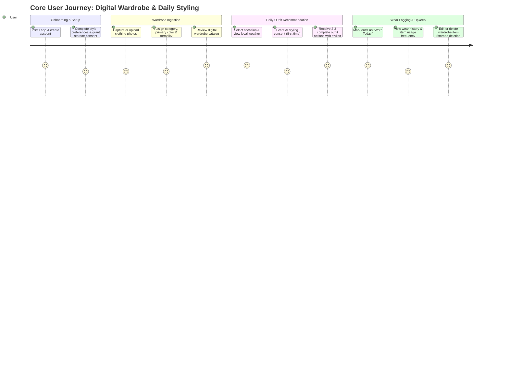

# Groom.ai — Product Requirements Document (PRD)

**Document Version:** 2.0.0  
**Status:** Approved Product Baseline (Pivot to Wardrobe-First Personal Stylist)  
**Author:** Product & Architecture Working Group  
**Last Updated:** October 2026  

---

## 1. Executive Summary & Product Vision

### 1.1 Executive Summary
**Groom.ai** is an AI-powered personal stylist delivered as a cross-platform mobile application (iOS and Android). The product helps individuals make confident, well-styled outfit decisions using clothes they already own. By combining digital wardrobe cataloging, deterministic outfit grammar rules, local weather and occasion context, and multimodal AI styling explanations, Groom.ai transforms the daily friction of "what should I wear?" into a fast, effortless, and personalized routine.

### 1.2 Product Vision
Most people own plenty of clothes but experience daily hesitation, decision fatigue, and repetitive dressing habits because they lack an objective, intuitive way to combine their existing garments. Traditional fashion apps focus almost entirely on selling new clothes, and generic style inspiration boards (e.g., Pinterest) show outfits made of pieces the user does not own. 

Groom.ai takes a **wardrobe-first approach**: empowering users to look their best with their existing clothes, reducing unnecessary purchases, and suggesting outfits tailored to the day's weather, dress code, and wear history. In the long term, Groom.ai will evolve into a comprehensive personal appearance assistant, adding hairstyle, beard, and grooming consultations once the core wardrobe experience is established.

---

## 2. Problem Statement & Target Audience

### 2.1 Problem Statement
1. **The "Full Closet, Nothing to Wear" Paradox:** Users struggle to visualize viable combinations from their existing clothes, leading to decision fatigue each morning.
2. **Context Misalignment (Weather & Occasion):** People frequently pick outfits that are inappropriate for the day's temperature, rain, or workplace/social dress code.
3. **Repetitive Outfit Habits:** Without tracking what they wore recently, users default to the same 2–3 "safe" combinations, leaving the rest of their wardrobe unworn.
4. **Uncertainty in Wardrobe Additions:** When shopping, users do not know which single item would unlock the most new combinations with items they already own.
5. **AI Hallucination & Privacy Hesitancy:** Users reject styling tools that recommend clothes they don't own or that compromise the privacy of personal clothing imagery.

### 2.2 Target Audience
- **Primary Segment:** Working professionals, university students, and style-conscious individuals (ages 20–40) who want to look sharp and intentional with minimal daily effort.
- **Key Characteristics:** Own a moderate-to-large wardrobe (20–100+ items); experience daily morning routine friction; value practical, explainable advice over high-fashion avant-garde trends.
- **Secondary / Future Segments:** Capsule wardrobe enthusiasts, travelers planning trip packings, and users seeking unified grooming (hair, beard, clothes) consultations.

---

## 3. User Needs & Jobs to Be Done (JTBD)

### 3.1 Jobs to Be Done Framework
- **Core Functional Job:**  
  *When* I need to dress for the day or a specific event,  
  *I want to* receive complete outfit recommendations built exclusively from clothes I already own that suit the weather and dress code,  
  *So that* I look well-put-together without wasting time, stressing, or defaulting to the same outfit repeatedly.
- **Emotional Job:**  
  *I want to feel* confident, organized, and effortlessly stylish in my day-to-day life without feeling pressured to purchase more fast fashion.
- **Privacy & Trust Job:**  
  *I want to know* that my clothing photos are stored privately, that AI recommendations never hallucinate items I do not own, and that I can purge my data whenever I choose.

### 3.2 Target User Personas

#### Persona A: "The Busy Professional" (e.g., Software Consultant, Age 28)
- **Profile:** Works in a hybrid environment (office days require smart casual; remote days require elevated loungewear).
- **Pain Point:** Has dozens of shirts and pants but wears the same dark jeans and navy polo every week. Hesitates on pairing shoes and outerwear when it rains or gets cold.
- **Goal:** Open app, select "Office / Smart Casual", check today's weather, and get an immediate 1-tap outfit recommendation with an explanation of why the colors and pieces work.

#### Persona B: "The Thoughtful Dresser" (e.g., Marketing Lead, Age 24)
- **Profile:** Enjoys personal style and curating clothes, but struggles with outfit repetition across social outings and work meetings.
- **Pain Point:** Can't remember if he wore a specific blazer/trouser combination to the same client meeting last week.
- **Goal:** Track outfit wear history, explore fresh combinations of existing items, and see versatile pieces that revitalize underutilized clothes.

---

## 4. Value Proposition & Differentiation Hypotheses

### 4.1 Value Proposition
Groom.ai delivers a private, objective personal stylist in your pocket that works with your **existing closet**. Unlike fashion e-commerce apps that push buying more, Groom.ai maximizes the utility and versatility of clothes you already own.

### 4.2 Differentiation Hypotheses
| Dimension | Traditional Alternatives | Groom.ai Hypothesis | Validation Metric |
| :--- | :--- | :--- | :--- |
| **Catalog Scope** | Shopping apps recommend catalog inventory to purchase | Recommendations strictly restricted to user's verified owned items (Zero Hallucination) | User rating on recommendation feasibility (target ≥ 4.2/5) |
| **Recommendation Engine** | Generic mood boards or unconstrained generative LLM output | Hybrid pipeline: deterministic rules guarantee category completeness and color harmony; AI supplies styling rationale | Outfit acceptance rate (% recommended outfits selected/worn) |
| **Context Awareness** | Static styling quizzes ignorant of daily reality | Real-time weather brackets and occasion presets guide outfit filtering | Daily recommendation generation frequency |
| **Wear History** | No memory of previous outfits | Automatic wear logging and repetition penalty across 3–7 day windows | Reduction in repeat outfit complaints in user feedback |
| **Data Privacy** | Opaque data sharing with advertising networks | Dual decoupled consent, private object storage, and transactional account outbox erasure | Consent opt-in rate (> 75%) and deletion verification |

---

## 5. Scope Definition: MVP vs. Post-MVP

### 5.1 MVP Scope (Phase 1 Implemented; Phase 2 & 3 Next)
1. **User Accounts & Authentication (Phase 1 — Implemented & Verified):**
   - Secure registration, email/password login, JWT access tokens with rotating refresh tokens, logout, and token revocation.
2. **User Profile & Styling Preferences (Phase 2):**
   - Profile management (display name, style persona).
   - Style preferences: primary aesthetic, preferred fit, favorite colors, avoided colors, default formality.
   - Dual decoupled privacy consent: independent flags for wardrobe cloud storage and external AI processing. Deterministic outfit scoring remains available without AI consent; AI-generated rationale is optional and consent-gated.
3. **Digital Wardrobe Management (Phase 2):**
   - Fast item ingestion via camera or gallery with on-device JPEG normalization (max 10MB).
   - Direct-to-storage upload via pre-signed S3 URLs (with local filesystem fallback for offline dev/test).
   - Lightweight item schema: `name`, `category` (TOP, BOTTOM, FOOTWEAR, OUTERWEAR, ACCESSORY), `primaryColor`, `formalityLevel`, `pattern`, `subcategory`, `secondaryColor`, `season`.
   - Wardrobe catalog browsing, filtering by category/formality, editing, and deleting items (with durable outbox cleanup).
4. **Deterministic Outfit Engine & AI Styling Rationale (Phase 3):**
   - Deterministic rule engine verifying category completeness: Top + Bottom + Footwear (+ Outerwear if cold/rainy; + Accessories).
   - Context input: Weather (temperature bracket + condition) and Occasion (Casual to Corporate Formal).
   - Color harmony matrix validation (monochrome, complementary, neutrals).
   - Multimodal AI styling rationale: explains why the outfit works, layering/tucking tips, and why alternative candidates were ranked lower.
   - Strict guardrail: AI never recommends items not present in the user's active wardrobe.
5. **Outfit History & Wear Logging (Phase 4):**
   - Log outfit as worn today.
   - Wear history tracking to penalize recently worn items in subsequent recommendations.
6. **Privacy & Data Control:**
   - Permanent one-click account deletion cascading through all user data and enqueuing all storage keys to the durable deletion outbox.

### 5.2 Post-MVP Roadmap (Future Evolution)
- **Phase 5: Smart Wardrobe Gap Analysis & Generative Try-On:**
  - Gap analysis identifying high-leverage versatile items to buy that maximize new combinations with existing clothes.
  - Generative visual try-on rendering realistic images of the user wearing specific outfit combinations.
- **Phase 6+: Grooming Expansion:**
  - Hairstyle and beard styling consultations using portrait photos.
  - Barber Cards with technical clipper guard numbers, taper styles, and scissor texturing advice.
  - Daily grooming maintenance checklists and trim interval schedules.

---

## 6. Core User Journeys



---

## 7. Functional Requirements (FR)

| Requirement ID | Module | Title | Description | Priority |
| :--- | :--- | :--- | :--- | :--- |
| **FR-AUTH-001** | Auth | User Registration | System shall allow new users to register via email and password with BCrypt (strength 12) hashing. | P0 (Implemented) |
| **FR-AUTH-002** | Auth | User Login & JWT Session | System shall authenticate users and issue 15-minute JWTs and 30-day rotating refresh tokens. | P0 (Implemented) |
| **FR-AUTH-003** | Auth | User Logout & Revocation | System shall revoke active refresh token on logout and purge mobile SecureStore. | P0 (Implemented) |
| **FR-AUTH-004** | Auth | Password Reset Workflow | System shall support forgot-password email requests and secure password reset with token invalidation. | P1 |
| **FR-PROF-005** | Profile | Profile Management | System shall store and retrieve user profile attributes (display name, style persona). | P0 |
| **FR-PROF-006** | Profile | Style Preferences | System shall record primary style, preferred fit, favorite colors, avoided colors, and default formality. | P0 |
| **FR-PRIV-007** | Privacy | Dual Decoupled Consent | System shall maintain distinct, unbundled consents for wardrobe photo storage (`wardrobe_storage_consent_granted`) and AI styling analysis (`ai_styling_consent_granted`). | P0 |
| **FR-WARD-008** | Wardrobe | Photo Capture & Normalization | Mobile client shall capture or select wardrobe item photos, transcode to JPEG via `expo-image-manipulator` (max 10MB), and reject HEIC on backend. | P0 |
| **FR-WARD-009** | Wardrobe | Upload Intent Handshake | Backend shall verify storage consent and generate upload intent (S3 pre-signed PUT URL in cloud or direct local stream endpoint for dev). | P0 |
| **FR-WARD-010** | Wardrobe | Lightweight Item Model | System shall record item: `name`, `category` (TOP, BOTTOM, FOOTWEAR, OUTERWEAR, ACCESSORY), `primaryColor`, `formalityLevel`, `pattern`, `subcategory`, `secondaryColor`, `season`. | P0 |
| **FR-WARD-011** | Wardrobe | Catalog Browsing & Filter | Users shall be able to browse wardrobe items with filters by category, formality, season, and color. | P0 |
| **FR-WARD-012** | Wardrobe | Item Edit & Deletion | Users shall be able to update item details or delete an item; deletion enqueues its storage key into `storage_deletion_outbox`. | P0 |
| **FR-OUTFIT-013** | Outfit | Deterministic Outfit Generator | System shall evaluate user's wardrobe to generate valid outfits satisfying completeness (1 Top + 1 Bottom + 1 Footwear [+ Outerwear/Accessory]), formality, weather, and color harmony. | P0 |
| **FR-OUTFIT-014** | Outfit | AI Styling Rationale | Backend shall invoke multimodal AI with candidate outfit items to generate natural-language styling advice ("Why this works", tuck/layering tips); strictly zero hallucination of unowned items. | P0 |
| **FR-OUTFIT-015** | Outfit | Weather & Occasion Input | Users shall specify occasion (`CASUAL`, `SMART_CASUAL`, `BUSINESS_CASUAL`, `CORPORATE_FORMAL`, `DATE_NIGHT`, etc.) and weather conditions to guide recommendations. | P0 |
| **FR-WEAR-016** | History | Wear Logging | Users shall be able to log an outfit as worn on a specific date. | P0 |
| **FR-WEAR-017** | History | Repetition Prevention | Outfit recommendation engine shall apply a scoring penalty to items worn within the past 3–7 days. | P0 |
| **FR-PRIV-018** | Privacy | Complete Account Deletion | System shall permanently erase user account via database cascade (HTTP 204) and enqueue all photo/wardrobe keys into durable outbox for eradication. | P0 |
| **FR-SYS-019** | System | Health & Diagnostic Ping | Backend shall expose a public health check endpoint reflecting database and service health. | P0 (Implemented) |

---

## 8. User Stories & Acceptance Criteria

### US-001: User Style Profile Setup
- **As a** registered user,  
- **I want to** declare my styling preferences, favorite colors, and typical dress code,  
- **So that** Groom.ai can tailor outfit suggestions to my personal taste.
- **Acceptance Criteria (Gherkin):**
  ```gherkin
  Scenario: Setting style preferences
    Given I am an authenticated user on the mobile app
    When I navigate to Style Profile
    And I select aesthetic "Smart Casual", fit "Regular", and favorite colors ["NAVY", "WHITE", "OLIVE"]
    Then my preferences are saved to the backend
    And future outfit recommendations reflect these style parameters
  ```

### US-002: Wardrobe Item Ingestion & Storage Consent
- **As a** user building my digital closet,  
- **I want to** take a photo of a clothing item and tag its category and color with minimal effort,  
- **So that** it becomes part of my digital wardrobe.
- **Acceptance Criteria (Gherkin):**
  ```gherkin
  Scenario: Adding a new wardrobe item
    Given I have granted wardrobe storage consent
    When I capture a photo of a white linen button-down shirt
    And the mobile app normalizes the photo to JPEG under 10MB
    And I submit name "White Linen Shirt", category "TOP", and primary color "WHITE"
    Then the photo is uploaded directly to private storage via pre-signed URL
    And the item is stored with status "ACTIVE" and appears in my Tops catalog
  ```

### US-003: Daily Outfit Recommendation with AI Rationale
- **As a** user deciding what to wear,  
- **I want to** select my occasion and today's weather and receive complete outfits made from my own clothes,  
- **So that** I look great and understand why the outfit works.
- **Acceptance Criteria (Gherkin):**
  ```gherkin
  Scenario: Receiving outfit recommendations
    Given I have at least 1 Top, 1 Bottom, and 1 pair of Shoes in my wardrobe
    And I have granted AI styling consent
    When I request recommendations for occasion "Business Casual" and weather "Mild / Sunny"
    Then the backend deterministic engine filters and scores valid combinations from my owned items
    And the multimodal AI generates a styling rationale explaining color harmony and layering tips
    And the app displays 2–3 complete outfits containing only items I own
    And zero unowned or hallucinated items are recommended
  ```

### US-004: Outfit Wear Logging & Repetition Prevention
- **As a** user who wore a recommended outfit,  
- **I want to** log it as worn today,  
- **So that** the app avoids suggesting the exact same combination tomorrow or later this week.
- **Acceptance Criteria (Gherkin):**
  ```gherkin
  Scenario: Logging an outfit and avoiding repetition
    Given I selected and wore "Outfit Option 1"
    When I tap "Mark as Worn Today"
    Then the outfit wear event is recorded with today's date
    When I request recommendations tomorrow for the same occasion
    Then the items worn today receive a repetition penalty and alternative combinations are prioritized
  ```

### US-005: Account & Data Deletion
- **As a** privacy-conscious user,  
- **I want to** permanently delete my account and all uploaded wardrobe photos,  
- **So that** no personal data remains on Groom.ai servers.
- **Acceptance Criteria (Gherkin):**
  ```gherkin
  Scenario: Complete account erasure
    Given I am an authenticated user with wardrobe items and wear logs
    When I confirm account deletion in Settings
    Then within a single database transaction:
      all photo and wardrobe storage keys are enqueued into storage_deletion_outbox
      and the user record is deleted cascading across all dependent tables
    And HTTP 204 No Content is returned immediately
    And existing JWT access tokens are invalidated immediately
    And the storage outbox asynchronously eradicates all cloud binaries with retries
  ```

---

## 9. Non-Functional Requirements (NFR)

| ID | Category | Requirement | Validation Method |
| :--- | :--- | :--- | :--- |
| **NFR-001** | Performance | **API Latency:** Non-AI standard REST endpoints must respond within 300ms at the 95th percentile under normal load. | Automated integration benchmarks. |
| **NFR-002** | Performance | **Deterministic Outfit Generation Latency:** Stage 1 rule-based candidate filtering in Java must execute in < 100ms for wardrobes up to 500 items. | JUnit performance microbenchmarks. |
| **NFR-003** | Performance | **AI Styling Latency:** Multimodal AI styling rationale targets completion within ≤ 15 seconds at 90th percentile; enforced by a 30s socket timeout. | Backend metrics and WireMock tests. |
| **NFR-004** | Security | **Tenancy Isolation:** Every database query mutating or reading wardrobe items, preferences, or outfits must enforce `user_id == authenticatedUserId`. | IDOR integration tests. |
| **NFR-005** | Security | **Zero Secrets in Code:** Credentials, JWT secrets, and storage keys read strictly from environment variables. | Pre-commit git secret scanners and CI linting. |
| **NFR-006** | Privacy | **Private Storage:** Wardrobe photos stored in private buckets with short-lived pre-signed URLs (TTL ≤ 15 min). | Bucket permission automated audit. |
| **NFR-007** | Privacy | **No PII in Logs:** Binary streams, presigned URLs, passwords, and raw JWTs must never be logged. | Logback sanitization filter. |
| **NFR-008** | Reliability | **Database Consistency:** Schema changes managed exclusively via immutable Flyway SQL migrations. `ddl-auto` set to `validate`. | CI migration testcontainer check. |
| **NFR-009** | Reliability | **Local Dev Storage Resilience:** Local filesystem storage adapter (`LocalStorageService`) allows developers to test image upload/viewing offline on emulators and physical devices without cloud keys. | Local integration tests. |
| **NFR-010** | Mobile UX | **Offline / Network Resilience:** Mobile client displays clean offline banners and optimistic caching for wardrobe browsing. | Network cutoff manual & automated UI testing. |

---

## 10. Product Success Metrics

```mermaid
graph LR
    A[Registration] --> B[Wardrobe Cataloging (≥ 3 items)]
    B --> C[Outfit Generation Requested]
    C --> D[Outfit Selected & Worn]
    D --> E[Daily / Weekly Active Styling]
```

1. **Cataloging Activation Rate:**  
   - *Definition:* Percentage of newly registered users who add at least 3 wardrobe items (1 Top, 1 Bottom, 1 Footwear) within 48 hours.  
   - *Target Benchmark:* > 55% during private beta.
2. **Recommendation Acceptance Rate:**  
   - *Definition:* Percentage of outfit recommendation sessions where the user selects and marks an outfit as worn.  
   - *Target Benchmark:* > 35% of generated sessions.
3. **Styling Utility & Feasibility CSAT:**  
   - *Definition:* In-app rating ("Did these recommendations fit your day?") displayed after outfit generation.  
   - *Target Benchmark:* Average rating ≥ 4.2 / 5.0.
4. **Repeat Outfit Reduction:**  
   - *Definition:* Percentage of users reporting greater wardrobe variety after 14 days of use.  
   - *Target Benchmark:* > 60% positive survey response.
5. **Data Deletion Reliability:**  
   - *Definition:* 100% of account deletions commit relational erasure immediately and schedule outbox eradication tasks with zero untracked orphaned files.

---

## 11. Assumptions, Risks & Mitigations

| Category | Description | Impact | Mitigation |
| :--- | :--- | :--- | :--- |
| **Risk** | Onboarding friction from photographing clothes | High | Keep item form ultra-lightweight (photo + name + category + color); allow bulk gallery upload in fast-follow; defaults for formality/pattern. |
| **Risk** | AI hallucinating clothes user doesn't own | Critical | Architectural guardrail: Stage 1 deterministic engine generates candidates strictly from owned items; AI only provides styling rationale on pre-filtered set. |
| **Risk** | Cold-start problem (wardrobe incomplete) | Medium | App provides clear guidance on minimum required items (1 Top, 1 Bottom, 1 Footwear) and celebratory progress bar as wardrobe grows. |
| **Risk** | Cloud storage credentials in local development | Medium | Built-in `LocalStorageService` adapter allows full local file storage under `./data/storage` for physical devices/emulators without AWS keys. |
| **Assumption** | Users will find rule-based + AI explained outfits more trustworthy than pure black-box LLM suggestions. | High | Validate via MVP CSAT feedback comparing deterministic accuracy vs user satisfaction. |

---

## 12. Phased Roadmap Alignment

- **Phase 0 (Completed):** Foundation & Baseline Scaffolding (Java 21, Spring Boot 3, Expo, PostgreSQL 16, CI).
- **Phase 1 (Completed):** Vertical Slice & JWT Authentication (Registration, login, refresh, logout, `/me`, physical device verified).
- **Phase 2 (Current Focus):** Digital Wardrobe Management (Wardrobe CRUD, categories, private storage, lightweight item model, dual consent).
- **Phase 3:** Deterministic Outfit Engine & AI Styling Rationale (Occasion, weather, color harmony, explainable AI, zero hallucination).
- **Phase 4:** Outfit History & Wear Tracking (Log wear, repetition penalty, wardrobe usage metrics).
- **Phase 5:** Smart Wardrobe Gap Analysis & Generative Try-On.
- **Phase 6+:** Grooming Consultations Expansion (Hairstyles, Beard Styles & Barber Cards).

---

## 13. Status Matrix: Facts, Hypotheses & Open Decisions

| Topic | Category | Current Status | Notes |
| :--- | :--- | :--- | :--- |
| **Core Product Direction** | Approved Pivot | Wardrobe-First AI Stylist | Approved baseline; grooming expansion deferred to Phase 6+. |
| **Tech Stack** | Approved Fact | Java 21, Spring Boot 3, Expo SDK, PostgreSQL 16 | Phase 0 & 1 verified in CI and on physical devices. |
| **Dual Consent Model** | Approved Architectural Decision | Two unbundled consent flags in `user_profiles` | `wardrobe_storage_consent_granted` and `ai_styling_consent_granted`. |
| **Storage Architecture** | Approved Architectural Decision | S3 for production, `LocalStorageService` for dev | Ephemeral pre-signed URLs, client JPEG normalization, outbox deletion. |
| **Recommendation Engine** | Approved Architectural Decision | Two-stage hybrid: Deterministic grammar + AI explainer | Guarantees zero item hallucination; sub-100ms rule evaluation. |
| **Weather Integration** | Baseline Decision | Client-declared brackets for MVP | Temperature brackets (`HOT`, `WARM`, `MILD`, `COOL`, `COLD`) + conditions, with optional free Open-Meteo fallback. |
