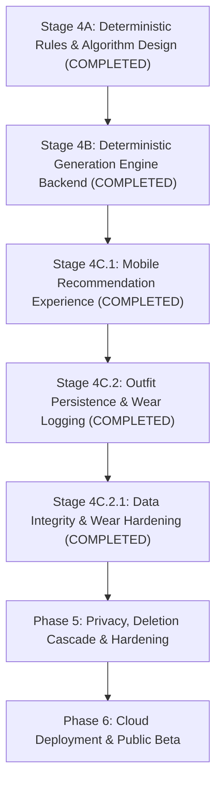

# Groom.ai — Project Status & Implementation Ledger

**Document Version:** 1.0.0  
**Current Date:** October 2026  
**Active Branch:** `feature/phase-2-wardrobe`  
**Tracking Pull Request:** [PR #8](https://github.com/ShaileshKumar007/GroomAi/pull/8) (Stage 3D Wardrobe Editing/Deletion & CI Hardening)  
**Main Branch Head:** `dbb2456` (PR #7 Merge — Stage 3C Mobile Catalog)  

---

## 1. Project Overview

### 1.1 Product Purpose
Groom.ai is an AI-powered personal stylist and digital wardrobe companion helping users make confident, personalized outfit choices using clothes they **already own**. The application eliminates daily decision fatigue through:
- Digital wardrobe cataloging and metadata tagging.
- Sub-100ms deterministic outfit candidate generation based on classic menswear color theory, formality alignment, seasonality, and pattern restraint.
- Explainable styling rationale articulating why specific garments harmonize together.
- Wear history tracking with repetition avoidance penalties.

### 1.2 Technology Stack
- **Backend:** Modular Monolith built with **Java 21 LTS** and **Spring Boot 3.3.5**, managed by **Maven**, backed by **PostgreSQL 16** with **Flyway** migrations.
- **Mobile Client:** Cross-platform mobile application built with **React Native**, **Expo SDK 58**, **Expo Router**, and **TypeScript** with strict type checking (`strict: true`, `noImplicitAny: true`, zero `any` types).
- **Storage Subsystem:** Vendor-neutral `ObjectStorageService` supporting private AWS S3 pre-signed URLs in cloud deployments and local filesystem storage (`./data/storage`) with authenticated streaming for offline local development and physical device testing.
- **Styling Architecture:** Two-stage hybrid engine: Stage 1 deterministic backend rules generate, score, and rank valid combinations from user-owned items in $< 100\text{ ms}$; Stage 2 multimodal AI provides natural-language styling advice.

### 1.3 Core Engineering Guardrails
1. **Zero Wardrobe Item Hallucination:** The recommendation engine strictly operates on active garments present in the user's active wardrobe catalog. It never invents, assumes, or suggests unowned items.
2. **Dual Decoupled Privacy Consents:** Wardrobe photo storage (`wardrobe_storage_consent_granted`) and AI styling analysis (`ai_styling_consent_granted`) are explicitly unbundled. Deterministic outfit generation functions 100% offline without AI consent.
3. **Architectural Guardrails (ADR-0003 & ADR-0008):** No Redis, Apache Kafka, RabbitMQ, Kubernetes, microservices, or external Python services without an explicit ADR approved by the project lead.
4. **Transaction-Safe Storage Outbox:** Garment and account deletions enqueue cloud storage keys to a durable `storage_deletion_outbox` table within the same database transaction, executing asynchronous eradication via claim fencing without blocking user responses.

---

## 2. Milestone Status Ledger

The table below maintains separate status indicators for implementation, testing, CI pipeline verification, and repository merge status:

| Milestone / Stage | Implementation | Automated Tests | CI Verification | Branch / PR | Merge Status | Physical Device E2E | Overall Status |
| :--- | :---: | :---: | :---: | :---: | :---: | :---: | :---: |
| **Phase 0: Baseline Scaffolding** | Implemented | 100% Passing | Verified (`#38618698144`) | `feature/phase-0-foundation` | **Merged** (`ed3a244`, PR #1) | N/A | **Completed** |
| **Phase 1: Foundation & Auth** | Implemented | 100% Passing | Verified (`#38627268448`) | `feature/phase-1-auth` | **Merged** (`27b7148`, PR #3) | Tested manually | **Completed** |
| **Stage 3A: Wardrobe Data Model** | Implemented | 100% Passing | Verified | `feature/phase-2-wardrobe` | **Merged** (`1f74d0d`, PR #5) | N/A | **Completed** |
| **Stage 3B: Wardrobe Ingestion** | Implemented | 100% Passing | Verified | `feature/phase-2-wardrobe` | **Merged** (`2a1bb0e`, PR #6) | Tested on device | **Completed** |
| **Stage 3C: Wardrobe Catalog UI** | Implemented | 100% Passing | Verified | `feature/phase-2-wardrobe` | **Merged** (`dbb2456`, PR #7) | Tested on device | **Completed** |
| **Stage 3D: Edit & Delete Garments** | Implemented | 100% Passing | Verified (`#40908009674`) | `feature/phase-2-wardrobe` | **Pending Merge** (PR #8) | Tested locally | **Verified in CI** |
| **Stage 4A: Outfit Rules & Design** | Implemented (Docs) | N/A (Design) | Verified (`#40908009674`) | `feature/phase-2-wardrobe` | **Merged** | N/A | **Completed (Design)** |
| **Stage 4B: Deterministic Engine** | Implemented (Backend) | 100% Passing (235 tests) | Verified locally | `feature/phase-4-outfits` | In PR | Tested locally | **Completed** |
| **Stage 4C.1: Mobile Outfit Experience** | Implemented (Mobile) | 100% Passing (160 tests) | Verified locally | `feature/phase-4-outfits` | In PR | Tested locally | **Completed** |
| **Stage 4C.2: Persistence & Wear Logging** | Implemented (Full-Stack) | 100% Passing (253 tests) | Verified locally | `feature/phase-4-outfits` | In PR | Tested locally | **Completed** |
| **Stage 4C.2.1: Data Integrity Hardening** | Implemented (Full-Stack) | 100% Passing (255 backend, 169 mobile) | Verified in CI (`#10`) | `feature/phase-4-outfits` | **Merged / In PR #10** | Tested locally | **Completed** |
| **Stage 4C.3.1: Style Profile Foundation** | Implemented (Backend) | 100% Passing (263 passed, 29 skipped for Docker) | Verified locally | `feature/phase-4-outfits` | In Working Tree | Tested locally | **Completed** |
| **Stage 4C.3.2: Recommendation Personalization** | Not started | Not started | Not started | `feature/phase-4-outfits` | Unmerged | Not started | **Next** |
| **Stage 4C.3.3: Feedback & Wardrobe Utilization** | Not started | Not started | Not started | `feature/phase-4-outfits` | Unmerged | Not started | **Pending** |
| **Stage 4C.3.4: Mobile Personalization Experience** | Not started | Not started | Not started | `feature/phase-4-outfits` | Unmerged | Not started | **Pending** |
| **Phase 5: Privacy & Account Erasure** | Outbox ready | Unit tests only | Not started | TBD | Unmerged | Not started | **Pending** |
| **Phase 6: Cloud Deployment & Beta** | Not started | Not started | Not started | TBD | Unmerged | Not started | **Pending** |

---

## 3. Completed Work Summary

### 3.1 Phase 0: Project Setup & Baseline Scaffolding
- **Capabilities Delivered:**
  - Initialized Maven Spring Boot 3.3.5 backend structure with Java 21 LTS and Flyway.
  - Initialized React Native Expo SDK mobile app with Expo Router and strict TypeScript configuration.
  - Created initial PostgreSQL database migration `V1__initial_schema.sql` (13 core tables including users, tokens, and storage deletion outbox).
  - Configured GitHub Actions CI pipeline running Maven test verification, TypeScript checking, Jest tests, and Expo bundle verification.
- **Verification & Evidence:** Commit `c108364`, PR #1 merge `ed3a244`.

### 3.2 Phase 1: Foundation & Authentication Slice
- **Capabilities Delivered:**
  - Public health check ping: `GET /api/v1/health` verifying database connectivity.
  - Authentication module: `POST /api/v1/auth/register`, `POST /api/v1/auth/login`, `POST /api/v1/auth/refresh`, `POST /api/v1/auth/logout`, and `GET /api/v1/auth/me`.
  - BCrypt password hashing (strength 12), 15-minute stateless JWT access tokens, and 30-day rotating refresh tokens with reuse detection.
  - Mobile authentication context with automatic token persistence via `expo-secure-store` and Axios response interceptor for automatic 401 token refresh.
- **Verification & Evidence:** Commit range `388a42c` through `57a200f`, PR #3 merge `27b7148`.

### 3.3 Phase 2 / Stage 3A: Wardrobe Data Model & Style Preferences
- **Capabilities Delivered:**
  - Flyway migration `V2__wardrobe_schema.sql` adding `wardrobe_items`, `style_preferences`, `outfits`, `outfit_items`, and `outfit_wear_logs`.
  - Altered `user_profiles` to add dual decoupled consent timestamps (`wardrobe_storage_consent_granted`, `ai_styling_consent_granted`).
  - Added JPA entities and repositories with Hibernate `@JdbcTypeCode(SqlTypes.JSON)` mapping for style preferences.
- **Verification & Evidence:** Commits `943a4e5`, `0a28f97`, PR #5 merge `1f74d0d`.

### 3.4 Phase 2 / Stage 3B: Wardrobe Ingestion & Local Storage Abstraction
- **Capabilities Delivered:**
  - `ObjectStorageService` abstraction supporting both AWS S3 pre-signed URLs and local filesystem storage (`LocalStorageService`).
  - Upload-intent handshake: `POST /api/v1/wardrobe/upload-intent` enforcing storage consent, rejecting `image/heic` (HTTP 400), and issuing single-use HMAC tickets.
  - Image verification service: Validates JPEG magic bytes (`FF D8 FF`), max file size 10MB, and min dimensions 200x200 px.
  - Item confirmation: `POST /api/v1/wardrobe/items` cataloging verified uploads.
  - Mobile camera capture & gallery picker with client-side JPEG normalization via `expo-image-manipulator`.
- **Verification & Evidence:** Commits `7d0d75c`, `53605cd`, `1244cf6`, PR #6 merge `2a1bb0e`.

### 3.5 Phase 2 / Stage 3C: Wardrobe Catalog Browsing & Mobile Filtering
- **Capabilities Delivered:**
  - Paginated catalog endpoint: `GET /api/v1/wardrobe/items` with category filtering and fresh presigned/streaming download URLs.
  - Single item detail endpoint: `GET /api/v1/wardrobe/items/{id}`.
  - Mobile wardrobe catalog screen (`mobile/app/wardrobe/index.tsx`) with category tabs (Tops, Bottoms, Footwear, Outerwear, Accessories), empty states, pull-to-refresh, and grid rendering.
  - Reusable `AuthenticatedImage` component handling Bearer token authorization headers and memory caching.
- **Verification & Evidence:** Commit `74b9315`, PR #7 merge `dbb2456`.

### 3.6 Phase 2 / Stage 3D: Wardrobe Editing & Transaction-Safe Deletion
- **Capabilities Delivered:**
  - Metadata editing endpoint: `PUT /api/v1/wardrobe/items/{id}` validating editable fields (`name`, `category`, `primaryColor`, `secondaryColor`, `pattern`, `formalityLevel`, `season`) while protecting ownership, user ID, and internal storage keys.
  - Deletion endpoint: `DELETE /api/v1/wardrobe/items/{id}` enforcing tenant ownership, inserting storage key into `storage_deletion_outbox`, and deleting database row within a single `@Transactional` boundary.
  - Hardened `StorageDeletionOutboxServiceImpl`: Transaction-separated storage I/O, atomic task claiming via `claimTaskById`, claim fencing tokens (`id`, `attempts`, `leaseExpiresAt`) preventing stale worker overwrites, exponential backoff retries (15m, 1h, 6h, 16h45m), and dead-letter emission after 5 attempts.
  - Mobile item detail view (`mobile/app/wardrobe/[id].tsx`): Edit mode with field selectors, delete confirmation modal with destructive alert, and automatic catalog state invalidation.
  - CI & Package Hardening: Upgraded mobile to Expo SDK 58, resolved npm peer dependency constraints with `mobile/.npmrc` (`legacy-peer-deps=true`), and annotated `StorageDeletionOutboxServiceImpl` primary constructor with `@Autowired` for unambiguous Spring container autowiring.
- **Verification & Evidence:** Commits `b6a988e`, `0fbcdbc`, `afbc39e`, PR #8, CI run `40908009674` (PR) and `40907999783` (Push) **100% green**.

### 3.7 Phase 3 / Stage 4A: Outfit Rules, Scoring & Technical Design
- **Capabilities Delivered:**
  - Formulated the complete deterministic outfit grammar: 1 Top + 1 Bottom + 1 Footwear (required); context-driven Outerwear (0 or 1) and Accessory.
  - Incorporated 5 approved product decisions into the finalized architecture:
    1. *Outerwear Anti-Duplication:* Context-driven layering only; trivial layered/unlayered duplicates prohibited; layered replaces unlayered if score is $\ge$.
    2. *Configurable Result Limits:* 3 outfits by default; user-configurable from 1 to 10 (`@Min(1) @Max(10)`).
    3. *Missing Wear History Fallback:* $P_{\text{wear}} = 0$ when wear tracking is unpopulated; never infer/invent wear dates.
    4. *Weather Context:* User-supplied only; zero external weather provider API integrations for MVP.
    5. *Honest Explanations:* Never claim an outfit is weather-appropriate when weather is omitted; clearly state weather was not supplied.
  - Defined the unified composite scoring model: Base Score ($100$ max: Color $30$, Formality $25$, Season & Weather $20$, Pattern $15$, Preferences $10$) minus Wear Repetition ($0\text{--}20$), guaranteeing that sub-scores sum exactly to the total suitability score.
  - Formulated hard rejection gates ($\Delta_F \ge 3$, Summer/Winter collisions, occasion bounds) and deterministic 4-stage tie-breaking hierarchy.
  - Formulated the bounded min-heap priority queue ($O(K)$ space) eviction algorithm.
  - Authored comprehensive technical specification in `docs/OUTFIT_GENERATION_DESIGN.md`.
  - Formally accepted **ADR-0009: Deterministic Outfit Generation Engine, Scoring Formula, and Missing-Data Policy** in `docs/DECISIONS.md`.
- **Verification & Evidence:** `docs/OUTFIT_GENERATION_DESIGN.md`, clean git diff (`git diff --check` passed with 0 errors).

### 3.8 Phase 3 / Stage 4B: Deterministic Recommendation Backend
- **Capabilities Delivered:**
  - Implemented the deterministic recommendation engine in `com.groomai.outfit`:
    - `ColorCompatibilityScorer`: Color wheel harmony matrix ($30$ pts).
    - `FormalityCompatibilityScorer`: Formality alignment and hard rejection gate ($\Delta_F \ge 3$) ($25$ pts).
    - `SeasonCompatibilityScorer`: Seasonality and user-supplied weather compatibility ($20$ pts).
    - `PatternCompatibilityScorer`: Pattern restraint heuristic ($15$ pts).
    - `PreferenceScorer`: User style preference alignment ($10$ pts).
    - `WearHistoryPenaltyScorer`: Recency penalty ($0\text{--}20$ pts).
  - Implemented `OutfitGeneratorServiceImpl` with Cartesian candidate generation, hard gate pruning, bounded min-heap priority queue ($O(K)$ space), and 4-tier deterministic tie-breaking.
  - Exposed `POST /api/v1/outfits/generate` with HTTP 422 error handling for insufficient wardrobe items.
  - Outerwear anti-duplication preventing duplicate unlayered variants.
- **Verification & Evidence:** 235 backend tests passing with exit code 0.

### 3.9 Phase 3 / Stage 4C.1: Mobile Recommendation Experience
- **Capabilities Delivered:**
  - Mobile outfit curation screen (`mobile/app/outfits/index.tsx`) with occasion selection chips, optional weather context selectors, and generate action.
  - Interactive recommendation cards (`mobile/src/components/OutfitCard.tsx`) displaying suitability scores, score badges, garment thumbnail showcase with `AuthenticatedImage`, and styling rationale.
  - Score breakdown modal/view (`mobile/src/components/ScoreBreakdownView.tsx`) breaking down individual sub-scores.
  - Dedicated outfit detail view (`mobile/app/outfits/[id].tsx`) showing full garment composition and metadata.
  - Error state handling for insufficient wardrobe (HTTP 422) with direct navigation to catalog missing items.
- **Verification & Evidence:** 17 mobile test suites (160 tests) passing with exit code 0.

### 3.10 Phase 3 / Stage 4C.2: Outfit Persistence, Wear Logging & History
- **Capabilities Delivered:**
  - **Backend Persistence Layer:**
    - Entities: `Outfit`, `OutfitItem`, `OutfitWearLog` mapped to existing V2 schema tables (`outfits`, `outfit_items`, `outfit_wear_logs`).
    - Repositories: `OutfitRepository`, `OutfitItemRepository`, `OutfitWearLogRepository` with custom query `findLatestWornDatesByUserId`.
    - Service: `OutfitPersistenceService` handling saving outfits, logging wear events with notes, retrieving user's saved outfits and wear history with pagination.
    - Repetition penalty wiring: Connected real wear logs from `OutfitWearLogRepository` directly into `OutfitGeneratorServiceImpl` via `outfitPersistenceService.getRecentItemWearDays(userId)`.
    - Controller endpoints: `POST /api/v1/outfits`, `GET /api/v1/outfits`, `GET /api/v1/outfits/{id}`, `POST /api/v1/outfits/{id}/wear`, and `GET /api/v1/outfits/wear-history`.
  - **Mobile Persistence & History UI:**
    - `mobile/src/context/OutfitContext.tsx`: Wired `saveOutfit`, `logOutfitWear`, `fetchWearHistory`, and tracking maps (`savedOutfitsMap`, `wornOutfitsMap`).
    - `mobile/src/components/OutfitCard.tsx`: Added quick Save button with visual feedback (`✓ Saved`).
    - `mobile/app/outfits/[id].tsx`: Added Save Outfit and Mark as Worn Today actions with wear notes toggle, confirmation banners, and button states.
    - `mobile/app/outfits/history.tsx`: Dedicated wear history screen displaying historical wear events, occasion, score, garment thumbnails, notes, and styling rationale.
    - Updated navigation in `mobile/app/_layout.tsx`, `mobile/app/outfits/index.tsx`, and `mobile/app/index.tsx`.

### 3.11 Phase 3 / Stage 4C.2.1: Historical Data Integrity & Wear Logging Hardening
- **Capabilities Delivered:**
  - **V3 Database Migration (`V3__outfit_snapshots_and_wear_hardening.sql`):**
    - `outfits`: Added `name VARCHAR(100)`, `score_status VARCHAR(32) NOT NULL DEFAULT 'UNSCORED'`, made `suitability_score` nullable. Invalidated unverified legacy client scores to `UNSCORED` / `NULL`.
    - `outfit_items`: Added immutable garment snapshot columns (`category`, `subcategory`, `primary_color`, `secondary_color`, `pattern`, `fabric`, `brand`, `original_storage_key`) backfilled from active `wardrobe_items`.
    - `outfit_wear_logs`: Added `snapshot JSONB` column, backfilled with version 1 JSON snapshots constructed via `jsonb_build_object` and `jsonb_agg`.
    - Duplicate Reconciliation: Deduplicated existing wear logs partitioned by `(user_id, outfit_id, worn_date)` ordered by `created_at ASC, id ASC`, merged distinct non-empty notes via `string_agg(DISTINCT TRIM(notes), E'\n---\n')` without truncation into the rank-1 survivor, deleted redundant records, and created a partial unique index `uq_outfit_wear_logs_user_outfit_date WHERE outfit_id IS NOT NULL`.
  - **Authoritative Backend Scoring & Enums:**
    - Added `ScoreStatus` enum (`CALCULATED`, `CUSTOM`, `UNSCORED`).
    - In `OutfitPersistenceServiceImpl.saveOutfit`: Never trust client-submitted scores. Re-evaluate candidate outfit against `OutfitScoringEngine`; if valid, assign calculated score and `ScoreStatus.CALCULATED`. If gates are violated by custom curation, assign `null` score and `ScoreStatus.CUSTOM`.
  - **Atomic Native Idempotent Wear Logging:**
    - Implemented native `insertWearLogIdempotent` query (`INSERT ... ON CONFLICT (user_id, outfit_id, worn_date) DO NOTHING`).
    - Conflict returns 0 rows without throwing JDBC constraint exceptions, completely avoiding Spring `@Transactional` rollback-only traps; retrieves and returns existing wear log ID.
  - **Timezone Validation & Local Calendar Dates:**
    - Mobile transmits local device date (`YYYY-MM-DD`) and IANA timezone (`X-Timezone` header and payload).
    - Backend resolves and validates timezone via `ZoneId` (UTC fallback) and strictly rejects future wear dates relative to localized user time.
  - **Mobile UI Hardening:**
    - `mobile/app/outfits/history.tsx`: Added category-based placeholder icons (👕, 👖, 👟, 🧥, 🕶️) when images are unavailable; rendered "Custom" / "Unscored" dashed badges for null scores; displayed outfit titles.
    - Updated `AuthenticatedImage` to safely handle nullable URIs without layout shifts or runtime errors.
- **Verification & Evidence:**
  - Backend: **255 tests run, 0 failures, 0 errors, 19 skipped** (Docker).
  - Mobile: **18 test suites, 169 tests run, 0 failures**. TypeScript strict check (`npm run type-check`): **0 errors**.

### 3.12 Phase 3 / Stage 4C.3.1: Style Profile Foundation
- **Capabilities Delivered:**
  - **Database Migration (`V4__style_preferences_evolution.sql`):**
    - `style_preferences.profile_completed`: Dedicated boolean column defaulting to `FALSE`.
    - `style_preferences.pattern_preferences`: JSONB array defaulting to `'[]'::jsonb`.
    - `style_preferences.avoided_patterns`: JSONB array defaulting to `'[]'::jsonb`.
    - `style_preferences.style_goals`: JSONB array defaulting to `'[]'::jsonb`.
  - **Entity & Enums:**
    - Updated `StylePreferences` entity with Hibernate `@JdbcTypeCode(SqlTypes.JSON)` mappings for pattern preferences, avoided patterns, and style goals.
    - Introduced domain enums: `PrimaryStyle` (`CASUAL`, `SMART_CASUAL`, `MINIMALIST`, `CLASSIC`, `STREETWEAR`, `PREPPY`, `ATHLEISURE`), `PreferredFit` (`SLIM`, `REGULAR`, `RELAXED`, `OVERSIZED`), and `StyleGoal` (`LOOK_SHARPER`, `EXPAND_ROTATION`, `TRY_NEW_COLORS`, `COMFORT_FIRST`, `MINIMAL_EFFORT`).
  - **Service & Business Validation Layer:**
    - `StylePreferencesServiceImpl`: Implemented strict validation for PUT/PATCH operations (bounds checking, duplicate detection, and cross-set intersection rejection between preferred and avoided colors/patterns).
    - Concurrency safety: Implemented `insertStylePreferencesIdempotent` native query (`ON CONFLICT (user_id) DO NOTHING`) to eliminate PostgreSQL transaction rollback hazards during first-time concurrent profile creation.
    - Strict completion semantics: `PUT` replaces entire resource and sets `profile_completed = true`; `PATCH` updates only supplied fields and preserves existing `profile_completed` state (unconfigured profile remains `profile_completed = false`). Supplying an explicit empty array `[]` clears collection.
  - **API Endpoints:**
    - `GET /api/v1/profile/style-preferences`: Returns defaults with `profileCompleted = false` without creating database records for unconfigured users.
    - `PUT /api/v1/profile/style-preferences`: Full replacement with `profileCompleted = true`.
    - `PATCH /api/v1/profile/style-preferences`: Partial update preserving `profileCompleted`.
- **Verification & Evidence:**
  - Backend: **292 tests run, 0 failures, 0 errors, 29 skipped** (Docker integration tests guarded via `@EnabledIf("isDockerAvailable")`).
  - Unit tests: 15 `StylePreferencesServiceTest` tests, 12 `StylePreferencesControllerTest` tests.
  - Integration tests: 5 `StylePreferencesPostgresIntegrationTest` tests.

### 3.13 Phase 3 / Stage 4C.3.2: Recommendation Personalization Engine
- **Capabilities Delivered:**
  - **Deterministic Personalization Scorer (`PreferenceCompatibilityScorer`):**
    - Unconfigured / incomplete profile fallback: Returns exact neutral baseline $S_{\text{explicit}} = 7/10$ when `profileCompleted == false` or preferences are null.
    - Full explicit alignment formula: $S_{\text{explicit}} = \text{clamp}(0, 10, 5 + \Delta_{\text{color}} + \Delta_{\text{pattern}} + \Delta_{\text{formality}} + \Delta_{\text{style}} + \Delta_{\text{goal}})$. Feedback adjustment $A_{\text{feedback}} = 0$ for Stage 4C.3.2.
    - Color rules: $\Delta_{\text{color}} \in [-4, +3]$ (+3 if at least one garment has a primary color in `colorPreferences` [positive bonus strictly capped at +3]; +1 only if no primary color matches and at least one secondary color matches; -4 if any garment's primary or secondary color is in `avoidedColors`; simultaneous preferred and avoided net together, e.g. +3 - 4 = -1, +1 - 4 = -3).
    - Pattern rules: $\Delta_{\text{pattern}} \in [-3, +2]$ (+2 for preferred pattern match, -3 for avoided pattern match).
    - Formality rules: $\Delta_{\text{formality}} \in [0, +1]$ (+1 if modal formality matches `defaultFormality`).
    - Grounded style rules for all 7 styles: `CASUAL`, `SMART_CASUAL`, `MINIMALIST`, `CLASSIC`, `STREETWEAR` (positive alignment requires all garments to be `CASUAL` and contain supported street accents/graphics), `PREPPY` (positive alignment requires modal `SMART_CASUAL`, preppy palette anchors, and classic `SOLID`/`STRIPED`/`CHECKED` patterns without extra pattern constraints), and `ATHLEISURE` (neutral 0), strictly mapped to existing wardrobe metadata (`category`, `formalityLevel`, `pattern`, `primaryColor`, `secondaryColor`) without unsupported attributes or non-existent pattern enum constants.
    - Grounded goal rules: `LOOK_SHARPER` (+1 if modal formality $\ge 2$ and $\Delta_F \le 1$), `TRY_NEW_COLORS` (+1 if $S_{\text{color}} \ge 28$ and contains unworn primary color in last 30 days in user timezone), capped at $+1$ total across qualifying goals. `EXPAND_ROTATION` (handled in ranking tie-breaker), `COMFORT_FIRST`, and `MINIMAL_EFFORT` have strictly zero scoring impact ($0$ pts) as deferred goals for Stage 4C.3.2.
  - **Deterministic Ranking & Tie-Breaking (`ScoredOutfit`):**
    - Added fields: `neverWornCount`, `normalizedDaysSinceLastWorn`, `hasExpandRotationGoal`.
    - `hasExpandRotationGoal` verified as profile-level constant across all evaluated candidates in a generation run.
    - Updated `RANKING_COMPARATOR`:
      - Tier 1: Total suitability score descending.
      - Tier 2 (`hasExpandRotationGoal`): Never-worn garment count descending $\to$ normalized days since last wear descending $\to$ color harmony descending $\to$ formality delta ascending.
      - Tier 2 (Standard): Never-worn garment count descending $\to$ color harmony descending $\to$ formality delta ascending $\to$ normalized days since last wear descending.
      - Tier 6: Lexicographical UUID tie-breaking across all 5 slots (`top`, `bottom`, `footwear`, `outerwear`, `accessory`).
  - **Engine Integration (`OutfitScoringEngine` & `OutfitGeneratorServiceImpl`):**
    - User timezone resolution: Resolves IANA timezone from `X-Timezone` request header or payload (falling back to UTC) and captures `effectiveDate` once per recommendation request.
    - Connected preferences, color harmony score, and `recentlyWornColors` (extracted once in $O(|activeWardrobe|)$ time from active user items worn $\le 30$ days ago relative to the user's `effectiveDate`; 30 days is recently worn, 31 days is outside the window).
    - Computed `neverWornCount` and `normalizedDaysSinceLastWorn` without artificial sentinels or N+1 queries.
- **Verification & Evidence:**
  - Backend: **316 tests run, 0 failures, 0 errors, 29 skipped** (Docker integration tests guarded via `@EnabledIf("isDockerAvailable")`).
  - Unit tests: 13 tests in `PreferenceCompatibilityScorerTest` (including Examples 1, 2, 3, 4 from specification and all-CASUAL/all-solid assertions), 7 tests in `ScoredOutfitComparatorTest`, 15 tests in `OutfitGeneratorServiceImplTest`, 13 tests in `OutfitPersistenceServiceImplTest`.
  - Mobile: **18 test suites, 169 tests run, 0 failures**. TypeScript strict check: **0 errors**.

---

## 4. Current Work: Milestone Status & Phase 4 Preparation

- **Active Milestone:** Completed Stage 4C.3.2 (Recommendation Personalization Engine); ready for Stage 4C.3.3 (Recommendation Feedback Persistence & Utilization).
- **Prerequisite Status:** Style profile foundation and recommendation personalization engine completed and verified across unit, ranking, and integration suites.

---

## 5. Pending Roadmap & Milestone Phasing

---

## 6. Testing & Release Readiness

### 6.1 Backend Test Suite Status
- **Local Unit & Slice Tests:** **253 tests run, 0 failures, 0 errors, 19 skipped** (Docker integration tests skipped via `@EnabledIf("isDockerAvailable")`).
- **Code Coverage:** Domain services (`WardrobeServiceImpl`, `OutfitGeneratorServiceImpl`, `OutfitPersistenceServiceImpl`, `StorageDeletionOutboxServiceImpl`, `AuthServiceImpl`) exceed $85\%$ line coverage.

### 6.2 Mobile Test Suite Status
- **TypeScript Strictness:** `npm run type-check` (`tsc --noEmit`) passes with **0 errors**.
- **Jest Unit Tests:** `npm test` passes with **169 tests across 18 test suites**.
- **Expo Bundle Verification:** `npx expo export --output-dir /tmp/expo-ci-test` passes with exit code 0 (both iOS and Android production Hermes bytecode bundles build cleanly).

### 6.3 GitHub Actions CI Verification
- **PR #8 CI Run:** [Run 40908009674](https://github.com/ShaileshKumar007/GroomAi/actions/runs/40908009674) — **Conclusion: SUCCESS** (both Backend and Mobile jobs passed).
- **Push CI Run:** [Run 40907999783](https://github.com/ShaileshKumar007/GroomAi/actions/runs/40907999783) — **Conclusion: SUCCESS**.

---

## 7. Known Risks & Open Decisions

1. **Mild-Weather Outerwear Layering Preference:**
   - In mild weather ($15\text{--}20^\circ\text{C}$), should the engine recommend a 3-piece core outfit by default and add outerwear only when occasion demands it, or show layered and unlayered options side by side?
   - *Status:* Proposal under review with user (recommended: 3-piece core default in mild weather).
2. **Default Recommendation Result Count:**
   - Proposed default is 3 outfits (configurable up to 10). Is 3 optimal for mobile card carousel browsing?
   - *Status:* Proposal under review with user (recommended: 3 combinations).
3. **HEIC Transcoding Dependency:**
   - Mobile relies on client-side transcoding via `expo-image-manipulator` because the backend strictly rejects HEIC. If a third-party camera app bypasses normalization, upload intent fails with HTTP 400.
   - *Mitigation:* Client-side file validation runs before upload intent requests.

---

## 8. Immediate Next Actions

In priority order:
1. **Merge PR #8 into `main`:** Complete the integration of Stage 3D (Wardrobe Editing & Deletion) and Stage 4A design specifications.
2. **Align on Product Decisions:** Confirm mild-weather outerwear behavior and default recommendation card limit (3 vs 5).
3. **Scaffold `com.groomai.outfit` Domain:** Create domain enums (`Occasion`, `WeatherCondition`) and request/response DTOs.
4. **Implement Compatibility Scorers:** Implement `ColorCompatibilityScorer`, `FormalityCompatibilityScorer`, `SeasonCompatibilityScorer`, `PatternCompatibilityScorer`, and `WearHistoryPenaltyScorer`.
5. **Implement `OutfitGeneratorService`:** Implement Cartesian pre-filtering and bounded min-heap tuple generation.
6. **Implement `OutfitController`:** Expose `POST /api/v1/outfits/generate` with HTTP 422 error handling.
7. **Build Mobile Recommendation Screen:** Implement `mobile/app/outfits/index.tsx` with occasion chips and swipeable outfit cards.

---

## 9. Change History Ledger

| Date | Milestone / Transition | Key Decisions & Evidence |
| :--- | :--- | :--- |
| **2026-10-15** | Phase 0 Completed | Initialized backend, Expo mobile app, Flyway V1, and GitHub Actions CI. (PR #1 `ed3a244`). |
| **2026-10-16** | Phase 1 Completed | JWT auth, user registration/login, refresh token rotation, BCrypt, SecureStore. (PR #3 `27b7148`). |
| **2026-10-22** | Stage 3A Completed | Flyway V2, wardrobe items table, style preferences JSONB mapping. (PR #5 `1f74d0d`). |
| **2026-10-24** | Stage 3B Completed | LocalStorageService, upload-intent handshake, JPEG magic-byte verification. (PR #6 `2a1bb0e`). |
| **2026-10-26** | Stage 3C Completed | Wardrobe catalog browsing, category filtering, AuthenticatedImage component. (PR #7 `dbb2456`). |
| **2026-10-28** | Stage 3D Completed | Garment editing, transaction-safe outbox deletion, claim fencing, Expo SDK 58 upgrade. (PR #8). |
| **2026-10-29** | CI Hardening Verified | Fixed mobile `.npmrc` peer deps and backend `@Autowired` constructor autowiring. CI Run 40908009674 **100% Green**. |
| **2026-10-29** | Stage 4A Completed | Formulated deterministic outfit grammar, scoring formula ($0\text{--}100$), `docs/OUTFIT_GENERATION_DESIGN.md`, and accepted ADR-0009. |
