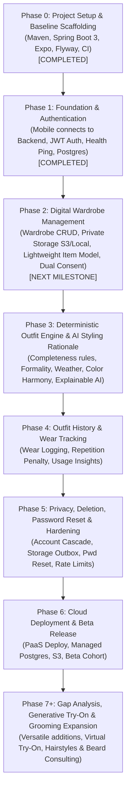

# Groom.ai — Implementation Roadmap & Phased Execution Plan

**Document Version:** 2.0.0  
**Status:** Approved Roadmap (Wardrobe-First Evolution)  
**Approach:** Phased, Milestones-Driven Delivery with Early Vertical Slice  
**Last Updated:** October 2026  

---

## 1. Phasing Overview & Milestone Dependencies

The project is structured into sequential phases to validate technical feasibility early, derisk integrations, and maintain high engineering quality without architectural drift.

---

## 2. Detailed Milestone Specifications

> **Status hygiene:** “Implemented”, “CI passed”, and “verified on a physical device” are separate claims. Only mark a task/device flow verified when the corresponding test evidence exists. The CI run IDs and commit ranges below are historical notes and must be reconciled against GitHub/repository history before being treated as canonical.

### Phase 0: Project Setup & Baseline Scaffolding
- **Status:** Completed (commit `c108364`, PR #1 merge `ed3a244`). **CI run ID requires reconciliation:** this document previously listed `#38618698144`, while earlier project notes listed `#38615049255`.
- **Delivered Capabilities:**
  - Initialized Spring Boot 3.3.5 project with Java 21 LTS, Maven, and Flyway.
  - Initialized React Native Expo mobile app with Expo Router and strict TypeScript.
  - Flyway migration `V1__initial_schema.sql` applied and tested against real PostgreSQL 16 Testcontainers.
  - Multi-job CI pipeline verifying Java compilation, tests, TypeScript strictness, and Expo Doctor.

---

### Phase 1: Foundation & The First Vertical Slice
- **Status:** **Implementation/CI reported complete; manual device E2E not confirmed** (commits listed here: `388a42c` through `57a200f`; CI run `#38627268448`; reconcile commit IDs against repository history before relying on this line)
- **Delivered Capabilities:**
  - Public health check ping: `GET /api/v1/health` rendered on mobile onboarding screen.
  - User Registration and Login screens in the mobile app.
  - Backend `auth` module endpoints: `POST /api/v1/auth/register`, `POST /api/v1/auth/login`, `POST /api/v1/auth/refresh`, `POST /api/v1/auth/logout`, and `GET /api/v1/auth/me`.
  - Secure token persistence on the mobile client using `Expo SecureStore`.
  - Centralized Axios client with automatic Bearer injection and 401 refresh interception.
  - CI verification reported for backend/mobile tests and PostgreSQL integration tests; BCrypt (strength 12) password hashing and rotating refresh tokens are part of the Phase 1 implementation.
  - **Manual physical-iPhone end-to-end verification: NOT YET CONFIRMED by the available evidence.** Record device, app/API configuration, tested flows, and result here only after a fresh successful run.

---

### Phase 2: Digital Wardrobe Management (Next Milestone)
- **Objective:** Implement user style preferences, dual decoupled privacy consents, and the digital wardrobe catalog with private object storage.
- **Key Tasks:**
  - Author and apply Flyway migration `V2__wardrobe_schema.sql`:
    - Add `wardrobe_items` table.
    - Add `style_preferences` table.
    - Alter `user_profiles` to add `wardrobe_storage_consent_granted`, `wardrobe_storage_consent_granted_at`, `ai_styling_consent_granted`, `ai_styling_consent_granted_at`.
  - Implement backend `user` module endpoints:
    - `GET /api/v1/profile` (updated with dual consent status).
    - `PUT /api/v1/profile` (update display name, age bracket).
    - `PUT /api/v1/profile/consents` (update decoupled wardrobe storage and AI styling consents).
    - `GET/PUT /api/v1/profile/style-preferences` (style aesthetic, preferred fit, favorite/avoided colors, default formality).
  - Implement `ObjectStorageService` abstraction in `com.groomai.storage`:
    - `S3StorageService`: AWS S3 private bucket implementation generating pre-signed upload/download URLs (TTL ≤ 15 min; `uploadMode: "S3_PRESIGNED"`).
    - `LocalStorageService`: Local filesystem adapter (`./data/storage`) providing direct multipart upload endpoint (`POST /api/v1/storage/upload/{storageKey}`; `uploadMode: "LOCAL_STREAM"`) and authenticated download stream (`GET /api/v1/storage/files/{storageKey}`) enabling offline development and testing on physical devices/emulators without AWS keys.
  - Implement backend `wardrobe` module:
    - `POST /api/v1/wardrobe/upload-intent`: Verifies `wardrobe_storage_consent_granted == true`; returns upload intent response with `uploadMode`, `storageKey`, and `uploadUrl`; rejects `image/heic` with HTTP `400 Bad Request` (`UNSUPPORTED_IMAGE_FORMAT`).
    - `POST /api/v1/wardrobe/items`: Verifies uploaded object in storage (magic bytes `FF D8 FF`, size ≤ 10MB, min dimensions 200x200), catalogs item with required fields (`name`, `category`, `primaryColor`, `storageKey`) and defaults for optional fields (`formalityLevel`, `pattern`, `subcategory`, `secondaryColor`, `season`).
    - `GET /api/v1/wardrobe/items`: Paginated listing with filtering by category, formality, season, color. Returns fresh pre-signed or authenticated download URLs.
    - `GET /api/v1/wardrobe/items/{id}`: Single item detail view.
    - `PUT /api/v1/wardrobe/items/{id}`: Edit item metadata.
    - `DELETE /api/v1/wardrobe/items/{id}`: Verifies ownership, enqueues storage key to `storage_deletion_outbox` in same transaction, deletes database row.
  - Build Mobile UI features:
    - Style profile setup screen.
    - Wardrobe storage consent modal.
    - Wardrobe Catalog Dashboard with category tabs (Tops, Bottoms, Footwear, Outerwear, Accessories).
    - Add Wardrobe Item screen: Camera capture / gallery picker, client-side JPEG normalization via `expo-image-manipulator` (≤ 10MB), metadata tagging form.
    - Item detail and edit/delete screens.
- **Security & Privacy Checkpoint:**
  - Verify wardrobe photos are stored in private storage with no public access.
  - Verify upload intent generation strictly requires `wardrobe_storage_consent_granted == true`.
  - Verify tenancy isolation: user A cannot view, edit, or delete user B's wardrobe items.
- **Definition of Done (DoD):**
  - Authenticated user can complete style preferences, grant storage consent, upload clothing photos, and view their organized digital wardrobe on a physical iPhone.
  - 100% unit and integration tests passing for wardrobe module using Testcontainers PostgreSQL.

---

### Phase 3: Deterministic Outfit Engine & AI Styling Rationale
- **Objective:** Build the two-stage hybrid outfit recommendation engine combining sub-100ms deterministic candidate generation with multimodal AI styling rationale.
- **Key Tasks:**
  - Implement Stage 1 Deterministic Combinations Engine in `com.groomai.outfit`:
    - Category completeness rules: exactly 1 Top + 1 Bottom + 1 Footwear (+ optional Outerwear if weather is cold/rainy; + optional Accessories).
    - Occasion & formality alignment (`CASUAL`, `SMART_CASUAL`, `BUSINESS_CASUAL`, `CORPORATE_FORMAL`, `DATE_NIGHT`, etc.).
    - Weather compatibility rules: temperature brackets (`HOT`, `WARM`, `MILD`, `COOL`, `COLD`) and conditions (`SUNNY`, `RAINY`, `WINDY`, `SNOWY`).
    - Color harmony matrix: monochromatic, complementary, neutral bases.
    - Candidate ranking & top 2–3 selection.
  - Implement Stage 2 Multimodal AI Styling Adapter:
    - Passes pre-validated candidate items and styling prompt to external AI provider.
    - Generates natural-language rationale: why the combination works, tucking/layering advice, shoe pairing tips.
    - **Strict Guardrail:** AI is strictly constrained to the candidate set; it never hallucinates or recommends unowned clothes.
    - Enforces 30-second socket timeout with graceful fallback and user quota preservation.
  - Implement endpoint: `POST /api/v1/outfits/generate` (requires minimum 1 Top, 1 Bottom, 1 Footwear). AI styling consent is required only before invoking the hosted AI provider; without it, return deterministic candidates without AI-generated rationale.
  - Build Mobile UI:
    - Daily outfit recommendation generator screen with occasion selector and weather input.
    - Recommendation result cards rendering complete outfits with item photos, suitability score, and AI styling explanation.
- **Definition of Done (DoD):**
  - Recommendation generation executes reliably with zero unowned item hallucinations.
  - WireMock integration tests verify behavior on AI timeouts and rate limits.

---

### Phase 4: Outfit History & Wear Tracking
- **Objective:** Enable users to log worn outfits and prevent repetitive recommendations.
- **Key Tasks:**
  - Implement wear logging endpoint: `POST /api/v1/outfits/{id}/wear`.
  - Implement `GET /api/v1/outfits/wear-history`.
  - Integrate repetition penalty into Stage 1 deterministic engine: penalizes items worn within the past 3–7 days to prioritize fresh combinations.
  - Build Mobile UI:
    - "Mark as Worn Today" action on outfit cards.
    - Outfit wear history timeline / calendar view.
    - Basic wardrobe utilization insights (most worn / least worn pieces).
- **Definition of Done (DoD):**
  - Logging an outfit as worn immediately penalizes its items in subsequent recommendation requests for 7 days.

---

### Phase 5: Privacy, Deletion, Password Reset & Security Hardening
- **Objective:** Enforce complete relational erasure, durable cloud storage outbox retries, password recovery, rate limiting, and observability.
- **Key Tasks:**
  - Implement password reset workflows: `POST /api/v1/auth/forgot-password` and `POST /api/v1/auth/reset-password`.
  - Implement atomic account deletion cascade: `DELETE /api/v1/users/account`.
    - Single `@Transactional` database transaction: enqueues all wardrobe and photo storage keys into `storage_deletion_outbox` (`status = 'PENDING'`, `attempts = 0`); deletes user row cascading across all dependent tables; returns HTTP 204 immediately (< 500ms provisional target).
  - Implement `StorageOutboxSweeper` background worker & retry dispatcher (the table schema is already applied in `V1__initial_schema.sql`):
    - Post-commit dispatcher and one-minute sweeper (`@Scheduled(cron = "0 * * * * *")`) atomically claim due tasks, transitioning them to `PROCESSING` with a 2-minute lease.
    - Bounded exponential retries across 24 hours (15m, 1h, 6h, 16h45m). Tasks transition to `FAILED` with dead-letter alert on Attempt 5 and are never automatically purged until deletion is confirmed.
  - Implement rate limiting filter using Bucket4j on auth and styling endpoints.
  - Conduct IDOR penetration test suite across all wardrobe and outfit endpoints.
- **Definition of Done (DoD):**
  - Account deletion atomically purges all database records and guarantees durable outbox cleanup of storage assets.
  - Zero IDOR vulnerabilities across all user endpoints.

---

### Phase 6: Cloud Deployment & Closed Beta Release
- **Objective:** Deploy production infrastructure, distribute mobile builds, and onboard initial beta cohort.
- **Key Tasks:**
  - Containerize Spring Boot application with Dockerfile (Eclipse Temurin 21 JRE).
  - Deploy to managed cloud PaaS (e.g., Render, Railway, AWS App Runner) with managed PostgreSQL 16.
  - Configure production AWS S3 private storage and CORS policies.
  - Distribute mobile application via Expo Application Services (EAS) to TestFlight (iOS) and Google Play Internal Testing (Android).
  - Onboard initial beta cohort and monitor wardrobe activation and recommendation CSAT.

---

### Phase 7+: Gap Analysis, Generative Try-On & Grooming Expansion (Post-MVP)
- **Smart Wardrobe Gap Analysis:** Algorithms identifying versatile missing items that maximize new outfit combinations with existing clothes.
- **Generative Virtual Try-On:** Realistic visual rendering of the user wearing specific outfit combinations.
- **Grooming Consultations Expansion:** Hairstyle and beard styling consultations using portrait photos, Barber Cards with technical cut instructions, and daily maintenance routines.
