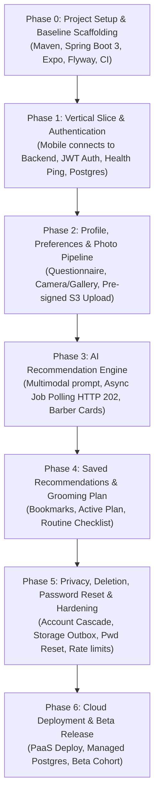

# Groom.ai — Implementation Roadmap & Phased Execution Plan

**Document Version:** 1.1.0  
**Status:** Draft — Proposed Roadmap (Pending Stakeholder Approval)  
**Approach:** Phased, Milestones-Driven Delivery with Early Vertical Slice  
**Last Updated:** October 2026  

---

## 1. Phasing Overview & Milestone Dependencies

The project is structured into sequential phases to validate technical feasibility early, derisk integrations, and maintain high engineering quality without architectural drift.

---

## 2. Detailed Milestone Specifications

### Phase 0: Project Setup & Baseline Scaffolding
- **Objective:** Establish the development environments, tooling, and baseline project structures for both the backend and mobile repositories.
- **Key Tasks:**
  - Initialize Spring Boot 3.x project with Java 21 LTS, Maven, and core dependencies (Spring Web, Spring Security, Spring Data JPA, Flyway, Lombok, Jakarta Validation).
  - Configure PostgreSQL database connectivity with HikariCP and create baseline `V1__initial_schema.sql` migration containing all tables defined in `docs/DATA_MODEL.md` (including `password_reset_tokens` and `storage_deletion_outbox`).
  - Initialize React Native mobile application using Expo, TypeScript (strict mode), and Expo Router.
  - Set up GitHub Actions CI workflow to run backend tests and mobile TypeScript checks on pull requests.
- **Definition of Done (DoD):**
  - Backend compiles via `mvn clean verify` with zero warnings or errors.
  - Flyway migration executes successfully against a fresh PostgreSQL testcontainer.
  - Mobile application boots cleanly in Expo Go / simulator with zero TypeScript errors.

---

### Phase 1: Foundation & The First Vertical Slice
- **Objective:** Prove end-to-end connectivity between the mobile app, backend API, and database through a functional vertical slice.
- **Vertical Slice Scope:**
  - Public health check ping: `GET /api/v1/health` rendered on mobile splash/onboarding screen.
  - User Registration and Login screens in the mobile app.
  - Backend `auth` module endpoints: `POST /api/v1/auth/register`, `POST /api/v1/auth/login`, `POST /api/v1/auth/refresh`, `POST /api/v1/auth/logout`, and `GET /api/v1/auth/me`.
  - Secure token persistence on the mobile client using `Expo SecureStore`.
  - Centralized Axios/Fetch client with automatic `Authorization: Bearer` token injection and 401 refresh interception.
- **Security Checkpoint:** Verify password hashing uses Argon2id or BCrypt (cost factor ≥ 12); verify JWT expiration claims.
- **Definition of Done (DoD):**
  - A user can register on the mobile client, store their JWT session in SecureStore, terminate the app, reopen it, and fetch their user details from `GET /api/v1/auth/me`.
  - 100% unit and integration tests passing for the `auth` module using Testcontainers.

---

### Phase 2: User Profile, Preferences & Photo Pipeline
- **Objective:** Implement user onboarding preferences and the secure direct object storage photo upload pipeline.
- **Key Tasks:**
  - Build onboarding screens in mobile: Hair Type, Hair Density, Beard Pattern, Styling Effort, and Workplace Environment.
  - Implement backend `user` module endpoints: `GET/PUT /api/v1/profile` and `GET/PUT /api/v1/preferences`.
  - Create explicit Photo Privacy Consent modal in mobile, persisting consent via `PUT /api/v1/profile/consent`.
  - Implement mobile camera capture (with oval alignment guide) and photo gallery selection using Expo Camera and ImagePicker.
  - Implement client-side pre-validation and image normalization: transcode non-standard formats (e.g., iOS HEIC) to JPEG using `expo-image-manipulator` prior to requesting upload intent; enforce file size ≤ 10MB.
  - Implement backend `photo` module: pre-signed URL generation (`POST /api/v1/photos/upload-intent`, rejecting `image/heic` with `UNSUPPORTED_IMAGE_FORMAT`), and confirmation verification (`POST /api/v1/photos/{id}/confirm`).
  - Implement direct S3 upload from mobile and backend object verification (`HeadObject`).
  - Implement `DELETE /api/v1/photos/{id}` verifying asset ownership, atomically enqueuing storage key to outbox and deleting the `photo_assets` row, ensuring historical recommendations decouple via `ON DELETE SET NULL`.
- **Security & Privacy Checkpoint:** Verify photos are uploaded to private bucket with zero public access. Verify pre-signed URL TTL is ≤ 15 minutes.
- **Definition of Done (DoD):**
  - User can complete preferences, grant consent, capture a portrait photo, transcode to JPEG on-device, upload directly to S3 via pre-signed URL, and receive an `ACTIVE` status confirmation.
  - Backend verifies asset existence, rejects corrupted or unconfirmed uploads, and rejects `image/heic` content-type.

---

### Phase 3: AI Recommendation Engine & Job Orchestration
- **Objective:** Build the core AI recommendation engine with asynchronous job polling, multi-modal prompt construction, structured output enforcement, and Barber Cards.
- **Key Tasks:**
  - Implement hosted multimodal AI client abstraction in `com.groomai.recommendation` (supporting model adapter pattern).
  - Validate candidate AI provider image format compatibility (verifying native JPEG format support).
  - Implement asynchronous job execution via Spring `@Async` task executor:
    - `POST /api/v1/recommendations/jobs` (enqueues job with status `PENDING`, returns **HTTP 202 Accepted**).
    - Asynchronous worker retrieves short-lived photo URL, formats prompt with user preferences, and invokes AI provider.
  - Implement strict JSON schema validation for model output using Jakarta Validation.
  - On valid output, persist `recommendations` and `recommendation_options` records, transitioning job to `COMPLETED`.
  - Build mobile polling hook (`useRecommendationJob`) polling `GET /api/v1/recommendations/jobs/{jobId}` every 2.5 seconds (up to 12 attempts / 30s) with visual progress indicator.
  - Build Recommendation Result screen on mobile:
    - 2–3 Hairstyle options with suitability score and styling rationale.
    - 1–2 Beard options.
    - High-contrast "Barber Card" with exact technical cut instructions (guards, scissor work, taper).
    - Maintenance routine card (daily minutes, product categories, trim cadence).
- **Reliability & Security Checkpoint:**
  - WireMock integration tests verifying behavior on AI timeouts (30s) and HTTP 429 rate limit responses.
  - Validate that prompt disclaims medical diagnoses and face shape infallibility.
- **Definition of Done (DoD):**
  - End-to-end recommendation generation meets the provisional latency target of < 15 seconds (measured strictly from backend job creation `created_at` to persistence `completed_at`, excluding mobile upload and render times) under standard upstream provider conditions.
  - Upstream AI provider calls exceeding 30-second read timeout transition cleanly to `FAILED` with error code `AI_INFERENCE_TIMEOUT`, preserving user quota.
  - Malformed AI outputs handled gracefully with retry without crashing or corrupting data.

---

### Phase 4: Saved Recommendations & Personalized Grooming Plan
- **Objective:** Enable users to bookmark preferred styles and maintain an active daily/weekly grooming plan.
- **Key Tasks:**
  - Implement backend `plan` module:
    - `POST /api/v1/saved-recommendations` (bookmark style option).
    - `GET /api/v1/saved-recommendations` (list saved options).
    - `DELETE /api/v1/saved-recommendations/{id}`.
    - `GET /api/v1/grooming-plan` and `PUT /api/v1/grooming-plan`.
    - `PATCH /api/v1/grooming-plan/items/{itemId}` (toggle checklist items).
  - Build mobile Saved Styles screen and Grooming Plan dashboard.
  - Display active haircut and beard style alongside daily routine checklist.
- **Definition of Done (DoD):**
  - User can bookmark any recommended hairstyle or beard style.
  - Grooming plan reflects active selections and maintains checklist state across sessions.

---

### Phase 5: Privacy, Deletion, Password Reset & Security Hardening
- **Objective:** Enforce relational data erasure, durable cloud-deletion tracking and recovery, password recovery workflows, IDOR penetration defenses, rate limiting, and observability.
- **Key Tasks:**
  - Implement password reset workflows:
    - `POST /api/v1/auth/forgot-password` (rate-limited, email enumeration proof).
    - `POST /api/v1/auth/reset-password` (token validation, password update, refresh token invalidation, `tokens_invalid_before` update).
  - Implement backend `DELETE /api/v1/users/account` cascade:
    - Within a single `@Transactional` block: cancel active in-flight recommendation jobs; extract and enqueue cloud storage object keys into `storage_deletion_outbox` (`status = 'PENDING'`, `attempts = 0`, no `user_id`); execute `DELETE FROM users WHERE id = :userId` cascading across all 11 dependent tables.
    - On transaction commit return HTTP `204 No Content` (provisional target: < 500ms until measured under production load). Use the same target in the Definition of Done.
    - Insert outbox rows with `next_attempt_at = NOW()`; dispatch deletion asynchronously post-commit and use a one-minute sweeper as recovery. Atomically claim work with a two-minute lease; recover expired leases. Retry after 15 minutes, 1 hour, 6 hours, and 16 hours 45 minutes (24 hours total across four retries); emit `STORAGE_DELETION_DEAD_LETTER` after five failed claimed attempts.
    - Unverified deletion tasks remain in `storage_deletion_outbox` until confirmed — **never purged automatically**.
    - Verify that subsequent requests with old access tokens fail immediately (`401 Unauthorized`).
  - Implement backend `POST /api/v1/users/export` returning structured personal data archive.
  - Implement rate limiting filter using Bucket4j on auth endpoints (10 req/min; 5 req/hour on forgot-password) and AI job dispatches (5 jobs/hour).
  - Conduct thorough IDOR penetration test suite: verify that user A cannot access or mutate user B's photos, jobs, recommendations, or plans.
  - Configure production Logback structured JSON logging with MDC `traceId` correlation and ensure zero photo URLs or PII are logged.
- **Security Checkpoint:** Complete OWASP Top 10 checklist verification for API endpoints.
- **Definition of Done (DoD):**
  - Account deletion atomically purges relational records in a single transaction and returns HTTP `204 No Content` (provisional target: < 500ms until measured). Cloud-object deletion is tracked by the outbox; unverified tasks persist until deletion is verified or an operator resolves the task.
  - Password recovery workflow functions cleanly end-to-end.
  - IDOR regression tests pass with 100% coverage across all user endpoints.

---

### Phase 6: Cloud Deployment & Closed Beta Release
- **Objective:** Deploy production-ready backend and database infrastructure, distribute mobile beta builds, and measure MVP metrics.
- **Key Tasks:**
  - Containerize Spring Boot backend with multi-stage Dockerfile based on Eclipse Temurin 21 JRE.
  - Deploy backend container to managed cloud PaaS (e.g., Render, Railway, AWS App Runner).
  - Provision managed PostgreSQL database with automated daily backups.
  - Configure production cloud object storage (AWS S3 or Cloudflare R2) with private ACLs and CORS policies.
  - Configure production DNS and TLS certificates (TLS 1.3).
  - Build and distribute mobile application via Expo Application Services (EAS) to TestFlight (iOS) and Google Play Internal Testing (Android).
  - Onboard initial beta cohort of users.
- **Definition of Done (DoD):**
  - Public health endpoint `GET /api/v1/health` returns `200 OK`.
  - Real beta users successfully complete registration, photo upload, and recommendation generation without manual intervention.

---

## 3. Beta-Readiness Quality Criteria

Before opening Groom.ai to external beta testers, the system must meet all of the following gates:

| Quality Gate | Threshold / Requirement | Verification |
| :--- | :--- | :--- |
| **Test Suite** | 100% unit and integration tests passing; ≥ 80% line coverage on domain logic | CI pipeline |
| **Security Audit** | Zero high/critical vulnerabilities in Maven dependencies; zero secrets in git | GitHub Dependabot & TruffleHog |
| **Privacy Compliance**| Explicit consent collected before upload; 1-click account and photo deletion verified with outbox retry | Manual & automated deletion tests |
| **Error Handling** | No raw 500 stack traces leaked to client; all errors follow standard schema | API fuzzing tests |
| **AI Reliability** | Minimum 95% recommendation completion rate under test conditions | Telemetry dashboards |
| **Accessibility** | Mobile app meets WCAG 2.1 AA color contrast and supports font scaling | Accessibility inspection |
